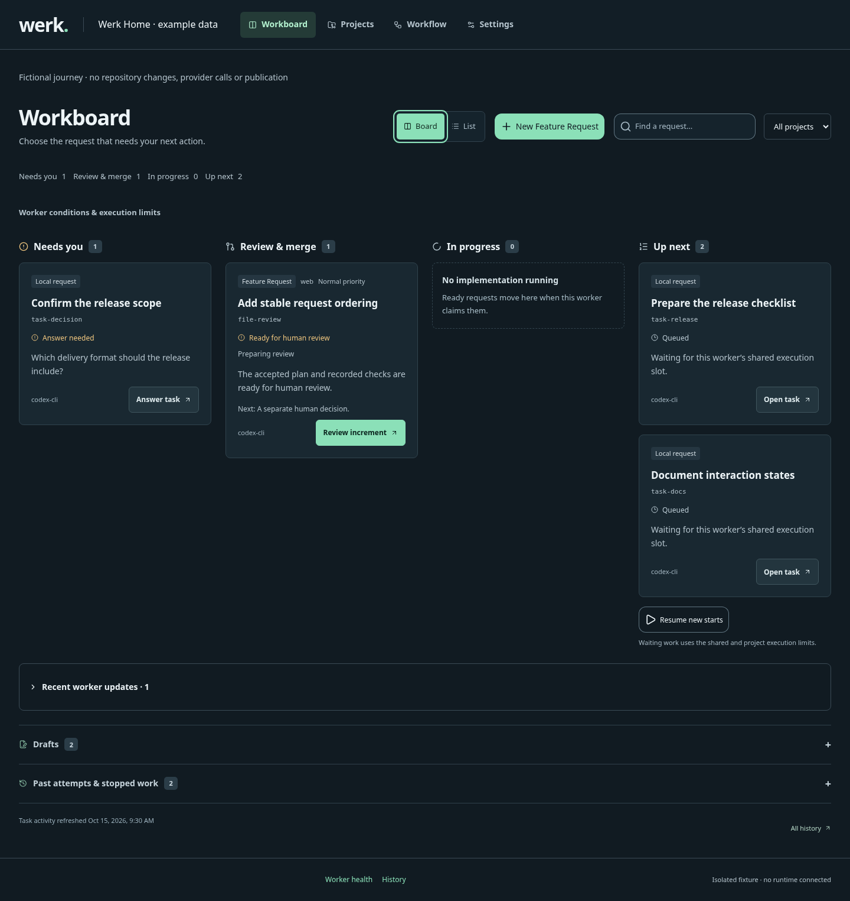
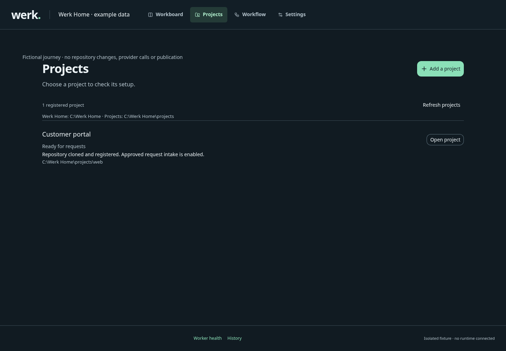
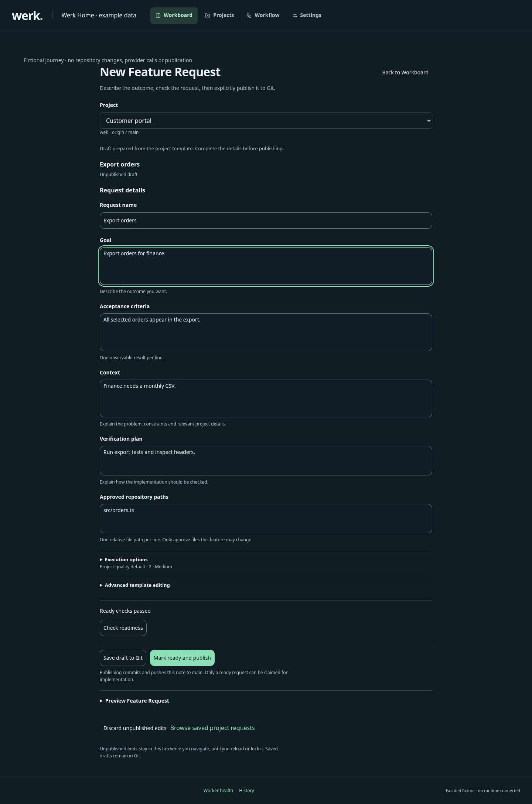
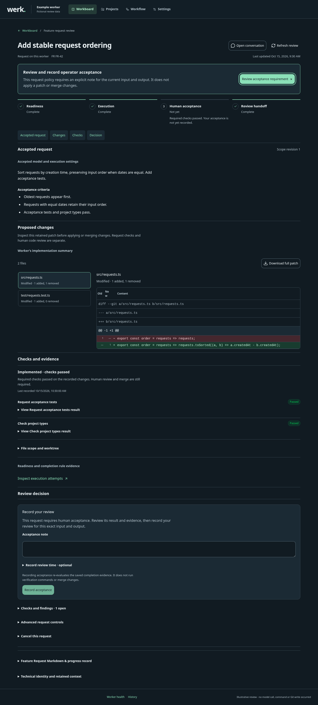
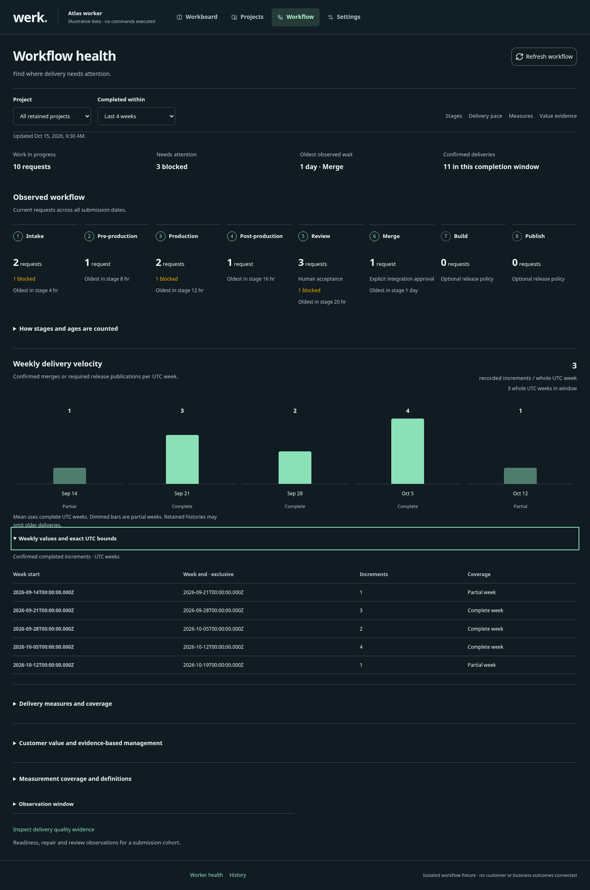
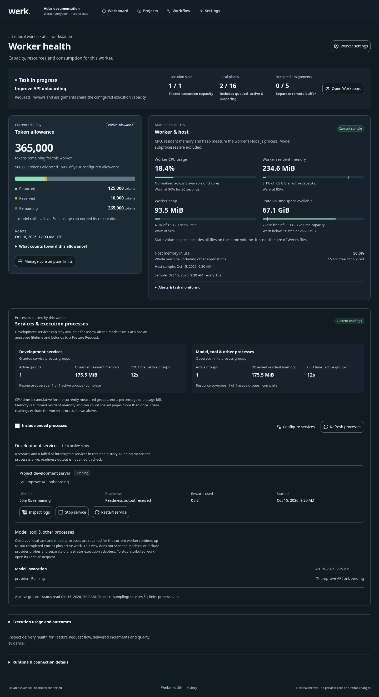
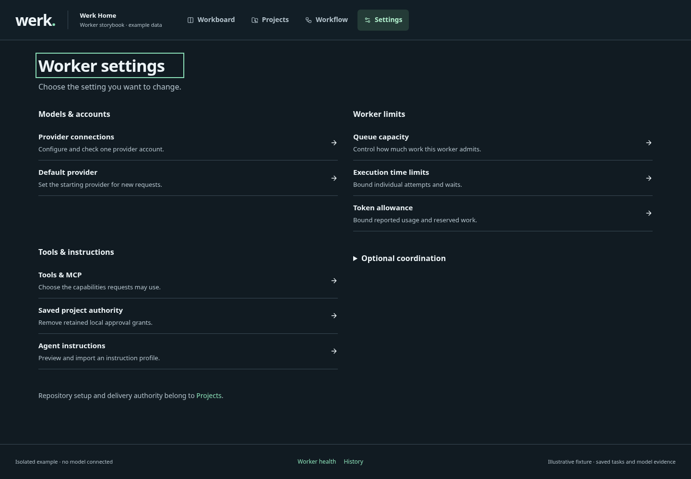
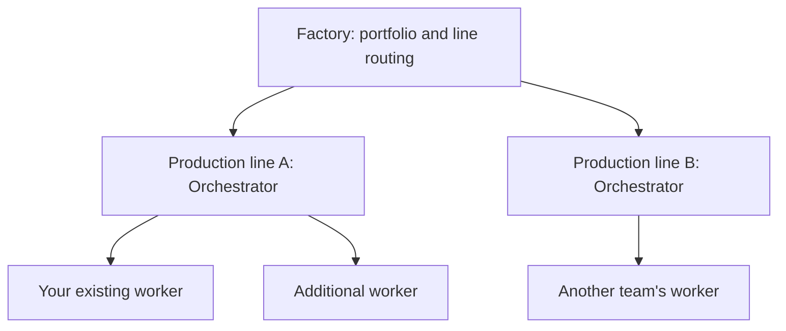

<!-- Generated from projects/werk/docs/overview.md and projects/werk/storybook/readme.json. Run npm --prefix projects/werk run readme:generate; do not edit this file directly. -->

# Werk

**Turn a shared Feature Request into an implementation your team can review.**

Werk runs from one dedicated Home on your machine. It clones project repositories
into isolated worker-owned checkouts and executes approved Feature Requests with
your configured model. Create a request in the webview or collaborate through
Obsidian-compatible Markdown notes, follow its progress and Git activity, then
review the increment and explicitly approve its merge.

[Documentation](https://luis85.github.io/production-line/) ·
[Download](https://github.com/Luis85/production-line/releases/latest) ·
[Changelog](projects/werk/CHANGELOG.md) · [Source documentation](projects/werk/docs/index.md)



*Workboard with deterministic sample requests. Choose the next request to advance; authoring, conversation and review have separate focused views. [Screenshot provenance](projects/werk/docs/evidence/readme/README.md).*

## Choose your starting point

| You want to… | Start here |
| --- | --- |
| Start a standalone worker in its own home | [Archive-to-main-checkout quick start](#start-a-dedicated-worker-home) |
| Bring an existing 0.16 worker into WerkHome | [Retained-state adoption](projects/werk/docs/how-to/project-worker.md#existing-standalone-installations) |
| Work locally from Markdown with review before merge | [Local delivery worker](projects/werk/docs/explanation/local-delivery-worker.md) |
| Explicitly opt into GitHub PRs and Releases | [Optional GitHub release workflow](projects/werk/docs/how-to/deliver-worker-release.md) |
| Let a team submit requests through Git and Obsidian | [Shared Markdown queue](projects/werk/docs/how-to/shared-feature-intake.md) |
| Design features by day and implement them overnight | [Evening handoff and morning review](projects/werk/docs/how-to/shared-feature-intake.md#work-during-the-day-implement-overnight) |
| Create and follow requests in the browser | [Worker webview](projects/werk/docs/how-to/use-worker-webview.md) |
| Configure provider routing, project capacity and delivery checks | [Project delivery policy](projects/werk/docs/reference/delivery-policy.md) |
| Assign your worker to an Orchestrator | [Connect the next building block](#connect-your-worker-to-an-orchestrator) |
| Bring production lines together in a Factory | [Grow into a Factory](#introduce-a-factory) |
| Build or extend the frontend | [Storybook and frontend reference](#documentation-and-frontend-reference) |

This overview describes the current source branch. Downloaded applications and the
hosted documentation reflect their published release; use that release's guides
when working with an older installation.

## Start a dedicated worker home

Use Node 24.x, Git and a complete verified runtime archive containing the standalone
`worker.mjs` launcher. Extract the archive directly into a fresh WerkHome; there
is no inner version folder. Start the prebuilt worker:

```sh
node ./worker.mjs
```

The launcher's directory is its Home regardless of the current working directory;
`--home PATH` selects it explicitly. The worker opens its webview and keeps private
state in `<home>/state/worker`, visible cloned repositories in `<home>/projects/`
and replaceable prebuilt files in `<home>/runtime/`. Startup prints the local URL and private credential
file path; unlock locally without putting the token in the URL. This starts the
standalone worker; no project-local `init`, npm step or Factory fleet is needed.

Use Werk 0.17.0 or later for this Home layout; older archives keep their original
layout and require the adoption procedure below.

In the webview, configure the provider, clone/register the project, preview its
workflow setup and approve its Git commit/push. Separately approve the exact
committed delivery policy and recheck project setup. Then create a Feature Request,
follow Kanban, Git commits/pushes, activity and updates to that same request,
review the delivered increment and explicitly allow its merge into the displayed
main checkout. New web-generated setup includes `localMerge: true`, so delivery
waits for that merge confirmation after candidate acceptance.



*Choose a registered project. Cloning, workflow publication, exact policy approval and intake recheck are separate explicit steps. [Screenshot provenance](projects/werk/docs/evidence/readme/README.md).*

The [primary tutorial](projects/werk/docs/tutorials/worker-home-to-main.md) follows this literal
archive-to-main journey. A newly built candidate archive and the currently public
released binary are separate artifacts; use the matching version's documentation.
GitHub PRs and Releases remain optional committed/approved integrations.

## Existing project-local workers

The new runtime uses one central WerkHome and retires project-local worker
installation. Projects contain source and committed workflow files; they do not
need runtime copies, private worker `.env` files or `init`.

An existing 0.16 installation must be stopped and inspected before adoption. Use
`node worker.mjs migration plan --state-dir ABSOLUTE_OLD_STATE` from the new Home,
then explicitly adopt the selected stopped state. Adoption retains its absolute
paths and writes a private selection; it does not move or delete old projects,
journals or worktrees. Follow [the adoption guide](projects/werk/docs/how-to/project-worker.md#existing-standalone-installations)
and keep the old files and a verified backup until recovery is resolved.

## One Feature Request throughout the workflow

The **Feature Request is the central workflow entity**. Markdown, chat and CLI
intake all target it. Conversations, execution attempts, progress, questions and
review evidence keep the same request identity.

1. **Describe the outcome.** Start from the project's template, in your editor,
   with the Create Feature Request skill, or in the worker's chat interface.
2. **Make it ready.** Complete the goal, context, acceptance criteria,
   verification plan and approved paths. Validate against `fr-ready-check.json`.
3. **Publish to the shared queue.** Mark it ready, commit and push to the watched
   branch. A local save or local commit alone does not start shared work.
4. **Let the worker implement it.** The worker validates and claims the request,
   then uses its configured model and approved tools in an isolated Git worktree.
   It publishes lifecycle updates to the original request.
5. **Answer when needed.** Pull updates and follow the linked Task note. Write
   under `## Answer`, set `status: ready`, then commit and push. The worker resumes
   the same request. You can also answer through its webview conversation.
6. **Review the result.** After the configured `fr-done-check.json` checks, the worker publishes
   a feature branch and a PullRequest Markdown note with evidence. A human
   reviews the changes and explicitly allows the exact candidate into the displayed
   main checkout when ready. The merge action identifies its path, branch and current head.

| Artifact | What the team uses it for |
| --- | --- |
| Feature Request | The accepted scope, owner, lifecycle and progress |
| Task note | A question, supported continuation, or operator action needed to proceed |
| PullRequest note | The review handoff: implementation branch, results and verification evidence |

The default **PullRequest is a Markdown file** delivered with the Git branches
and quality evidence. Review the delivered increment and explicitly allow its
merge into the displayed main checkout; no GitHub
API or GitHub CLI is needed. A GitHub repository URL, installed `gh` or provider
login does not opt the project into a hosting-service integration.

A PullRequest note does not automatically open a GitHub or GitLab pull request. A blocked Task may require a configuration change; answering
it does not grant new permissions. The developer checkout stays untouched by
shared implementation and publication. See the
[shared workflow guide](projects/werk/docs/how-to/shared-feature-intake.md) for ownership,
retries, conflicts and human review.

### Working locally

New Home requests use the project's committed template and shared Git handoff.
Legacy local request records retain their accepted source/intent and policy
semantics; they are not a new project-installation option. Review the exact
candidate and explicitly approve the displayed main-checkout merge. Acceptance
alone does not mutate the checkout or establish delivered-increment velocity.
A project can explicitly opt into [GitHub candidate publication](projects/werk/docs/how-to/publish-worker-candidates.md)
through committed integration policy and local approval of its exact digest.
Each authorized push or hosting-service PR retains its own recorded outcome.
The separately enabled optional [GitHub release workflow](projects/werk/docs/how-to/deliver-worker-release.md) continues through
current-candidate acceptance, verified merge, a build of the actual merged commit
and confirmed GitHub Release assets. It retains the request identity and records
each milestone separately; release-enabled delivery completes after publication.

The [local delivery guide](projects/werk/docs/explanation/local-delivery-worker.md) explains quality
profiles, dependencies, pause and interruption recovery. Both intake modes retain
the same Feature Request throughout execution and review.

## Create requests through Markdown or Workboard

### From any team member's clone

The committed authoring kit works without a worker connection or provider
credentials. Use the **Create Feature Request** skill in your own environment,
or create a draft from the terminal:

```sh
node .werk/authoring/feature-request.mjs create --name search.md --title "Find matching requests"
```

Fill in the template, including approved paths, then validate it. With the default
request folder:

```sh
node .werk/authoring/feature-request.mjs validate --file features/search.md
node .werk/authoring/feature-request.mjs ready --file features/search.md --if-match REVISION
```

Replace `REVISION` with the successful validation's revision. Commit and push the
ready note to the watched branch. Pull the worker's updates to see progress,
questions and review notes in Markdown or the Obsidian Base. Folder names,
templates and rules are configurable; see [team authoring](projects/werk/docs/how-to/team-feature-authoring.md).

### From the worker webview

Open **Workboard → New Feature Request**, describe the outcome and choose **Prepare
request**. This prepares the committed template without invoking a model. Fill
in the request details and use **Check readiness**, then **Save draft to Git** or
**Mark ready and publish**. Shared intake picks up that same note.



*One project request, from its committed template to an explicit publication decision. Draft preparation does not invoke a model or commit to Git. [Screenshot provenance](projects/werk/docs/evidence/readme/README.md).*

Once the worker owns the request, open its conversation to follow execution and
answer pending questions. Webview answers publish the same Task response that a
teammate can edit in Markdown. Accepted scope changes require a successor Feature
Request. See the [webview guide](projects/werk/docs/how-to/use-worker-webview.md).

Open **Review** to inspect a request’s accepted scope, changed files and current
verification evidence together. The next-step summary explains whether the team
needs to answer a question, inspect changes, record required acceptance or resolve
a hold. Acceptance applies only where the saved request policy asks for it; it
does not merge the feature branch.



*The real review workspace with a fictional verified candidate and a policy requiring human acceptance. Recording acceptance is separate from merging the change. [Screenshot provenance](projects/werk/docs/evidence/readme/README.md).*

## Inspect and configure the worker

Each focused view serves one user goal. **Workboard** helps choose the next request
and leads with work needing your input. **New Feature Request** prepares and publishes
one request; its conversation and **Review** have separate focused views.
**Projects** is the project directory: adding a clone, publishing workflow files,
approving policy and enabling intake each have an explicit next step.
**Workflow** explains recorded delivery health, with delivery-quality evidence in a
separate view. **Worker health** explains resources and consumption. **History**
inspects retained evidence without selecting or restoring archived requests.
**Settings** first helps you choose a setting, then opens one independent editor;
unsent edits survive navigation within the unlocked tab.



*Recorded delivery health and operational EBM proxies. Unmeasured customer or business outcomes remain unavailable rather than being inferred. [Screenshot provenance](projects/werk/docs/evidence/readme/README.md).*



*Worker health with deterministic sample measurements. Resource use and allowance are separate from delivery quality and live provider account balances. [Screenshot provenance](projects/werk/docs/evidence/readme/README.md).*

For development servers and other long-running project services, configure named
service presets explicitly. The worker supervises them in the request’s pinned
worktree, with bounded lifetime and restart limits. **Worker health → Processes** shows
owned services, observed resource use and stop/restart controls; missing operating
system measurements stay visible as unavailable. See
[manage worker processes](projects/werk/docs/how-to/manage-worker-processes.md).



*Choose one setting, then edit it on its own focused view. Provider connection, default provider, capacity and time limits have independent saves. [Screenshot provenance](projects/werk/docs/evidence/readme/README.md).*

| Configure | Where to learn more |
| --- | --- |
| Model providers and available CLI account details | [Provider connections](projects/werk/docs/how-to/use-worker-webview.md#connect-claude-codex-or-cursor) |
| Request, Task and review folders; template and rules | [Team workflow configuration](projects/werk/docs/how-to/team-feature-authoring.md) |
| Assigned repositories, watching and worktrees | [Repository setup](projects/werk/docs/how-to/project-worker.md#assign-git-repositories) |
| Built-in file/web tools, approved commands and MCP connections | [Model tool access](projects/werk/docs/how-to/manage-model-tools.md) |
| Daily/monthly allowance and the worker's share | [Consumption limits](projects/werk/docs/how-to/worker-consumption-limits.md) |
| Queue, capacity and execution duration | [Queue configuration](projects/werk/docs/how-to/use-worker-webview.md#configure-the-taskboard-and-orchestrator-queue) |
| Execution profiles and agent definitions | [Profile editing](projects/werk/docs/how-to/use-worker-webview.md#edit-execution-profiles) |
| Launch defaults and the local access token | [Project environment files](projects/werk/docs/reference/configuration.md#project-environment-files) |

Consumption limits allocate a share of a **configured allowance**; they do not
measure your everyday usage elsewhere in the provider account. Provider usage
availability varies. For implementation work, review
[required checks and evidence](projects/werk/docs/how-to/implement-feature.md) before relying
on a model's completion message.

## Grow from a worker into a production system

Start with the worker you have already installed and add the next building block
when your team needs it. An **Orchestrator** coordinates a production line's
workers and assignments. A **Factory** brings multiple lines together for
portfolio visibility and routing. A production line consists of one Orchestrator
and its enrolled workers; it can operate before a Factory is introduced.



| Building block | What it adds | What you manage there |
| --- | --- | --- |
| Worker | Implements a request using its model and approved tools | Repositories, model accounts, request progress, verification and consumption |
| Orchestrator | Coordinates one line and routes assignments to eligible workers | Line intake, worker registration, routing, task leases and execution evidence |
| Factory | Organizes lines, including optional logical subfactories | Line registrations, portfolio summaries and routing of new intake between lines |

Only workers invoke models. Each application has its own webview, private state
and credentials. A worker can run bounded project-scoped work concurrently within
its configured machine and project limits. Add workers with distinct state
directories and ports when you need separate machines, accounts or operating
policies; unscoped assignments retain exclusive execution.

### Connect your worker to an Orchestrator

Keep your existing project worker running. From the project directory, start the
Orchestrator app from the same extracted release, using an unused port and a
separate state directory:

```sh
node /path/to/werk-release/bin/apps/orchestrator/cli.mjs start --state-dir .werk/line --port 3001 --project demo
```

Replace `demo` with the line's project ID before its first start. Use that same
state directory on subsequent starts. You may also copy the complete
`bin/apps/orchestrator` folder into your project; the app needs no sibling
application or npm install.

1. Open the URL returned by the command. Sign in using the Orchestrator's admin
   token from the private credential file named in its startup result.
2. Open your worker's **Settings → Orchestrator**. Enter the Orchestrator address
   and its separate **enrollment token**, then select **Save & connect**.
3. Confirm registration in the worker and the Orchestrator's worker list. Review
   **Settings → Execution profiles**. To edit them, pause and drain the worker,
   save the profiles, wait for the Orchestrator's acknowledgment, then resume
   new starts on Workboard.
4. In the Orchestrator, choose automatic routing to eligible workers or a manual
   worker destination. Submit a small **simulation** using the line's project ID
   and an advertised provider/profile. Inspect its evidence and expect the
   terminal state `simulated`.

Enrollment adds line assignments to the worker's existing execution capacity.
Its shared Git requests retain their intake and identity; connecting an
Orchestrator does not reimport those notes into the line queue. A configured
Claude/Codex chat connection also does not select the line's execution mode:
**orchestrated assignments default to simulation**. Review the
[supported execution modes](projects/werk/docs/explanation/modes.md) before submitting live
implementation work.

For another worker, repeat enrollment with its own state and identity. See
[assemble independent components](projects/werk/docs/how-to/assemble-independent-components.md#start-an-orchestrator-and-enroll-the-worker)
for the full native/Docker journey and
[execution profiles](projects/werk/docs/how-to/use-worker-webview.md#edit-execution-profiles)
for compatibility and configuration acknowledgment.

### Introduce a Factory

Once one or more lines are running, start a Factory and register them. Each
registration points to an existing Orchestrator; its enrolled workers remain
owned by that line.

1. Export a private environment variable for each line into the process that
   starts Factory, such as `WERK_LINE_DEMO_TOKEN`, containing that Orchestrator's
   **admin token**. Use your shell's private environment setup or secret manager;
   keep token values out of command arguments and Git. Adding this line variable
   to project `.env` alone does not load it. Follow the
   [private credential example](projects/werk/docs/how-to/assemble-independent-components.md#start-factory-with-a-private-line-credential).
   Restart Factory with the updated environment after adding or rotating a line
   credential.
2. Start the Factory from Home with its own state and port:

   ```sh
   node /path/to/WerkHome/runtime/bin/apps/factory/cli.mjs start --state-dir /path/to/WerkHome/state/factory --port 3100
   ```

3. Open the returned URL and sign in with the Factory's own admin token. Create
   a root Factory, then register your running Orchestrator as a production line.
4. Provide the line name, owning Factory, Orchestrator URL, browser webview URL
   and the **environment-variable name** `WERK_LINE_DEMO_TOKEN`. The registration
   stores the name, not the secret value.
5. Confirm the line is available in the Factory dashboard. Open it to inspect
   its workers and tasks. Add further lines, group them into logical
   subfactories if useful, and configure automatic or manual intake routing.

The Factory aggregates available line observations and makes unavailable or
stale lines visible. A line keeps its accepted tasks, worker leases and evidence;
Factory routing chooses a destination for new intake. Registering a line does
not start its processes. Existing lines and workers can continue when the
Factory is stopped.

These local examples use loopback addresses. Across machines or containers,
configure addresses reachable by each caller and trusted HTTPS/access settings.
Follow [Factory registration and credentials](projects/werk/docs/how-to/assemble-independent-components.md#start-factory-with-a-private-line-credential)
and [access configuration](projects/werk/docs/how-to/manage-access.md) for that setup. The
[portable apps reference](projects/werk/docs/reference/portable-apps.md#project-environment-and-local-access)
explains how each app's `env init` adds its settings to the project's private
`.env` and shareable `.env.example`.

<a id="run-a-factory-and-production-lines"></a>

### Start a complete system from YAML

For a new multi-line installation, the system launcher can start all building
blocks from one definition. Keep its managed state separate from the independent
apps above; it does not automatically adopt your existing worker or line state.

The supplied [system definition](projects/werk/examples/system.yaml) declares
a Factory, a logical subfactory and two isolated production lines.

From the extracted runtime, start the supplied system with Node 24:

```sh
node werk.mjs system plan --file examples/system.yaml --json
node werk.mjs system up --file examples/system.yaml
```

Or use Docker Engine 26+ and Compose 2.35+ without host Node/npm:

```sh
bash werk-docker.sh system up --file examples/system.yaml --environment docker
```

On Windows, use `./werk-docker.ps1 system up --file examples/system.yaml --environment docker`.
The system opens the Factory once healthy. Follow the
[system tutorial](projects/werk/docs/tutorials/system-from-yaml.md) for credentials, your first
assignment and shutdown. For one line, use the
[native](projects/werk/docs/tutorials/local-first-task.md) or [Docker](projects/werk/docs/tutorials/docker-first-task.md)
first-task tutorial. Running the installer without `--no-start` starts the default
Factory demonstration directly.

**Default Factory/orchestrator assignments are simulated.** Trusted operators can
opt into [native Linux Codex execution](projects/werk/docs/how-to/run-codex-task.md). Supplied
orchestrator Docker and managed VM profiles remain simulated. Standalone workers
use their configured Claude, Codex or Cursor CLI or API provider; Docker workers need an API
provider or a prepared image with its own CLI authentication. See
[execution modes](projects/werk/docs/explanation/modes.md) for platform limits.

Each application has its own webview, CLI and private state. Use one runtime per
state directory. Operational guides cover [monitoring](projects/werk/docs/how-to/monitor-runtime.md),
[access and TLS](projects/werk/docs/how-to/manage-access.md), [maintenance](projects/werk/docs/how-to/maintain-runtime.md),
[updates](projects/werk/docs/reference/updates.md), and [backup/recovery](projects/werk/docs/how-to/upgrade-backup.md).

## Documentation and frontend reference

The [public Storybook](https://luis85.github.io/production-line/) is the system's
documentation entry point: **Start here → Set up your workspace → Work with
requests → Operate the system → Frontend reference → Architecture and contracts**.

- [Handbook](https://luis85.github.io/production-line/handbook/): searchable setup,
  operating guides and reference documentation.
- [Illustrated UI reference](https://luis85.github.io/production-line/storymap/):
  real Vue components, workflows and desktop/mobile screenshots with sample data.
- [Source documentation hub](projects/werk/docs/index.md): tutorials, how-to guides, reference
  contracts and architectural explanation for this branch.
- [Frontend architecture](projects/werk/docs/reference/webview-architecture.md) and
  [system architecture](projects/werk/docs/explanation/architecture.md): component reuse,
  shared interfaces and application boundaries.

Each release also includes a versioned Storybook ZIP. See
[generate and host Storybook](projects/werk/docs/how-to/generate-storybook.md) for local preview,
qualification and publishing. Historical evidence is kept in
[review reports](projects/werk/docs/reports/index.md); the [concept index](projects/werk/docs/CONCEPT.md)
identifies the original requirements.

## Develop from source

From `projects/werk`, with Node 24 and npm:

```sh
npm ci
npm run check
npm run dev:factory
```

`dev:factory` starts a simulated development fleet. Use `npm run dev:fleet` for
one line or `npm run storybook` for component/documentation development.

| Application | Responsibility |
| --- | --- |
| Factory | Hierarchy, line registry and portfolio summaries |
| Orchestrator | Line intake, routing, leases, context and evidence |
| Worker | Provider execution, shared Markdown lifecycle, worktrees and review evidence |
| Shared | Contracts and reusable primitives across applications |

`npm run check` runs LOC checks, Oxlint, Fallow, architecture rules, source and
test typechecking, builds and tests. Source files are limited to 400 code-bearing
lines and test/support files to 450, excluding blank and comment-only lines.
Source checks also require Python 3 on every platform, including Windows, to
count Python code and run supported infrastructure tests. Downloaded runtimes
do not require it.

Stryker mutation testing runs as an **advisory release check**: findings warn
without blocking development or release. `npm run mutation` runs it explicitly.
`npm run release:build` validates the changelog, builds applications, qualifies
Storybook and packages the runtime and documentation. See
[development](projects/werk/docs/how-to/development.md), [tests](projects/werk/tests/README.md), and
[release procedure](projects/werk/docs/reference/releases.md) for the maintained checks.

To update this introduction, edit the [maintained overview](projects/werk/docs/overview.md) and run
`npm run readme:generate`. See [README generation](projects/werk/docs/how-to/generate-readme.md) for
screenshot selection, qualification and release artifacts.
