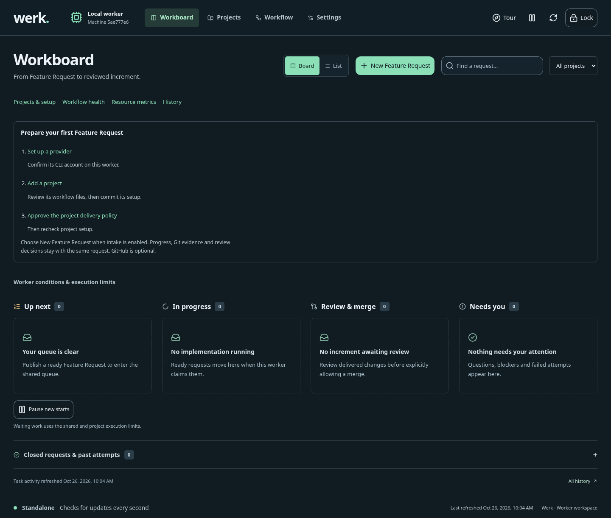
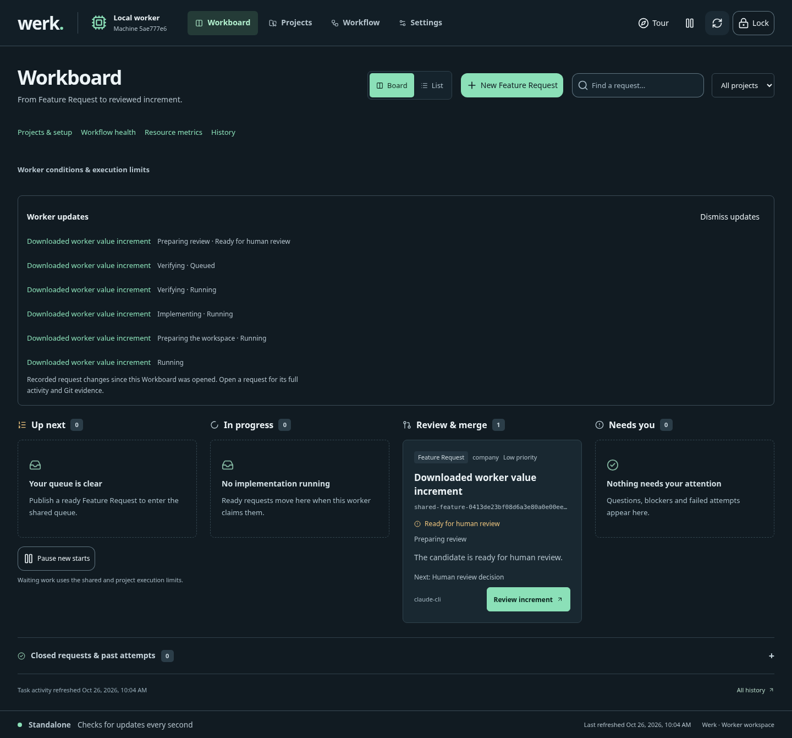

# Initial flat WerkHome archive proof

Date: 2026-10-26. These observations qualify the recorded development candidate,
not the final committed artifact or a public release. The complete browser result,
archive/manifest digests, native smoke and update/recovery result are in
[receipt.json](receipt.json). Its archive sourceCommit is explicitly null.

The extracted flat ZIP started from an empty Home, opened/unlocked the real
Chromium webview, prepared/edited/checked and committed/pushed the project Feature
Request before inference, executed real candidate MCP tools and a native committed
check, published the implementation branch and Markdown review, and recorded
browser human acceptance plus explicit exact-main-checkout merge. The browser
reported no page errors. Native API smoke separately confirmed visible clone,
Git review publication and restart identity/credential preservation.

The selective-update smoke used a previous-version fixture, applied the exact
preview with authenticated stop, preserved credentials/selection/visible project,
verified rollback, and recovered an absent runtime through a separate verified
candidate launcher. The observed booleans are retained; they do not infer coverage
for every crash or migration boundary.

Claude login/version/inference were explicitly deterministic protocol fixtures.
The host was Linux, not Windows. No live account, model or GitHub Release was
qualified. Later hardening and the final committed artifact need their own run.

Selected original screenshots are retained unmodified; their byte hashes are in
the receipt. The other four screenshots remain part of the original run output.

