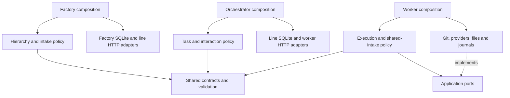

# Architecture and delivery workflow

Werk separates orchestrator assignments from local worker execution. Assignments
default to simulation; the opt-in native Linux Codex adapter creates a patch for
review. Local workers support configured API/CLI providers, approved-file tasks
and shared Git intake that publishes feature branches and Obsidian review notes.
Human merge and automated merge tracking remain separate. See
[execution modes](modes.md) for each path's scope and qualification limits. The [client/server ADR](adr-001-client-server-boundaries.md) records
ownership, retry/fencing semantics and deployment tradeoffs. The
[UI journey](ui-journey.md) maps the same boundaries to user-facing behavior.

The imported handoff's [technical contracts](../handoff/technical-contracts.md)
and [readiness audit](../handoff/readiness.md) record the original baseline and
requirement IDs. Later work updates that baseline; use the current
[API reference](../reference/api.md) and [documentation hub](../index.md) for
implemented contracts and operating procedures.

## Feature Request ownership across intake channels

A Feature Request is the parent of accepted work. Its stable `feature` reference
links source identity to sessions, execution/gate requests, attempts, Task notes
and review evidence. These children retain their own IDs and durable state;
a progress projection is not another request to admit. The existing journals
remain authoritative for their owned execution facts, without a second catalog
database or a replacement global lifecycle service.

The shared webview composer and connected CLI are authoring adapters. They load
the committed project template, expose the same readiness rules, and publish a
guarded draft or ready note. Offline authoring reaches the same remote branch
through the teammate's Git client. `SharedFeatureIntake` alone validates and claims
these requests before passing the accepted Feature Request to the existing
executor. A bound project refuses legacy direct creation even when new shared
claims are disabled, so changing interfaces cannot bypass the shared lifecycle.

Likewise, webview answers publish the linked Task response and reuse the Markdown
response consumer. A reply continues the same Feature Request; additional scope
requires a successor. Generated folder/shared tracking uses
`FeatureRequestProgress` and cannot be ingested as a fresh request.

Private unbound interaction, local folder intake and orchestrator assignments
retain their adapters and execution authority. The common admission contract
carries Feature Request identity into the existing chat or approved-file executor;
it does not add another queue, claim owner or permission source. Orchestrator
leases and shared Git claims remain distinct ownership protocols for their
respective execution paths. See the [request contract](../reference/feature-requests.md).

## Portfolio hierarchy above independent lines

`src/factory` is a third standalone application with its own CLI, HTTP webview
and SQLite registry. It owns factory records, logical parent/child relationships,
stable line registrations, durable intake routing and read-only rollups. Each line points to an
independent orchestrator; tasks, workers, leases and evidence remain inside it.
A project is a repository/context binding inside a line, not the line itself.

The hierarchy is logical within one Factory service in this iteration. It is not
cross-server federation. An unavailable line produces an explicit partial
rollup; its missing counters are not zero. Factory contains server-side
credential references and uses its configured credentials when reading lines;
the browser receives no line secret. See [Factory setup](../how-to/factory.md).

The original `src/orchestrator`/`src/worker` separation remains. Existing line
runtimes can be deployed without Factory, and Factory neither opens their
SQLite files nor moves accepted tasks between lines. Factory routes new intake to
a compatible line using observed capabilities and a durable idempotent delivery
record; the selected orchestrator owns the accepted task. Current rollups are
fresh observations, not a persisted cross-line timeseries. See
[Factory mutation idempotency](../reference/factory-idempotency.md).

## Target source of truth and branch relationship

The product team authors requirements, designs, concepts, specifications and
acceptance tests in its project repository using Obsidian. Weekly planning
creates an iteration branch and a draft integration PR. Features explicitly
marked ready become factory tasks. The team can then prepare the next iteration
without modifying the pinned specification of work already in execution.

| Object | Base / destination | Completion meaning |
| --- | --- | --- |
| Iteration PR | `iteration/2026-W42` → `main` | Integration/release decision by product team |
| Feature PR | `factory/REQ-241` → `iteration/2026-W42` | Delivery of one feature |
| Review rework | Same feature branch and PR | New attempt, new snapshot pair |
| Task | Feature ID + iteration + project | Done only after verified feature-PR merge |

The feature PR targets the iteration branch, which contains its specifications
and tests. Merging it completes its task; it does not imply that the iteration
has reached main or production. Report those portfolio outcomes separately.

## Target execution sequence

1. Team plans and commits the iteration; creates an iteration draft PR.
2. Importer reads committed Obsidian properties, validates feature identity and
   acceptance criteria, resolves required wiki context, and pins the Git commit.
3. Scheduler atomically leases the task to a compatible project worker/profile.
   Machine, profile and shared subscription quota limits must all allow execution.
4. Worker creates an isolated feature worktree/branch from the pinned iteration
   commit. It records the before snapshot. A first snapshot commit provides a
   real diff, allowing the feature draft PR to be opened immediately.
5. Provider adapter implements the feature using the full repository context,
   agreed system prompt, skills and allowed tools. Host-controlled steps enforce
   leases, timeouts, workspace bounds, checks and publication rules.
6. Worker executes project checks and records the after snapshot. Its code and
   snapshot artifacts are published to that feature PR. CI must validate the
   current head; only then does the PR become ready and request human review.
7. Review feedback creates a new implementation attempt. Prefer the same worker
   when available, but retain branch, PR, specification revision and repository
   identity if another authorized project worker takes over. Never transfer a
   native Claude/Codex session to another provider.
8. A push invalidates previous head-specific checks/approval. Address review
   threads, rerun checks, capture another snapshot pair and request review again.
9. Human acceptance enables merge. Only a verified merged event for the bound
   feature PR marks the task done. Closed-without-merge is a decision state.

Product planning for the next iteration uses its own branch. Dependencies between
features and changes to the iteration base require explicit ordering/rebase work;
the scheduler must not assume that independent-looking features cannot conflict.

## Server, worker and shared modules

`src/orchestrator` owns the task state, HTTP API, webview, SQLite store, scheduling
and analysis index. Its CLI is both a server entry point and a headless HTTP
client. Dashboard (`#system`) is the default webview page; direct Intake links
retain their destination. Repository import is the primary team workflow and
manual submissions are an explicit alternative.

`src/worker` owns polling, the execution adapter boundary, local journals,
configuration, snapshots and an authenticated Vue workspace with Taskboard, Metrics,
History and Settings. Local chat, file tasks and parent assignments
share one execution slot. Basic status, health and metrics remain public read-only
endpoints. Assigned repositories provide retained per-task worktrees. The native
Linux Codex assignment adapter executes in one of these worktrees and manages
provider cancellation and descendant cleanup. Its exact file allowlist and
host-account trust boundary are described in the
[live workflow](../how-to/run-codex-task.md). Local approved-file tasks freeze explicit paths and immutable inputs. New eligible
requests materialize edits in an owned Git worktree, run the saved required checks
and derive the review patch from the actual candidate. Existing tasks retain their
proposal contract. See [feature implementation](../how-to/implement-feature.md). Shared Git
intake claims ready work remotely, freezes policy/source, and publishes the
validated result plus a review note. Its outbox and recovery semantics are
specified in [shared intake](../reference/shared-feature-intake.md). Concurrent
live execution, lease-fenced remote PR publication and automatic merge tracking
remain outside these implemented paths.

`src/shared` owns versioned contracts and validators. It imports neither server
nor worker. The build copies shared code into each independent CLI distribution.

Source folders group application policy, persistence, intake, context, HTTP infrastructure, journals and status by concern. Composition and CLI entrypoints stay at each package root; shared contracts remain independent. Tests mirror their primary concern under `tests/`; see the [test suite guide](../../tests/README.md).

## Implemented dependency map

Dependency arrows below point toward a consumed interface or implementation.
Each service retains its own composition root and state owner.

| Module | Responsibility and dependency direction |
| --- | --- |
| `factory/cli.ts`, `server.ts` | Factory process/client entry and composition of registry, line reader, application and HTTP handler |
| `factory/application/service.ts`, `application/ports.ts` | Logical hierarchy and scoped aggregation through registry/line-reader ports |
| `factory/application/overview.ts` | Descendant scope and partial-rollup policy; one unavailable line does not erase reachable evidence |
| `factory/infrastructure/registry.ts`, `delivery.ts` | Factory-owned SQLite hierarchy and stable line registrations; idempotent intake delivery through HTTP, without line database access |
| `factory/infrastructure/poller.ts`, `factory/http.ts` | Bounded authenticated line observation and Factory HTTP adaptation |
| `orchestrator/cli.ts` | Process entry point; parses commands and selects server startup or HTTP client/import operations |
| `orchestrator/server.ts` | Server composition root: constructs SQLite Store, application and HTTP handler; owns listener/reaper shutdown |
| `orchestrator/http.ts` | Routes, role-token authorization, request parsing and HTTP presentation; invokes application operations |
| `orchestrator/application.ts`, `application/worker-interaction.ts` | Commands/queries through `OrchestratorRepository`; injected worker interaction port with worker/session identity validation |
| `orchestrator/persistence/store.ts`, `session.ts`, focused persistence modules | Store facade and one SQLite transaction owner; task intake/lifecycle, leases, worker registry, queries and snapshot mapping share that owner |
| `orchestrator/persistence/schema.ts` | Versioned SQLite schema and atomic migrations |
| `orchestrator/context/*` | Exact-commit resolution, bounded admission and operator-owned context binding; committed source remains untrusted data |
| `orchestrator/policies.ts` | Scheduling eligibility, lease ownership and snapshot-assignment checks |
| `orchestrator/intake/importer.ts` | CLI composition of local Git reads and the HTTP task gateway |
| `orchestrator/intake/iteration.ts` | Committed-feature collection and import/revision policy through `IterationSource`/`IterationTaskGateway` ports |
| `worker/cli.ts` | Parses runtime/status commands, loads configuration and supplies process cancellation |
| `worker/runner.ts`, `runner-runtime.ts`, `runner-assignments.ts` | State-lock/lifecycle entry, concrete service composition, and assignment polling/lease dispatch through typed ports; share one execution slot and claim identity |
| `worker/application/*` | Attempt execution, sessions, approved-file tasks, frozen gates and shared feature lifecycle through injected ports; no infrastructure imports, filesystem I/O or SQLite ownership |
| `worker/infrastructure/*` | HTTP operation mapping, pinned-context verification, mock/Codex adapters, review artifacts and persisted registration identity |
| `worker/infrastructure/journal/{snapshots,files,retention}.ts` | Measurement capture, immutable journal, serialized upload and durable local file operations |
| `worker/status/server.ts`, `monitoring.ts`, `status/workspace.ts` | Public health/status, authenticated workspace facade and monitoring projection |
| `worker/status/workspace-context.ts`, `workspace-*.ts` | One composition-owned service/state context; focused task, request, repository, feature, settings and lifecycle operations |
| `worker/application/local-tasks.ts`, `sessions.ts`, `conversation.ts` | Stable facades with typed admission, execution, recovery and catalog collaborators; each facade retains its serialized state owner |
| `worker/infrastructure/journal/requests.ts`, `journal/requests/*` | Request-journal facade, one SQLite store/transaction owner and focused gate, execution, command, review and query operations |
| `*/webview/store.ts`, frontend controllers and composables | Reactive state and focused API/UI controllers; shared transport mechanics preserve per-service credentials, epochs and request identities |
| `shared/domain.ts`, `context.ts`, `validation.ts`, `snapshots.ts` | Domain data and pure validation of input/evidence |
| `shared/protocol.ts`, `factory.ts`, `worker-interaction.ts` | Typed request/response DTOs, Factory records, overview and cross-service interaction validation |
| `shared/build-info.ts` | Source-only development marker; distribution staging generates the root release version for snapshots and MCP |
| `shared/lifecycle.ts`, `http/server-lifecycle.ts` | Ordered cleanup that settles every resource; bounded HTTP drain remains an explicit transport helper |
| `shared/serialized-operations.ts` | FIFO scheduling with independent caller results and a snapshot drain; callers own admission, transaction boundaries and cancellation |
| `shared/http/dispatcher.ts`, `http/transport.ts` | Owned dispatcher/proxy mechanics through complete body consumption; adapters retain deadlines, authentication, limits and protocol errors |
| `shared/webview/http.ts`, `webview/components/SettingsSaveFeedback.vue` | Common browser JSON defaults and settings feedback; application stores retain credentials, session fencing and retry identities |
| `shared/git/environment.ts`, `http/response-body.ts` | Explicit Git authority profiles and bounded response reading; each adapter retains its auth, limits and error policy |
| `shared/wiki.ts` | Pure vault-reference syntax parser; no repository resolution |
| `shared/mcp/*` | Stdio tool catalog/transport mapped to one configured HTTP service, read-only by default |
| `shared/errors.ts` | Semantic application errors, independent of HTTP status codes |
| `shared/http/*`, `cli.ts` | Explicit transport and process-input adapters; they are separate from pure contracts |

`shared/contracts.ts` and `shared/io.ts` remain compatibility facades. New code
should import the specific module it consumes; the facades are not a place to
add cross-application behavior. Semantic errors are mapped to HTTP or CLI output
at adapter boundaries. The SQLite implementation no longer needs HTTP errors.

The worker application takes an execution adapter, operational client, journal,
state callbacks and clock through its ports. This lets tests exercise terminal
reporting and cancellation without starting HTTP or a real coding agent. The
server application similarly depends on its repository port, while the
composition root chooses SQLite. Shared code never imports either application.

The AST architecture guard checks imports, reexports, type edges, require calls,
literal dynamic imports and package aliases, with negative fixtures that must
fail the same policies. All worker and Factory application modules, the root orchestrator application
and its extracted application directory depend inward; they cannot import concrete
adapters even for types. Selected shared contracts have a closed pure dependency
graph. Node crypto/path/timer helpers and YAML parsing remain explicit application
allowances. Composition may select configured adapters dynamically; the guard is
not an arbitrary-JavaScript dependency resolver. See the
[architecture review](../reports/architecture-review-2026-10-16.md).

This is a concrete dependency improvement, not a claim that every domain rule
has a separate object model. The Store still combines transactional persistence
with several state-transition decisions. The importer composes Git and HTTP
adapters; its collection/revision policy lives separately in `iteration.ts`. `request<T>` provides a TypeScript expectation; its generic
does **not** runtime-validate an arbitrary server response against that DTO.
The worker HTTP adapter checks registration and the consumed assignment input,
including routing, timestamps, context and gate receipts. Legacy assignments without
an execution mode remain supported, and valid extension fields are preserved.
Heartbeat responses must still identify the same attempt. Other
boundary checks remain necessary when adding external services or plugins.

## Worker policy and presentation reuse

Candidate receipt classification is a Node-free application policy consumed by
completion checks, Markdown evidence and the browser. Private completion proof
still binds the accepted turn, run, patch and candidate; displaying a passed check
cannot authorize publication. Explicit task summary/detail DTOs and allowlist
projectors separate public responses from the private execution aggregate.

The application also owns common sensitive-patch and MCP endpoint policy. The
contained tool-process helper owns only launch mechanics and the minimal tool
environment; each caller keeps its deadlines, output bounds, errors and durable
checkpoint ordering. Provider account environments and MCP configuration remain
separate. See the [worker architecture review](../reports/worker-architecture-review.md)
for review decisions, qualification and remaining orchestration debt.

## Reused mechanics and owned policy

Worker definition, session, task, intake and journal writers share
`SerializedOperations`. Each submitted operation retains its own result or error;
a rejection does not prevent later operations. `drain()` observes work already queued,
so shutdown owners must stop admission first. It does not replace the execution-slot
scheduler, keyed repository locks, abort handling or transactional persistence.

Backend HTTP adapters use an owned dispatcher until response consumption finishes.
The common layer selects the packaged transport and proxy behavior, then destroys
the pool on success, error or cancellation. It does not introduce retries or choose
application credentials. Provider invocation deadlines, MCP session semantics,
Factory response checks and web-tool redirect/body limits remain in their adapters.

Browser stores share only JSON wire defaults. Authentication, stale-response fencing,
mutation identities and policy remain with each application. The settings feedback
component presents errors, uncertain acknowledgements and recovery actions; the
existing editor controllers still own drafts and resubmission behavior.

The [0.11 architecture review](../reports/architecture-review-0.11.md) records the
boundaries, retained debt and follow-up review. Mutation measurements are a scoped,
advisory signal, described in the [mutation guide](../how-to/mutation-testing.md),
and are separate from ordinary development and release qualification gates.

## Ownership across the client/server boundary

The browser owns navigation, draft form values, filters, focus and last-rendered
responses. It must obtain accepted task state from the API. The CLI is another
API client; changing its local JSON after submission cannot change persisted
work. The worker owns physical execution and evidence, but the server decides
whether its assignment is still valid and whether a transition is allowed.

A successful HTTP response acknowledges one specific operation. Snapshot receipt
is not task completion; mock completion is not human acceptance; a target feature
PR merge is not iteration release. Stable identity links these facts without
collapsing them into one status or rewriting historical evidence.

The server's clock governs lease acceptance. Worker-side expiry timers are
conservative local cancellation guards and depend on usable clock alignment;
they do not override server lease checks. Monotonic attempt duration and server
snapshot sequence are independent from cross-host wall-clock timestamps. Full
clock-offset negotiation is not implemented.

## SQLite deployment

One orchestrator process opens the SQLite file on a local persistent volume.
WAL, foreign keys, a busy timeout and short `BEGIN IMMEDIATE` transactions protect
state changes. Schema migrations are atomic and reject newer unsupported schema
versions. A background sweep reconciles expired leases without waiting for new
claims; the attempt ceiling is pinned when work is assigned.
Tasks, attempts, snapshots and events are persisted together as
needed. Workers never mount the DB or execute SQL. Scale workers first; multiple
orchestrator replicas and network-filesystem SQLite are outside the supported deployment.

The runtime uses synchronous `node:sqlite`. Store work must stay
bounded; large portfolio analytics should eventually move to rollups/background
queries. Raw snapshots have an ascending sequence cursor and can be exported to
an analysis tool. Unknown values must remain null through every aggregation.

## Publication, fencing and snapshots

The implemented shared-intake publisher runs at the local worker. A confirmed
remote claim and durable journal bind repository, intake branch, feature identity,
source commit, frozen checks and canonical output. It only publishes a validated
patch with matching successful done evidence, then reconciles the feature branch
and review-note acknowledgments. This authority comes from the configured shared
binding and host Git credentials, not an orchestrator lease. The developer's
original checkout is preserved; human merge is still required.

For orchestrator assignments, the following lease-fenced PR publisher remains
a target integration. In that integration, the worker initiates PR actions and a server-side
publisher holds Git write
credentials. It validates the live lease and serializes publication by task
revision. This prevents an old worker with a stale lease from pushing through
its own long-lived Git credential. The target publisher stages only the declared
code/artifact bundle, creates or updates the stable feature branch and correlates
its PR before retrying an interrupted publication. External Git operations require
an outbox plus reconciliation; they cannot share an SQLite transaction.

The before/after snapshot files are part of the feature PR, not only attached to
the orchestrator. Late telemetry is still accepted as historical evidence for an
authenticated old attempt, but never authorizes publication or task completion.
Failed/interrupted attempts retain evidence even when their PR stays draft.

A final telemetry commit cannot contain its own final commit hash. Snapshots
record the tested code commit/context. The orchestrator records final publication
commit, PR URL, CI and review events as separate immutable associations. If tests
ran before a telemetry-only commit, final-head CI still gates human handoff.

## Worker policy

Effective policy combines factory invariants, project configuration and worker
preferences. User prompts cannot disable lease checks, quality gates, snapshot
capture or human review. Configuration is validated and hashed; each attempt
records that hash, prompt hash, skill/policy versions and adapter version.

Worker settings have separate guarded update contracts. Repository assignments,
provider connections and tool grants are persisted locally. Execution profiles
can change within the installed mode only while paused and idle. Registered
workers retain their identity/history and stage a durable pending change until
the same orchestrator acknowledges its configuration hash. Pending changes block
new admission and resume; disconnecting cannot bypass acknowledgment. Historical
attempts retain their original provider/mode authority. See
[configuration](../reference/configuration.md). The attempt ceiling prevents an
unavailable provider or impossible check from causing endless automatic rework.

Machine slots, profile sessions and subscription quota are different constraints.
The worker enforces its single shared execution slot, not real subscription
limits. Orchestrator live assignments use the narrow native Linux Codex adapter;
local chat/file tasks support configured API providers and Codex/Claude CLIs on
their documented platforms. Unknown usage/cost remains unknown. Mixed live
profiles, concurrent live execution and shared quota enforcement remain future work.

## Obsidian context

An intake can now contain only `project` and `requirementRef` (one wikilink).
Default unbound mock intake derives a label and preserves an unresolved reference.
Operator-bound intake resolves a ready note at an exact commit and persists an
immutable manifest. Workers verify supplied manifests before execution; the
reference alone remains insufficient proof of readiness. Explicit pinned
iteration imports validate their source against that same server binding.

The target context integration supplies the committed vault: notes, Properties, headings, blocks,
aliases, tags, links/backlinks, embedded notes, attachments and Canvas files.
The factory indexes content by commit rather than relying on a user's running
Obsidian UI or local cache. Each format needs an appropriate reader. Full context
availability does not mean blindly concatenating every file into a model prompt.

For orchestrator iteration import, only designated `factory_*` properties control import. A note's text, embed or
attachment does not have authority to change execution policy. Secrets, personal
workspace settings and uncommitted notes must not enter telemetry artifacts.

The implemented resolver follows explicit whole-Markdown `factory_context`
dependencies, preserves committed bytes and hashes a versioned manifest.
Canvas, attachments, selectors and the full Obsidian context model remain outside
this supported subset. See [pinned context](../reference/pinned-context.md) and
[pinned iteration import](../how-to/pinned-iteration-import.md). The concept prototype
remains separate from the runtime.

## Implemented and remaining

| Implemented | Still required for live delivery |
| --- | --- |
| Repo-ready importer, server-pinned Markdown context and worker verification | Full Obsidian artifacts, verified remote identity and explicit revisions |
| SQLite, registration, idempotency, slots, leases; viewer/operator/admin tokens | Broader identity integration, per-project enrollment grants and shared quota groups |
| Mock assignments; native Linux Codex review adapter; local API and Codex/Claude CLI execution with operator-granted tools | Mixed/concurrent live assignments and shared provider quota enforcement |
| Verified local review artifacts, telemetry API, shared Git claims and feature branch/review-note publication | Lease-checked orchestrator publisher, early draft PR and automatic merge tracking |
| Snapshot/run dashboards, guarded questions/rework, configurable ready/done rules, candidate-bound project checks and resource alerts | Git webhook verification and deployment-specific live-provider qualification |
| Native/Docker launchers, VM profile, qualification gates and stopped-state backup/restore | Environment-specific deployment qualification and high-availability design |

The native, Docker and VM gates validate simulated task journeys. Their existence
does not establish that a particular release passed: inspect its completed
[qualification checks](../reference/releases.md#candidate-qualification-gates).
The authenticated Codex qualification attempt in the managed environment received
HTTP 403; provider-account and endpoint qualification remains deployment-specific.

## Source references

- SQLite WAL and single-writer constraints: https://www.sqlite.org/wal.html
- Docker Compose services/scaling: https://docs.docker.com/reference/compose-file/services/
- Dynamic port lookup: https://docs.docker.com/reference/cli/docker/compose/port/
- Claude Code headless CLI: https://code.claude.com/docs/en/headless
- Claude Code authentication: https://code.claude.com/docs/en/authentication
- Codex programmatic CLI: https://learn.chatgpt.com/docs/non-interactive-mode
- Obsidian links: https://obsidian.md/help/links

Provider-specific details must be rechecked when implementing adapters. Native
subscription CLI login is the intended baseline; do not silently substitute an
API key, different billing mode or a different provider.
