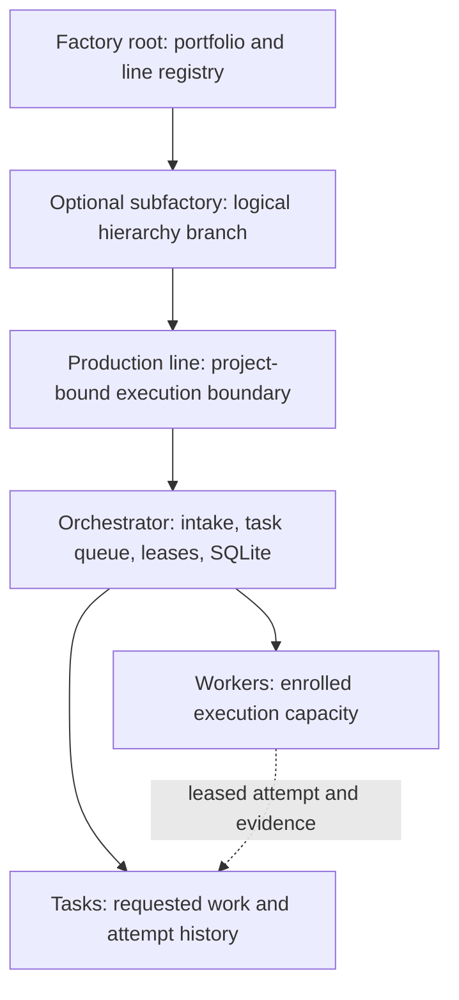

# Factory, production lines, workers and tasks

Werk models a Factory as a collection of production lines. Each line has one
orchestrator and one or more workers. A task belongs to one line's orchestrator;
a worker receives a leased attempt to execute it. Mock execution is the default:
completed attempts produce a `simulated` task and evidence. Explicitly enabled
native Linux Codex execution can produce a local change set in `review`; human
validation, publication and merge remain separate operator actions.

## Factory

Factory records the hierarchy and line registrations, then reads summaries from
those independent lines. Its SQLite database owns the registry and durable
management receipts. Subfactories are logical branches in that same Factory service/database, with
parent IDs forming a tree. A line belongs to exactly one root or subfactory; it
can be registered directly under the root without a subfactory. Every branch uses
the same Factory webview and service endpoint. No cross-server federation or
extra subfactory process is created. Each line retains its own task database,
credentials and workers. A missing line is represented as unavailable/partial evidence in the
portfolio.

The Factory is the logical parent of its production lines. Its identifier names
that portfolio entity; a line's `project` names the task/enrollment scope handled
by that line. Factory identity and project identity serve different purposes.

## Views and ownership

| Entity | Authoritative state | Where to inspect it |
| --- | --- | --- |
| Factory/root and subfactory | One Factory registry/database owns hierarchy and line registrations | Dedicated Factory webview, including its hierarchy and portfolio summaries |
| Production line | Stable Factory registration points to its independent orchestrator | Factory line entry opens that line's webview; line data remains local to its orchestrator |
| Orchestrator | Its own SQLite database owns tasks, claims, leases, context and accepted evidence | Dedicated line map, Intake/taskboard and task/worker inspectors |
| Worker | Own enrollment identity and local journal; line owns accepted worker/task records | Worker's local status webview and the orchestrator's worker view |
| Task/attempt | One orchestrator owns task state/history; worker supplies lease-scoped evidence | That line's task detail, events and snapshots |

Each line announces a versioned capability object with its project, intake/context
support, registered mock profiles and observed capacity. System bootstrap checks
those capabilities before registering the hierarchy. Factory preserves missing
capability data as unknown. The orchestrator exposes a bounded worker-detail view
with active tasks; the worker's own status remains its local diagnostic view. See
[observability](../reference/observability.md) for exact fields and limits.

Factory and orchestrator also serve a public, standalone `/guide` explaining
these entities; it makes no live API calls and performs no administrative actions.
Its 3D/2D topology is illustrative. A local composer can download a definition for
one line with one to eight mock worker processes; it cannot apply the file or
migrate running state. The standard native startup still supplies two independent
lines. Factory's live map, in contrast, uses registry and summary observations;
its aggregate worker pools do not invent individual identities. The line map
(`#system`) is the default authenticated entry, with direct routes to Intake,
tasks, workers and metrics.

Inspect service health, task events and worker evidence together when diagnosing a
failure. Each surface reports the state owned by its service; a portfolio summary
is not a replacement for the line's authoritative history.

## Production line and orchestrator

A production line is the unit shown in Factory and configured in the system YAML.
Its stable `id` identifies the registration; `name` is a human label. The
orchestrator is the service that implements the line: it owns intake, scheduling,
claims, lease fencing, task state, context manifests and the evidence index.

One orchestrator writes one line database. Workers communicate with it through
HTTP. System launchers can start several lines together while preserving these
boundaries; they do not combine their task queues or databases. The current
`project` binding controls which tasks and worker enrollments belong to the line.
It does not by itself configure a Git remote or a committed requirement vault.

## Worker

A worker enrolls with one orchestrator and receives a persisted worker ID and
credential. It owns its local identity, snapshots and pending evidence journal.
The orchestrator grants a time-bounded lease for an attempt and checks that
identity when accepting heartbeats, evidence and completion.

`workers.count` in YAML declares how many worker processes to launch. A generated
slot such as worker 1 identifies an operator-managed process/state location; its
persisted enrollment ID is created by the orchestrator and must survive restart.
These configured slots are distinct from a worker's internal execution/profile
concurrency policy. Replacing state creates a new identity, rather than renaming
an existing enrollment.

## Task and attempt

A task is requested work accepted by one orchestrator, with a generated task ID,
project, requirement input, status and attempt history. Tasks are submitted at
runtime through that line's Intake or API. They are not seeded by system YAML.
A stable submission key makes retries of the same intent idempotent within the
line.

Task states are `queued`, `running`, `review`, `simulated` and `blocked`.
`review` records a change set pending human validation, not acceptance or merge.
An attempt records which worker held which lease and its before/after evidence. A retry is another
attempt on the same task; it is not a second global Factory task. Lease expiry or
failure can requeue work or block it at its attempt ceiling.

The default requirement reference remains unresolved in mock mode. Explicit
committed-context binding is a separate line capability. Neither a provider label
nor a successful mock attempt invokes Claude/Codex, publishes Git changes or
creates a real PR.

## Definition versus running state

The system definition declares the topology and ports; the runtime creates
credentials, databases and worker identities in private state. The system `id`
selects the deployment namespace, while Factory, line, worker and task IDs retain
their domain ownership. Keep state separate from the YAML and release program files.

See the [system definition reference](../reference/system-definition.md) for
field constraints and the [system tutorial](../tutorials/system-from-yaml.md) to
run the complete hierarchy. [Runtime layout](runtime-layout.md) explains the
independent-service and lifecycle boundaries.
