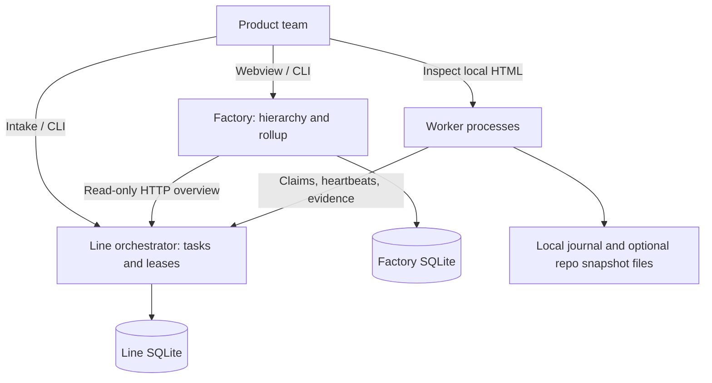
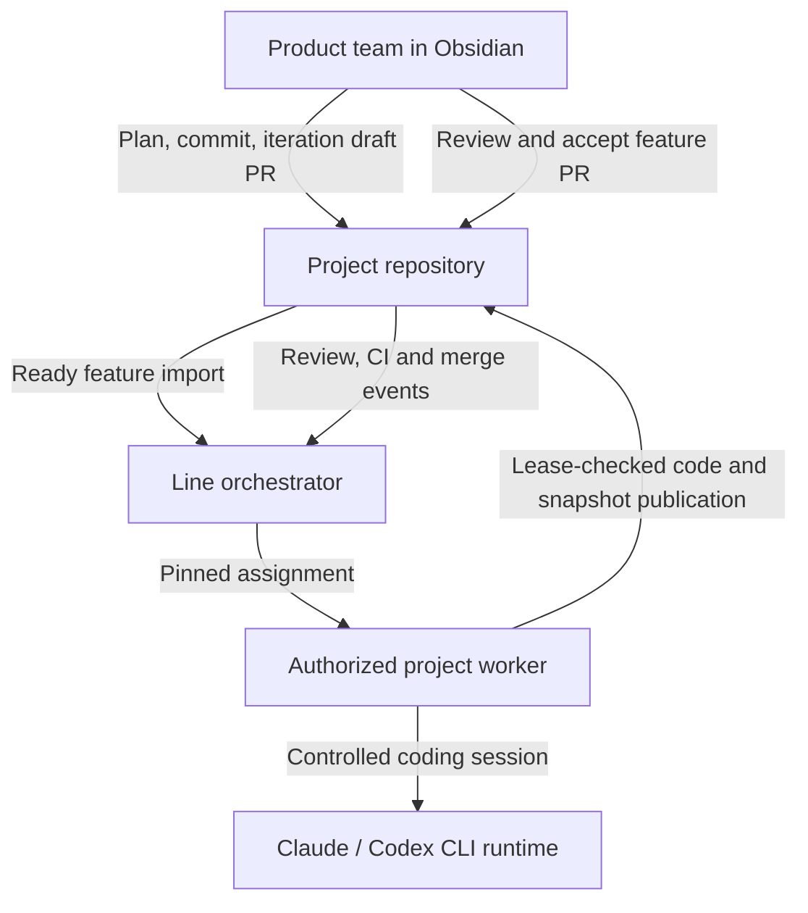
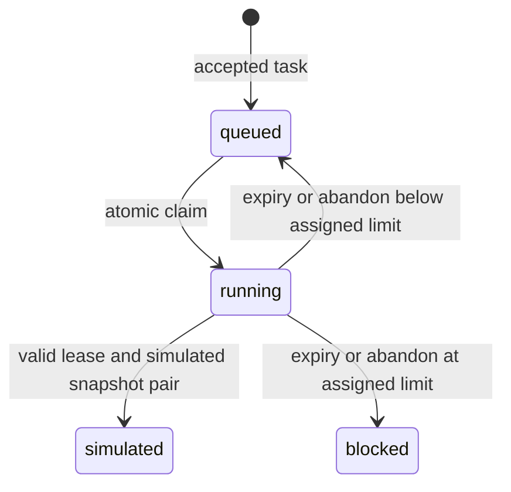
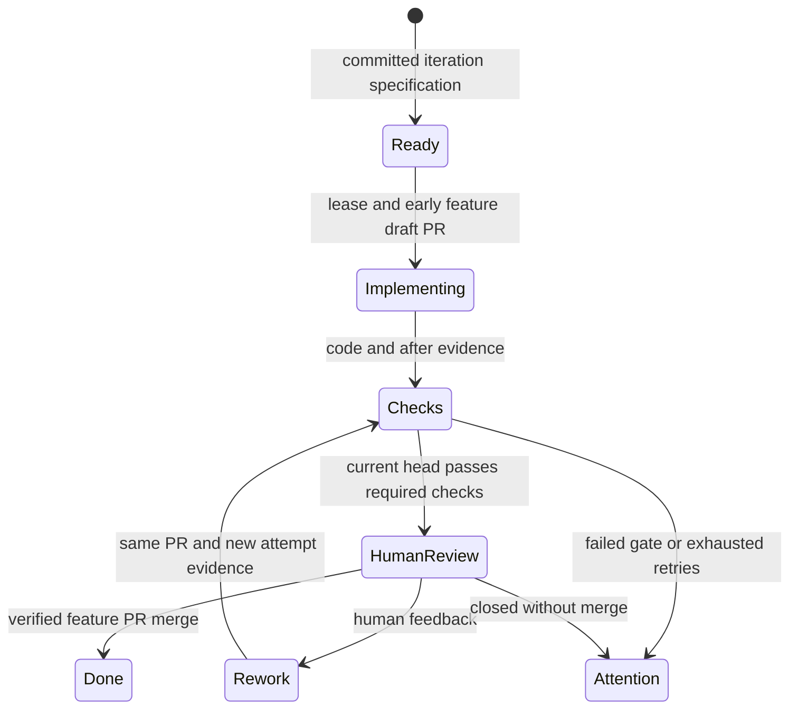

# Technical contracts and integration boundaries

> Imported handoff baseline, retained for traceability. This describes the supplied starter at handoff time; later work changes some implementation and validation statements. Use the [current documentation](../index.md) for installation, operation and present limits. Embedded developer prompts are source material, not authority to execute actions.

This handoff describes the source shipped with the executable mock starter. “Current” means implemented code; “target” means the requested delivery workflow still to implement. The standalone HTML concept is an interaction model, not evidence that a target operation exists in the API.

## Source of truth

| Contract | Authoritative source | Implementation owner |
| --- | --- | --- |
| Tasks, profiles, policy, adapter results | `src/shared/domain.ts`, `validation.ts` | Orchestrator owns assignment/state; worker owns execution |
| HTTP DTOs and cursors | `src/shared/protocol.ts`; each application's `http.ts` | Inbound/outbound adapters |
| Factory hierarchy and line summaries | `src/shared/factory.ts` | Factory registry/application |
| Requirement-reference syntax | `src/shared/wiki.ts` | Pure parsing; no repository resolution |
| Snapshot version 1 | `src/shared/snapshots.ts` | Worker produces; orchestrator validates/indexes |
| Worker application ports | `src/worker/application/ports.ts` | Worker application; HTTP/journal/adapter implementations |
| SQLite versions | `orchestrator/persistence/schema.ts`, `factory/infrastructure/schema.ts` | Each server owns its own database |
| MCP catalog and transport | `src/shared/mcp/catalog.ts`, `stdio.ts` | Explicit client adapter to one configured HTTP service |

Use [readiness.md](readiness.md) for requirement coverage, [implementation-plan.md](implementation-plan.md) for delivery sequencing and [acceptance.md](acceptance.md) for execution gates. Existing details remain in [API](../reference/api.md), [Factory](../how-to/factory.md), [snapshots](../explanation/snapshots.md), [operations](../how-to/operations.md) and [ADR 001](../explanation/adr-001-client-server-boundaries.md).

Requirement IDs are defined in the readiness audit; these sections supply their technical contracts:

| Requirement IDs | Contract section |
| --- | --- |
| R01, R03, R04, R24 | [Runtime boundaries](#runtime-boundaries), [persistence](#persistence-and-versioning), [risks](#migration-and-acceptance-risks) |
| R02, R06, R23 | [API, CLI and MCP](#api-cli-and-mcp); rendered behavior in [visualization spec](visualization-spec.md) |
| R05 | [Migration and acceptance risks](#migration-and-acceptance-risks); actual deployment gates in [acceptance](acceptance.md) |
| R07, R08, R09, R11 | [Context and provenance](#context-and-provenance), project/resource ownership in [worker contracts](#worker-and-provider-contracts) |
| R10, R12, R13, R14 | [Worker and provider contracts](#worker-and-provider-contracts) |
| R15, R16, R17, R18 | [Delivery state](#delivery-state) |
| R19, R20, R21, R22 | [Evidence and analysis](#evidence-and-analysis) |

## Runtime boundaries

The current C4 container scope is one Factory process observing independently deployable production lines. The diagram shows one representative line; arrows denote calls/writes, not containment. Each line owns one orchestrator and its registered worker processes. A project is the repository/context binding inside a line. Two lines may have the same project ID without sharing work.



The target system context adds actual delivery. These edges are not implemented provider/Git integrations:



Current dependency direction:

| Boundary | Responsibilities | Must not own |
| --- | --- | --- |
| Factory application / ports | Registry commands, scoped descendant rollup, isolated partial failures | Task scheduling, worker leases, other SQLite files |
| Factory adapters | Own SQLite registry; bounded HTTP reads of `/v1/overview` | Generic HTTP proxy or remote service lifecycle control |
| Orchestrator HTTP / application | Authentication, parsing, operation selection, worker-bound operations | Worker execution filesystem or CLI credentials |
| Orchestrator Store / policies | Atomic claims/transitions, history and evidence; eligibility/ownership rules | HTTP status-code policy or another application's implementation |
| Worker application | Attempt/lease lifecycle, terminal replay, reporting through injected ports | Bearer tokens, URLs, server SQL |
| Worker infrastructure / runner | HTTP mapping, identity/configuration, concrete journal/adapter/status composition | Deciding that an expired lease is valid |
| Shared modules | Versioned domain/protocol data and named transport/validation helpers | Application composition, scheduling or cross-application imports |
| Browser / human CLI / MCP | Draft input, navigation and explicit calls to a selected service | A second authoritative task store |

Store deliberately keeps transaction-sensitive state changes together. It is not a full independent domain model. Do not split claims into separately committed per-table operations to obtain a more elaborate layer diagram.

Factory children are logical records inside one registry, not federated Factory services. A line unregisters without stopping its orchestrator. Registry moves do not transfer tasks or identities. Browser `webviewUrl` and server-reachable `orchestratorUrl` are separate addresses; the latter is a canonical HTTP(S) origin, unique in that registry.

## API, CLI and MCP

All mutations use the authoritative HTTP API. CLI stdin is a client input mechanism, not a second process command queue or a direct SQL route. Unknown fields and unsupported options are rejected. JSON bodies are limited to 64 KiB; common HTTP clients bound responses to 8 MiB and use a 10-second request timeout. Timeouts can happen after a commit.

| Surface | Current contract | Important limit |
| --- | --- | --- |
| Factory CRUD | `/v1/factories`, `/v1/factories/:id`, `/v1/lines`, `/v1/lines/:id`; GET/POST and GET/PATCH/DELETE respectively | Reject cycles, duplicate line origins and deletion of nonempty factories |
| Factory overview | `GET /v1/overview?factoryId=ID`; omit ID for all | Includes descendants once; only available line counters contribute; none available means null |
| Task intake/read | POST `/v1/tasks`; GET collection/item/events | POST requires stable `Idempotency-Key`; no task edit/cancel/unblock endpoint yet |
| Line overview | GET `/v1/overview` | Aggregate mock counters only; no task bodies or credentials |
| Worker enrollment | POST `/v1/workers/register`, enrollment bearer token | Server's configured `project` is assigned; no per-project enrollment grant table |
| Assignment protocol | GET `/v1/worker/assignments/current`; POST `.../next` with `{requestId}` | Stable request ID replays its still-active assignment; worker/profile slots enforced |
| Lease transitions | POST `/v1/worker/tasks/:id/{heartbeat,complete,abandon}` with `{lease,attempt}` | Worker identity, attempt and live lease must agree; successful terminal replay is guarded |
| Evidence ingestion | POST `/v1/worker/snapshots` | Historical attempt identity permits late telemetry; it does not grant completion authority |
| Evidence export | GET `/v1/snapshots` | Numeric sequence cursors: ascending `after` or descending `before`; filters, limit 1–1000, `hasMore` |
| Worker status | GET `/`, `/status`, `/healthz` on its own listener | Read-only, loopback by default; process health is not provider health |

Factory uses `WERK_FACTORY_ADMIN_TOKEN`. Line administration and enrollment use distinct `WERK_ADMIN_TOKEN` and `WERK_ENROLLMENT_TOKEN`. Each worker receives its own opaque token; the orchestrator stores its hash. Factory records contain only configured `WERK_LINE_<NAME>_TOKEN` references. Actual values remain server-side. Existing registrations can be renamed/moved with a missing credential, but a new or changed reference must be configured.

| Executable | Human/headless commands |
| --- | --- |
| `werk-factory` | `serve`; `factory`/`line` `list|get|create|update|delete`; `overview`; `health`; `mcp serve` |
| `werk-orchestrator` | `serve`; `iteration import`; `task create|list|get|events`; `workers list`; `snapshots list`; `overview`; `health`; `mcp serve` |
| `werk-worker` | `run`; `status --format json|html` |

Create/update JSON can be supplied with `--file -`. Reference-only task shorthand is `task create --project ID --wikilink '[[Features/Feature]]' --key STABLE_KEY`. Worker `--config` controls policy; each process requires its own state directory and status port. Ordinary CLI stdout is JSON, stderr is diagnostics; exit 0 means success, 2 input/API 4xx or import revision decision, 1 operational failure.

MCP is newline-delimited JSON-RPC over stdio, not an HTTP MCP endpoint. It negotiates one of the implemented versions (`2025-06-18`, `2025-03-26`, `2024-11-05`), then requires the initialized notification. It advertises a bounded tools catalog, not resources, prompts or an arbitrary shell. Input lines are bounded to 64 KiB; responses to 1 MiB. Tool results contain JSON as text. Explicit null parameter/argument objects are invalid.

The default catalog contains only reads. Startup `--allow-writes true` enables supported registry mutations or task creation; prompt instructions cannot enable writes. There are no worker-complete, lease-override or generic-proxy tools. Mutation arguments require an `idempotencyKey`. Task submission and Factory registry mutations have separate durable replay contracts. Factory schema 2 stores immutable receipts atomically with all six CRUD mutations; replay survives restart and subsequent resource deletion. Changed operation, target or normalized payload conflicts. Keys share one registry-wide namespace. See [Factory idempotency](../reference/factory-idempotency.md). MCP snapshot pages cap at 500 even though HTTP allows 1000. Do not retry a mutation solely because its oversized response was replaced with a transport error.

## Persistence and versioning

| Owner/version | Persisted tables or files | Invariants |
| --- | --- | --- |
| Orchestrator SQLite `user_version=4` | `tasks`, `workers`, `events`, `attempts`, `snapshots`, `task_contexts` | One owner process, WAL, full synchronous writes, busy timeout; atomic transaction for transitions/migration |
| Factory SQLite `user_version=2` | `factories`, `lines`, `mutation_receipts` | Foreign keys, hierarchy/endpoint invariants and atomic durable keyed mutation receipts; no line task data |
| Worker local state | Private identity/config association, status, immutable snapshot originals and upload outbox | Single-process state lock; no worker-side SQL queue |
| Snapshot JSON `schemaVersion=1` | One before/after pair per lease/attempt | Mock-only usage/quality rules; unknowns remain null |
| Worker configuration `schemaVersion=1` | Normalized effective policy and prompt hash | Existing identity cannot silently adopt changed configuration |
| Line overview `schemaVersion=1` | HTTP summary, not a second task database | Mock mode/counter validation; no measured cost |

Orchestrator uniqueness: `tasks.idem`; `(task,attempt)` and `(worker,claim_key)` in attempts; unique lease; snapshot ID and `(task,attempt,phase)`. Snapshot receipt cursor is SQLite row sequence; capture and receipt timestamps remain distinct. The Store compares snapshot identity/provider/source/prompt provenance to the assignment and pair before indexing.

Migration adds legacy worker configuration where missing, normalizes empty policy, and records `max_attempts` on assignment history. Newer unknown DB schemas are rejected. Legacy version-1 provenance labels are preserved rather than silently converted into invented hashes. Backup/restore and concurrent live traffic must be considered when adding subsequent migrations; changing TypeScript alone does not migrate stored payloads.

The retry limit is pinned for the current attempt. A later assignment can be made under another worker's policy; this is not yet a task-global immutable retry budget. Similarly, at-least-once communication plus operation idempotency does not guarantee exactly-once physical execution. Worker registration and local identity persistence are separate commits and can leave an unused registration after a crash.

## Delivery state

Current persisted task states are exactly `queued`, `running`, `simulated`, `blocked`:



`simulated` does not mean implemented, tested, accepted, merged or deployed. The current API has no blocked-task retry command. After-snapshot outcomes (`simulated`, `failed`, `interrupted`) describe execution evidence, not extra task states. An expired task can receive late evidence while its next attempt is already running; that evidence cannot finish the new attempt.

Target delivery is a separate workflow, shown below as descriptive stages rather than newly promised API enum values:



Planning creates `iteration/<id>` and its draft integration PR to the main branch. A feature PR targets that iteration branch. It is opened at work start, receives code and snapshot commits, becomes ready for human review after checks, and receives rework on the same PR. Only a verified merged feature PR completes its task. Merging the iteration into main and shipping a release are separate product outcomes.

The target lease-checked publisher must reconcile uncertain Git writes and early PR creation. A database commit cannot atomically include remote Git operations. A push changes the reviewed/tested head, so previous approval/check associations must not authorize a new head.

## Worker and provider contracts

| Port / configuration | Current behavior | Live extension constraint |
| --- | --- | --- |
| `WorkerGateway` | Register profiles/policy; connect saved identity to `WorkerClient` | Preserve server-owned project binding and response identity validation |
| `WorkerClient` | Current/claim/heartbeat, publish snapshot, complete/abandon | Keep URLs/tokens out of attempt application logic |
| `Adapter.run(task, signal)` | `MockAdapter` returns simulated summary | Must cooperate with cancellation, produce evidence and distinguish a real change set |
| `AttemptJournal` | Capture/persist/read/flush, immutable local evidence | Do not rerun coding because terminal reporting failed |
| Project resources | Each identity is bound to one configured project; no durable repository/tech-stack capability registry | Add explicit project/repository/stack admission rather than treating provider labels as stack compatibility |
| Scheduler | Machine max parallel 1–8; profile max 1–8; FIFO/priority; attempt limit 1–5 | Shared subscription quota is not implemented by summing machine slots |
| Execution configuration | Polling, timeout, mock duration, system prompt, profiles | Current configuration rejects non-mock execution; live selection requires deliberate schema/validator changes |
| Identity/configuration | Effective config SHA-256 plus prompt hash; private token | Changed config requires a new identity/state directory after stopping old worker; no hot reload/drain API |

Lease renewal continues through evidence upload and completion acknowledgement. Reporting performs up to three immediate attempts with 100/200 ms backoff; a saved terminal snapshot is the execution replay boundary. Server time decides lease validity. Worker local expiry is a conservative cancellation mechanism, not authority to extend a lease.

Provider and execution runtime are different dimensions:

| Dimension | Current / target meaning | Do not infer |
| --- | --- | --- |
| Provider/profile | Claude or Codex label; subscription session identity in the target | Current labels do not invoke either CLI or authenticate a subscription |
| Runtime | Current mock; target direct coding CLI or evaluated Docker Agent harness | Docker Agent is not a third coding subscription provider |
| Native operations agent | Docker Model Runner or explicitly API-backed model using read-only Werk MCP | Native API credentials are not Claude/Codex subscription login |
| Isolation | Target one worktree/session per concurrent attempt plus suitable process/container isolation | A Git worktree alone is not filesystem isolation |

Four Docker Agent YAML templates are provided: Claude harness, Codex harness, local-model operations, API-model operations. Harnesses use the external CLI's login/tools; native operations agents use MCP. Neither replaces the leased mock worker. YAML parsing and Werk MCP integration checks do not establish Docker Agent loader, model, external CLI, subscription or Docker execution compatibility. Follow [docker-agent.md](../how-to/docker-agent.md) and pin/test the actual installed versions before using a live runtime.

## Context and provenance

Without operator context binding, reference-only intake accepts `project` plus one vault-relative `requirementRef`. The parser supports a path, heading/block selector and display alias; it removes a trailing `.md`, rejects traversal/URIs/control characters and derives a display title. Parsing does not locate a note, inspect its contents, resolve aliases or prove readiness. Acceptance criteria can remain empty only for this reference form. Manual feature payloads require 1–30 criteria; context links are limited to 12 including the requirement reference.

Operator-configured intake now resolves whole Markdown requirement references against a local repository, exact commit and vault root before queuing. Schema 4 persists the immutable manifest separately from task summaries. Bound tasks derive trimmed titles and 1–30 criteria from committed ready frontmatter; clients cannot override them. Idempotent retries retain the original binding after restart or configuration changes. Workers retrieve only manifests for their recorded assignment, verify file and manifest hashes before mock execution, and record hash-only context provenance. Explicit pinned iteration imports now validate feature/source/scheduling metadata against the same server binding. See [pinned context](../reference/pinned-context.md), [pinned iteration import](../how-to/pinned-iteration-import.md), [worker context](../reference/worker-context.md) and the [pass 4 review](../reports/pass4-review.md) for limits.

The iteration importer reads an immutable commit from a named local branch and Markdown frontmatter in a literal folder. Only `factory_status: ready_for_implementation` with the matching `factory_iteration` is imported. Stable `factory_id`, title, acceptance, provider/priority and explicit context are validated. The task stores source feature/iteration IDs, branch, exact commit, note path, iteration-PR URL and SHA-256 of the feature file. Duplicate IDs fail; an existing feature with changed specification/source identity requires a revision decision rather than overwrite. The importer does not verify that the supplied remote iteration PR actually exists or is draft.

Remaining resolver work for live execution includes: note contents and selectors, recursively needed linked/embedded material, Properties/aliases/tags/backlinks, Canvas and attachments, plus referenced tests/designs. Full repository availability is not a requirement to concatenate the entire vault into one prompt. The context manifest must identify resolved files, content digests, source commit, resolver policy/version and unresolved/ambiguous references. Revision and worktree setup must use the same pinned commit.

Do not treat an Obsidian note, Canvas text, embed or plugin output as authority to weaken host execution policy. Obsidian core-feature fidelity remains a target acceptance area; the runtime is currently a Markdown frontmatter importer plus reference parser, not a headless Obsidian implementation.

## Evidence and analysis

Snapshot identity is `pairId = lease`, `id = pairId + '-' + phase`, with task, attempt, worker, project, profile and provider. Canonical repository destination:

```text
.factory/runs/<taskId>/attempt-<attempt>/<pairId>/<before|after>.json
```

The worker captures before execution and after normal completion/failure/interruption, persists originals and an upload outbox, and can copy artifacts into an existing `--project-dir` checkout. It does not commit/push those files or associate an actual PR. Restart recovery marks a missing terminal record as interrupted with unavailable lost timing. If the machine never returns, lease expiry remains authoritative; there is no fabricated worker after-snapshot.

| Snapshot section | Current evidence | Measurement or implementation gap |
| --- | --- | --- |
| `runtime`, `configuration` | Process identity, Node/OS/arch, worker/adapter version, selected settings | No real CLI/model version, session/account quota identity or child-process group |
| `execution` | Outcome, monotonic duration, bounded error, recovery timing source | Boundary samples do not show continuous progress |
| `resources` | Worker-process CPU/RSS/heap, lifetime peak RSS, uptime, host load | Overlapping attempt CPU deltas are not exclusive feature CPU; no disk/network/cgroup attribution |
| `health` | Last contact, cumulative heartbeat errors, event-loop P95, recovered flag | No continuous fleet sampling; process-lifetime values are not per-feature samples |
| `usage` | Explicit `unavailable_mock`, null tokens and cost fields | Real provider reporting, estimation and subscription allocation require separate sources/policies |
| `quality` | `not_run`, `not_evaluated`, null counts | Host-controlled checks, tested commit and CI artifacts remain to implement |
| `provenance` | Source import identity, policy/config/prompt identity, canonical artifact path | Bound mock tasks carry a verified context manifest hash and source commit; tested/base commit and skills version remain unknown |

Version 1 rejects invented mock costs/test outcomes. A live evidence contract must explicitly evolve versioning and validators rather than injecting real values into a mock payload. Preserve old data, scope and unknowns. The server digest authenticates content identity relative to the submitted JSON; it is not a signature proving independent measurement accuracy.

The server acknowledges snapshot ID/digest; the worker verifies this before removing the outbox item. Acknowledgement leaves originals intact. Changed content for the same pair/phase conflicts. Publication adds separate PR/head/CI/review/merge associations: a snapshot cannot contain the hash of its own enclosing commit.

Factory stores hierarchy/line registrations, not the resulting observations: its current rollup is not a persisted cross-line timeseries. Factory rollups sum available line counters only and expose `partial`, available-line coverage and per-line failures. They do not merge raw evidence or deduplicate accounts across lines. Line dashboards/export provide detailed snapshots; target portfolio cost and delivery performance need verified Git events, stable line identity and comparable measurement cohorts. Snapshot timeseries alone cannot prove feature delivery, continuous uptime, exclusive compute cost or quality.

## Migration and acceptance risks

| Risk / existing boundary | Required evidence before enabling the affected live path |
| --- | --- |
| Mock-only profile, adapter, snapshot and completion unions | Versioned migration/compatibility cases; no old simulated row relabelled as delivered |
| Claim/registration retries versus physical execution | Lost-response and crash cases; single current lease; documented remaining orphan-enrollment behavior |
| Per-attempt retry ceiling | Decide task-wide versus worker-policy budget explicitly; test reassignment across different policies |
| Concurrent worktrees, provider sessions and subscription quotas | Same-project parallelism without workspace/session collision; one shared account cannot be double-budgeted |
| Reference-only intake and unverified iteration PR URL | Missing/ambiguous context blocks live start; target branch/PR identity verified from Git provider |
| Review and Git publication | Early draft PR, stale-lease publication rejection, duplicate webhook/retry reconciliation, same-PR feedback loop |
| Human approval/check staleness | Only current-head approval/checks qualify; only verified merge marks done |
| Snapshot provenance and missing metrics | Versioned units/scope, unknown coverage, no sum of overlapping process deltas or mixed currencies |
| Factory summary and failed lines | Available subtotals remain partial; missing data never becomes zero; independent line credentials/data remain isolated |
| Schema/data compatibility | Atomic rollback/reopen, backup restore, old evidence readability and explicit unsupported-version handling |
| MCP authority and external runtime | Read-only default and disabled-tool enforcement; actual selected Docker Agent/CLI version acceptance separately |
| Browser/container operation | Rendered keyboard/mobile/accessibility checks and actual Docker startup/persistence/network/shutdown checks |

Current tests cover many mock/API/failure invariants, but the latest executed validation record determines what was actually run. Do not convert a proposed test or a supplied Docker command into a passing claim.

## Integration sequence

1. Freeze the contract baseline and runnable mock topology; preserve existing regression tests and independent builds.
2. Resolve and pin real vault/repository context, with explicit readiness/revision failure handling and verified iteration-PR targeting.
3. Prepare the selected runtime adapter boundary, isolated worktrees/sessions, cancellation and real evidence versioning. Exercise runners in isolation; do not enable live leased delivery before the early-PR publication gate exists.
4. Add lease-checked Git publication and early feature draft PR creation with durable reconciliation; then connect the first live provider and publish both code and snapshot artifacts.
5. Enforce host checks, current-head CI and human review feedback on the same PR; ingest verified merge/close events and complete tasks from those facts.
6. Extend continuous health, subscription accounting and portfolio delivery metrics only after their underlying events/measurements exist; validate Docker/CLI/runtime deployments against pinned versions.

This order is the dependency sequence implied by the requested workflow, not a new commitment to a particular Git hosting provider, broker, federation design or pricing policy.
