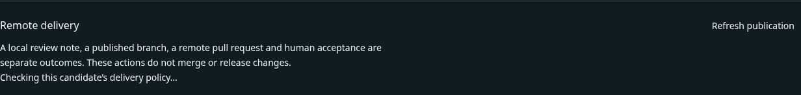
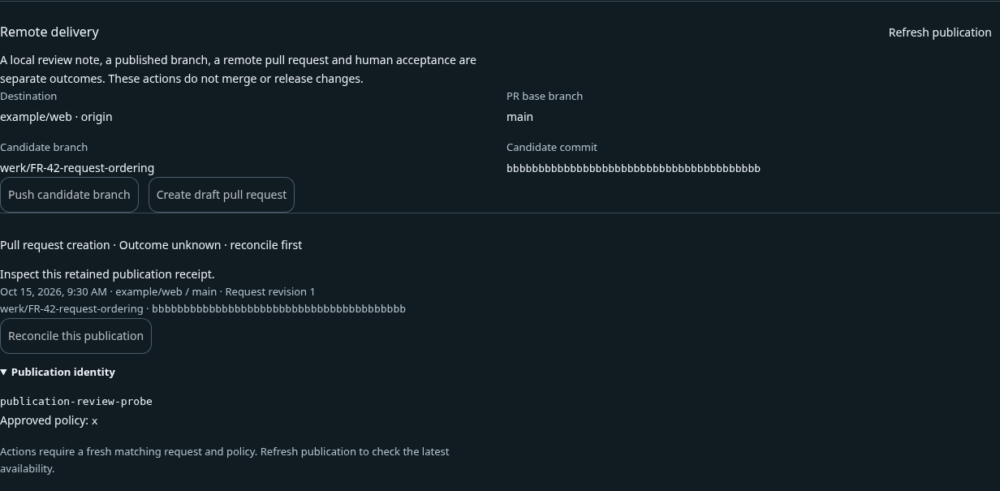

# Worker UI review and polishing · 2026-10-21

The reviewed worker journey preserves one Feature Request across creation, progress,
questions and human review. The polishing pass fixed a repeatable publication
refresh defect and aligned the project-policy approval control. It did not change
request authority, remote publication permissions, or the visual identity.

## Scope and evidence

Fresh Linux Chromium captures covered eight worker states at 1440 × 1000 and
390 × 844 viewports. The baseline produced 16 passing fixture runs. One grouped
fix pass and one confirmation round produced 20 passing runs, including two new
publication interactions at both sizes. All baseline images and the retained final
screenshots were opened and inspected. Full-page screenshots extend beyond the
viewport; the mobile review and metrics pages are intentionally long.

The baseline was captured on 2026-10-21 at 10:53 UTC (12:53 Europe/Berlin); the
confirmation completed at 11:01 UTC (13:01 Europe/Berlin). Displayed October 15
request dates and example accounts are fixture data. The
[receipt](../evidence/local-delivery/ui-review-2026-10-21/receipt.json) records
build-input digests, individual cases, dimensions and screenshot checksums.
These digests identify working-tree build inputs, not a final clean commit.

## Journey and findings

1. **Find current work — healthy in the captured state.** Taskboard separates
   Needs you and Up next, shows capacity, and keeps request creation alongside
   current work. The mobile layout stacks the same controls with explicit links
   between the board and interaction. Labels explain queued work without implying
   an execution ETA.
   [Desktop](../evidence/local-delivery/ui-review-2026-10-21/01-taskboard-desktop.png)
   · [Mobile](../evidence/local-delivery/ui-review-2026-10-21/01-taskboard-mobile.png).
2. **Create a project request — healthy in the captured state.** The composer
   identifies the project and presents its permitted execution profile. It states
   that the request is saved as Markdown and that policy approval is needed before
   dispatch. The fixture exercises project selection and retained request identity;
   it does not dispatch a model.
   [Request composer](../evidence/local-delivery/ui-review-2026-10-21/02-request-desktop.png).
3. **Understand execution — healthy in the captured state.** The review page
   separates Feature Request lifecycle, delivery run status and current phase.
   Current work and its next expected event precede expandable provider, policy,
   behavior and step evidence. Historical checks do not mark a running delivery as
   complete. Section links make the long review page navigable.
   [Delivery progress](../evidence/local-delivery/ui-review-2026-10-21/03-progress-desktop.png).
4. **Answer readiness decisions — healthy in the captured state.** A proposal
   has a reason field and explicit accept/reject actions. The view keeps an
   unanswered question distinct from an accepted assumption and explains that
   neither proves verification. The narrow layout wraps the content and actions.
   [Readiness decision](../evidence/local-delivery/ui-review-2026-10-21/04-readiness-mobile.png).
5. **Review the candidate — healthy in the captured state.** Human criteria,
   review notes, observed checks and the current candidate remain separate.
   Background observation updates retain the typed criterion observation and
   keyboard focus. Stale combined evidence remains visible with decisions guarded.
   The review page is long on mobile; task-based anchor navigation is an important
   retained affordance.
   [Human review](../evidence/local-delivery/ui-review-2026-10-21/05-review-desktop.png).
6. **Inspect remote delivery — fixed.** Updating a revision of the same request
   previously cleared the publication panel while its policy was read. The receipt
   list and actions disappeared, collapsing layout and losing an open disclosure.
   Same-request revision revalidation now retains those nodes and immediately
   invalidates action freshness. A new request identity or locked access still
   clears private data. Failed reads retain the evidence, expose a recovery action
   and keep publication disabled until a current response arrives.
   [Before](../evidence/local-delivery/ui-review-2026-10-21/06-publication-refresh-before.png)
   · [During refresh after the fix](../evidence/local-delivery/ui-review-2026-10-21/06-publication-refresh-after.png)
   · [Mobile confirmation](../evidence/local-delivery/ui-review-2026-10-21/06-publication-mobile.png).
7. **Inspect resources and consumption — healthy in the captured state.**
   Metrics distinguishes configured allowance, reported usage and reservations;
   worker-process measurements remain separate from host and owned-service data.
   Missing delivery measurements stay unavailable. Coverage and interpretation
   disclosures prevent empty history from looking like measured zero usage.
   [Metrics](../evidence/local-delivery/ui-review-2026-10-21/07-metrics-desktop.png).
8. **Configure project delivery — polished.** Committed policy, local approval
   and the editable draft remain distinct. The approval checkbox previously sat
   above its wrapped label because the scoped generic label rule overrode the
   shared layout. Its scoped layout now keeps the checkbox beside the label,
   preserves a 44-pixel label target and prevents the checkbox from shrinking.
   [Desktop](../evidence/local-delivery/ui-review-2026-10-21/08-policy-desktop.png)
   · [Mobile](../evidence/local-delivery/ui-review-2026-10-21/08-policy-mobile.png).

## Publication refresh comparison

Before: the same-request receipt list disappears while the new revision is read.

After: the receipt and disclosure remain visible while actions wait for current policy.

## Implementation and regression coverage

`useWorkerSnapshot` now distinguishes query identity from a revision that requires
revalidation of the same subject. Only the publication panel opts into the latter.
Revalidation fences earlier asynchronous reads, retains the current display and
clears decision freshness before starting a quiet read. Existing query, access,
KeepAlive and disposal boundaries retain their clearing behavior.

The focused snapshot suite passes **12/12**, including old background and manual
responses arriving after a newer revision, failed refresh recovery, request
identity changes and locking during pending reads. Focused Oxlint passes.
The new `Worker/Publication refresh` stories check DOM identity, open disclosure,
keyboard focus, disabled reconciliation during revalidation, failed-read recovery
and absence of unintended commands. Both pass at desktop and mobile sizes.
An independent architecture review found no blocker in the asynchronous fences.

Reproduce application-wide browser coverage with `npm run storybook:ci` and the
snapshot cases with `node --test tests/ui/runtime/worker-snapshot.test.mjs`.
Repository-wide validation and CI are recorded by the consolidated review; this
report does not substitute for them.

## Accessibility and qualification limits

The captured states retain text labels for status, named native controls, visible
keyboard focus and wrapping at 390 pixels. The confirmation cases detected no
horizontal viewport overflow or browser errors. A disclosure losing state during
refresh was a keyboard and reading-position risk; the new interaction assertions
cover that failure directly.

This is an evidence-based fixture review, not WCAG certification. It does not
establish screen-reader behavior, all zoom levels, other browser engines, native
Windows integration, real provider sign-in, a full real Git workflow or production
latency. The selected Windows with Claude Code pilot remains a separate live
acceptance exercise. No remote repository operation or release occurred in these
browser fixtures.
