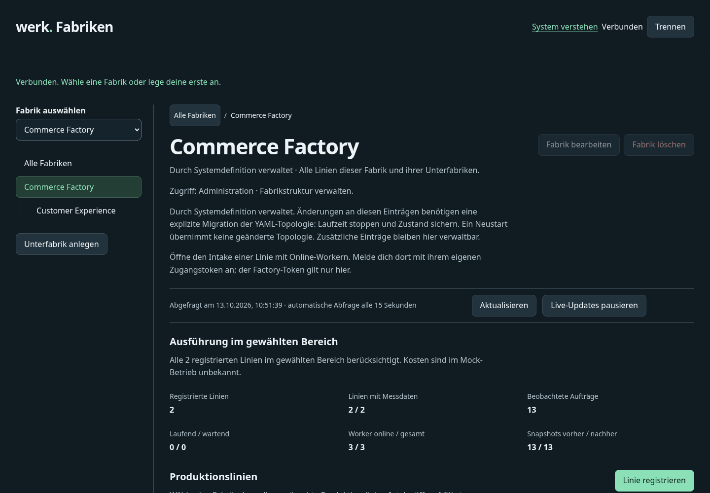
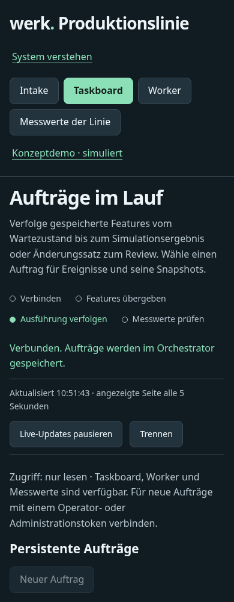

# First release review and polish

Date: 2026-10-13. Scope: the complete Werk product and the one-command release journey in PR 2. Five parallel reviewers assessed product workflows and documentation, UX/accessibility, security/privacy, engineering correctness, and release/operations. Confirmed findings were followed by a dedicated improvement pass and integrated qualification.

## Acceptance

- A downloaded release starts the complete Factory system without npm, a compiler or a source checkout.
- Default execution remains simulation; explicit native Codex execution, status and evidence are described accurately.
- Accepted tasks are claimable by a matching worker; malformed execution modes fail before persistence.
- Operators cannot change YAML-owned registry entries in a way that prevents the next startup. Additional manual registrations remain manageable.
- Read-only users land on an inspectable view; import examples work from an extracted release; bounded evidence tables disclose their limits.
- The candidate passes the source suite, dependency audit, extracted native smoke checks and all cross-platform release CI gates before publication.

## Review findings and changes

| Perspective | Confirmed issue | Improvement |
| --- | --- | --- |
| Product onboarding | The UI showed a global command unavailable in a downloaded archive and omitted the selected line URL | Use the packaged Node entrypoint and current line URL in a runnable import example |
| Product documentation | A malformed code fence hid live setup instructions; concept/architecture text described shipped live functionality as future work | Repair the example and distinguish implemented opt-in Codex patches from future publication/review/merge automation |
| Operator workflow | Backup guidance assumed single-line `.werk` state despite whole-system startup becoming the primary entry | Document `.werk-system`, stopped-state backup/restore and the correct whole-system restart command |
| Release operations | Installer restart guidance discarded custom YAML, state and headless settings | Preserve those options in a safely quoted Bash or PowerShell command |
| Runtime truthfulness | Control responses always reported `mock` | Validate and preserve `mock`, `cli` or `mixed` execution mode |
| Task correctness | Bound requirement intake rejected the explicit execution mode required by the live adapter | Accept `executionMode` under the existing pinned-context and Codex-only rules; keep mock as the default |
| API boundaries | String coercion accepted JSON arrays as execution modes and persisted unclaimable tasks/workers | Strictly validate task, profile, capability, overview and snapshot enums before persistence/use |
| Observability | Current worker and context endpoints appeared as `unmatched` in service logs | Recognize normalized routes while excluding task IDs, tokens and query strings |
| Managed topology | Renaming/removing YAML-owned registry entries could make the next whole-system startup fail | Reject managed-entry updates/deletion with HTTP 409 and identify ownership in the UI; preserve manual extra-resource management |
| Viewer experience | Viewer login stayed on Intake after hiding the submission form and attempted to focus hidden content | Open the taskboard with visible focus and suitable read-only next steps |
| Evidence comprehension | Only the newest 40 snapshot records appeared in the table without a visible truncation explanation | Display the visible count and narrowing guidance above the scrollable table |
| Interface polish | Readiness actions visually touched | Reuse existing spacing and action patterns without changing the product identity |

## Evidence and qualification

The initial installed-package walkthrough exercised two production lines and three workers with 13 simulated tasks and 26 snapshots. It verified manual intake, event history, raw evidence, worker detail, filtering, iteration import/replay, read-only access, API isolation/idempotency/pagination and a read-only MCP subprocess. A verified 62-file stopped-state backup was restored into a new directory; task records, histories, snapshots, worker IDs and credentials matched after restart.

The initial UI review inspected the operational views at 1440px, 390px and 320px widths without page overflow or JavaScript errors. The final integrated source suite passed 485 tests with no failures; one PowerShell-only test was skipped on the local Linux host. The final mobile caption refinement passed its 14 focused UI tests after rebuilding. Dependency audit found zero vulnerabilities. Forge workflow synchronization and strict vault checks passed without errors or warnings.

The rebuilt archive passed checksum-verifying installer, extracted single-line and extracted two-line system smoke tests. The system test verified isolation, three workers, persistent restart, read-only planning and definition-drift rejection. An independent final review of the managed-topology guard found no additional release blocker. Cross-platform native, Docker and cloud-init execution are release CI gates; local source-side tests do not substitute for them.

Final screenshots were taken against the freshly packaged native runtime at desktop and mobile sizes. They confirm managed-resource affordances, enabled extra-resource creation, viewer Taskboard arrival/focus, current-line import guidance, and a wrapping snapshot-limit disclosure. Browser checks found no page overflow or JavaScript errors. This is not an assistive-technology certification.

## Final interface evidence

Capture metadata and browser assertions: [validation record](../evidence/archive/first-release-validation.json). URLs identify local demo services; no credentials are embedded.

| Feature | Desktop | Mobile |
| --- | --- | --- |
| Managed Factory | [1440px](../evidence/archive/first-release-factory-managed-1440.png) | [390px](../evidence/archive/first-release-factory-managed-390.png) |
| Managed line | [1440px](../evidence/archive/first-release-factory-managed-line-1440.png) | [390px](../evidence/archive/first-release-factory-managed-line-390.png) |
| Viewer taskboard | [1440px](../evidence/archive/first-release-viewer-taskboard-1440.png) | [390px](../evidence/archive/first-release-viewer-taskboard-390.png) |
| Import command | [1440px](../evidence/archive/first-release-iteration-command-1440.png) | [390px](../evidence/archive/first-release-iteration-command-390.png) |
| Snapshot coverage | [1440px](../evidence/archive/first-release-snapshot-coverage-1440.png) | [390px](../evidence/archive/first-release-snapshot-coverage-390.png) |

## Product boundary

Default native, Docker and managed VM operation is simulated. Trusted native Linux operators can explicitly enable the existing Codex adapter to produce a local patch for human review. This review's regression uses a controlled provider fixture; it does not claim a new external provider execution. Automated PR creation, human acceptance, merge tracking, public TLS deployment and automatic in-place upgrades are not delivered by this release.

Pinned-context resolution and iteration import were exercised against a committed local sample. The default demonstration runtime remains unbound. Credentials, private backups and provider authentication are excluded from committed evidence and presentation downloads.

## Release procedure

Merge the qualified PR 2, tag its merged commit `v0.1.0`, and let the tag workflow build and qualify that exact source. Publication requires successful Linux/Windows/macOS native, Docker and Ubuntu cloud-init gates. The workflow uploads the archives, installer and checksums to a draft before making the stable release latest. Verify the actual published latest installer and its resulting runtime after publication; a local packaging test alone does not establish that GitHub download path.
