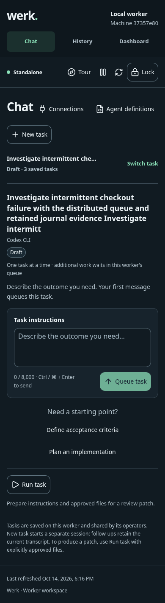
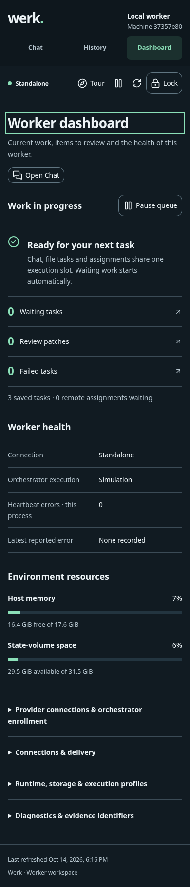
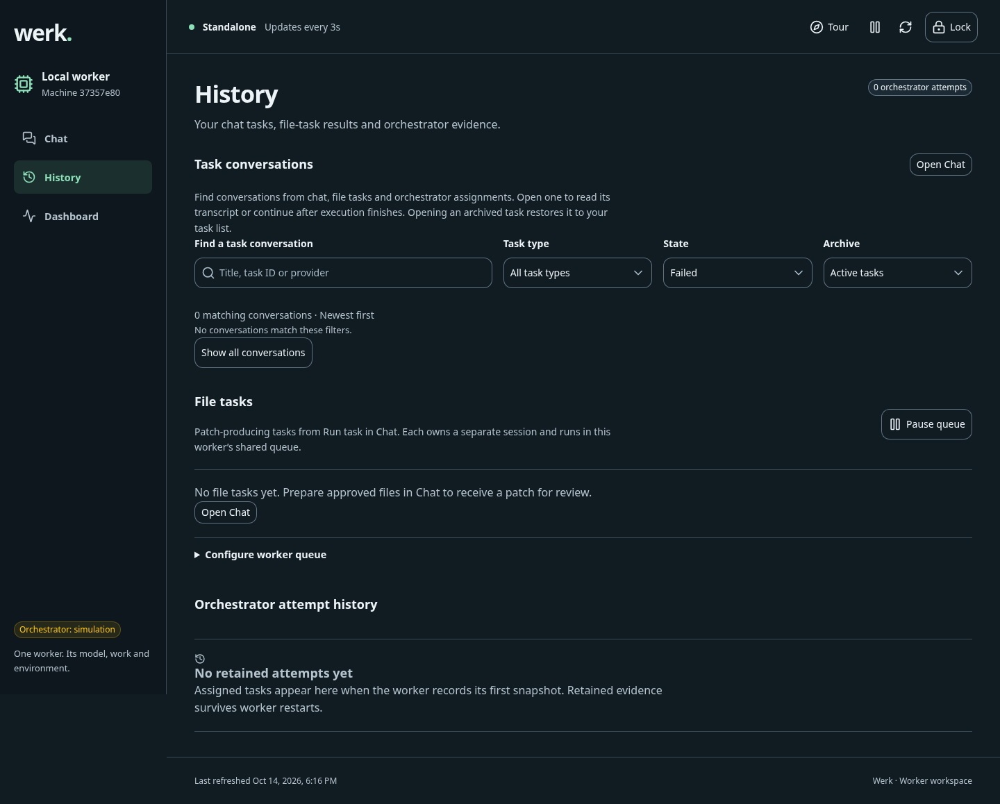
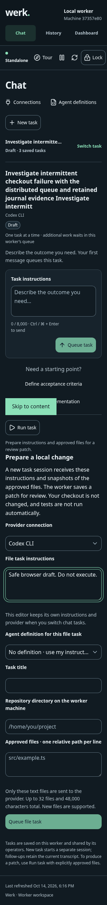
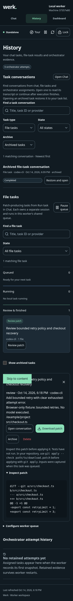

# Werk worker: deeper product and engineering review

14 October 2026

This second pass follows the request to go deeper across UI, usability and code
quality. Six subagents covered current web research, independent product review,
Chat interaction design, settings reliability, application concurrency and fresh
browser verification. The parent integrated the changes, redesigned Dashboard,
split route bundles and ran the complete checks. Findings were reproduced before
implementation where possible, then checked again in the rendered product.

The [first iteration report](worker-iteration-review.md) remains historical
evidence. This report supersedes its mobile-layout and bundle-size observations.

## Findings and implemented improvements

| Perspective | Reproduced problem | Change |
| --- | --- | --- |
| Mobile task entry | Long task names and the expanded task rail pushed composition far below the first screen. | Native saved-task disclosure below desktop width; bounded searchable list, selection closes it and focuses the conversation. Empty Chat puts composition before suggestions. |
| Information hierarchy | Standalone Dashboard displayed thousands of pixels of administrative detail before the operator could scan the whole page. | Current execution and queue controls lead, followed by actionable waiting/review/failed links and health/resource summaries. Connections, runtime and diagnostics disclose on demand. |
| Task lifecycle | Creating a session could be mistaken for submitting work. | Explicit Create draft task label, followed by Queue task; incomplete definition/agent selections cannot create drafts. |
| Recovery and discoverability | Archived file and assigned conversations disappeared from the Chat rail and were excluded from History's chat-only list. | History includes all conversation types with search, type, state and archive filters, plus explicit Restore and open. |
| Result review | File-task review was hard to locate; detail fetch failure had no useful local recovery. | Review patch on result cards, Open conversation in details, filtered Dashboard links, local loading/error/Retry, compact empty states. |
| Keyboard interaction | Closing setup panels lost initiating focus; destination links lacked section focus. | Close/Escape restores focus; task selection focuses its heading; filtered History links focus the relevant results section, including cached-page activation. |
| Detail request ordering | A slow response could replace another task's details or reopen a dismissed panel. | Request revisions and selected-task/access checks reject obsolete results after switching, closing, navigation or expiry. |
| Mutation correctness | Concurrent actions invalidated the read generation used by a successful POST, presenting accepted work as failed. | Access lifetime is separate from read freshness; successful writes remain acknowledged through unrelated reads and refresh failures. Accepted drafts clear only after acknowledgement. |
| Provider lifecycle | Provider reload during task admission could replace a live conversation and mark its reply interrupted. | Reserve admission while provider settings persist and conversations reload; reject conflicting starts and close replaced instances. |
| Settings trust | Background updates could silently overwrite edits; editing during a save could clear new input. | Pristine forms track public settings, dirty forms retain edits and offer Reload, pending controls freeze, duplicate saves are blocked and only submitted secrets are cleared. |
| Access isolation | Late private responses or an obsolete 401 could affect a newly locked/unlocked workspace. | Access generations prevent private state from returning after lock and prevent obsolete failures from relocking a new session. |
| Direct navigation | Filtered History links worked in-app but reloading their query URLs returned 404. | Match the existing page allowlist by pathname while preserving API, asset and unknown-route behavior. |
| Performance | All three page implementations loaded into the initial JavaScript chunk. | Lazy route imports produce separate Chat, History and Dashboard chunks. |
| Maintainability | Several touched templates were compressed into long single lines. | Consistent template nesting and readable attributes in the affected interaction surfaces; regression tests exercise observable races and recovery behavior. |

The independent file-task editor, persistence ordering, serialized same-ID
admission and partial refresh improvements from the first pass remain included.
The one-worker/one-execution-slot contract, approved input boundaries and human
patch review remain explicit.

## Measured browser outcomes

Measurements use the same isolated worker, seeded long task title, desktop
Chromium and mobile viewport emulation. They are layout observations, not a user
study or a real-device performance benchmark.

| Observation | Before this deeper pass | After |
| --- | --- | --- |
| Mobile composer top, 390px width, long title | About 1,280px | 773px |
| Mobile Dashboard document height, 390px width | 4,216px | 1,813px (57% shorter) |
| Mobile Chat document height, long title | 1,779px | 1,421px |
| Initial production JavaScript entry | About 502kB | About 350kB (30% smaller, uncompressed) |

Baseline captures: [long-title Chat](../evidence/worker-deeper-before-chat-mobile.png)
and [Dashboard](../evidence/worker-deeper-before-dashboard-mobile.png).

At 1440, 768, 390 and 320px, Chat, History, Dashboard and the expanded file
editor have no document-level horizontal overflow or browser page errors.
At 320px the long-title composer begins at 844px: the compact switcher improves
reachability but does not guarantee the composer fits in the initial viewport.

Browser checks cover panel close/Escape focus, task switching, disclosures,
filtered result navigation and client-side unknown-route fallback. Direct filtered
History links and reloads also pass; a full authenticated reload focuses the page
heading, while in-app navigation focuses the results section. Direct
unknown URLs retain the backend's intentional 404 response.

Browser-only API fixtures cover populated patch results, an initial failed
detail read followed by Retry, expanded diff text, close focus, conversation
navigation, and archived file/assigned type filtering. These captures are
explicitly mocked; no provider produced or executed the displayed patch.

## Research and resulting decisions

Primary sources were reviewed by the research subagent. Documented patterns
inform design decisions; they do not establish that Werk matches those products'
capabilities.

- [Codex remote engineering](https://developers.openai.com/blog/mastering-codex-remote-for-engineering)
  informed a compact mobile task switcher and emphasis on prompting and review.
- [W3C disclosure pattern](https://www.w3.org/WAI/ARIA/apg/patterns/disclosure/)
  supports native expandable task and administration sections. A nonmodal
  disclosure fits the existing page without adding a focus-trapping drawer.
- [W3C focus not obscured](https://www.w3.org/WAI/WCAG22/Understanding/focus-not-obscured-minimum.html)
  informed keyboard focus and containment checks. Software-keyboard behavior
  still needs real-device qualification.
- [Claude queued input](https://code.claude.com/docs/en/interactive-mode#queue-messages-while-claude-works)
  and [agent view](https://code.claude.com/docs/en/agent-view) informed distinctions
  between draft, queued, running and cancelled work. Werk retains follow-up drafts
  until the operator sends them after completion; it does not imply automatic delivery.
- [W3C status messages](https://www.w3.org/WAI/WCAG22/Understanding/status-messages.html)
  informed precise success/error feedback and preserving input on failed actions.
- [Codex review](https://learn.chatgpt.com/docs/code-review?surface=app) and
  [Claude diff review](https://code.claude.com/docs/en/interactive-mode#review-changes-with-diff)
  informed task-linked review actions and explicit patch scope.
- [W3C toolbar pattern](https://www.w3.org/WAI/ARIA/apg/patterns/toolbar/)
  informed retaining ordinary native buttons for small action groups instead of
  adding toolbar semantics without arrow-key behavior.

## Verification and limits

- `npm run typecheck`: passed on the final source.
- `npm test`: rebuilt all three applications; 618 discovered, 617 passed,
  one skipped, zero failed.
- Production worker entry JavaScript: 349.93kB, about 113kB gzip; separate
  Chat, History and Dashboard chunks. No 500kB entry-chunk warning.
- Browser matrix: 1440, 768, 390 and 320px; zero document overflow or page errors.
- Seven Taskboard/History behavioral regressions pass, including filtered
  section focus, cached activation and competing deep-link focus priority.
- `git diff --check` and strict documentation vault check: passed.

Coverage includes interaction recovery, concurrent writes and reads, expired
access, settings updates, provider reload/admission exclusion, archive filtering,
detail ordering and cached-route focus. Existing tests continue to cover worker
serial execution and the Factory/orchestrator boundaries.

This pass did not qualify live Claude/Codex/API sign-in or execution, software
keyboards, additional browser engines, exhaustive screen-reader behavior,
large-transcript performance, Docker packaging or production deployment. Public
settings comparisons cannot detect a secret rotation that leaves the returned
public fields identical. No change was committed, published or deployed.

## Evidence

[Sanitized browser results](../evidence/worker-deeper-browser-results.json) record
the viewport, fixture and final deep-link checks.

The screenshots are captured from the isolated local worker. The patch screenshot
uses explicitly mocked API responses. Machine identity and task titles are test
fixtures; credentials are excluded.

