# Worker experience review — 2026-10-16

This review covers the worker webview for Werk 0.10.0. The goal is a clear daily workflow: give the worker a request, see its capacity and queue, follow progress, inspect usage, and change configuration without losing context.

## Evidence and method

The review began with screenshots of the existing released interface, then examined interaction design, information architecture, accessibility, operational accuracy, reliability, privacy and component reuse. Parallel implementation and independent review were coordinated against one working tree. Browser evidence uses the actual isolated worker, HTTP API, storage and Vue application with a labelled local CLI protocol fixture. It does not demonstrate a live provider, subscription billing or successful implementation of a real feature.

Baseline captures were taken on 2026-10-16 at 17:13–17:15 UTC, at 1440 × 1000 and 390 × 844. The initial taskboard placed request instructions roughly 690 pixels below the top, after execution configuration. Dashboard mixed operational metrics and configuration across 3,699 pixels on desktop and 5,151 on mobile before expanded settings. Existing Markdown rendering, task selection focus, skip navigation and narrow-width containment worked and were retained.

## Findings and changes

| Product perspective | Finding | Result |
| --- | --- | --- |
| First use and daily interaction | Instructions competed with provider options; file work used a second editor and submit path. | One request composer starts with the desired outcome. Optional repository permissions and advanced options sit beside the same instructions. Every task has a Markdown feature-request record. |
| Visibility and ownership | Queue availability did not include all accepted work or explain consumption blockers. | One execution slot, actual local admission occupancy, remote assignments and start blockers are displayed separately. Stale data cannot claim availability. |
| Progress and continuity | Work could be tracked differently depending on its entry point. | A stable Markdown record follows each task across follow-ups, questions, attempts and terminal results. The UI exposes its saved state and recoverable sync errors. |
| Information architecture | Dashboard combined monitoring and many configuration forms. | Taskboard, Metrics, History and Settings have distinct purposes. Settings has focused sections; existing setup bookmarks redirect to the relevant section. |
| Metrics and trust | Host resources, process memory and retained execution evidence could be mistaken for a common scope. | Metrics prioritizes worker consumption and retained runs, with scope, coverage and unavailable measurements stated explicitly. Host and Node process measurements remain separate. |
| Interaction stability | Scheduled reads reused foreground loading flags, changing button icons, width, opacity and availability. | Automatic refreshes preserve valid controls and visible data. Initial loads, deliberate refreshes and mutations retain their own feedback. |
| Recovery and concurrency | A competing settings edit or delayed response could replace newer configuration; ambiguous task acknowledgements risked duplicate work. | Queue and duration editors preserve drafts and detect revision conflicts. New requests retry the same operation identity and select only the exact admitted session. |
| Accessibility and responsive use | Long mobile pages obscured navigation between queue and interaction. | Explicit jumps, bounded transcripts, larger primary controls, focused settings navigation and narrow layouts keep work reachable. |
| Privacy and authority | Persisting progress could accidentally export accepted file context or interfere with shared intake ownership. | The progress record uses selected public facts rather than raw dispatch/context. Original shared notes, Git publication and readiness/completion authority remain with their existing services. |
| Architecture and reuse | Capacity wording and guarded editors could diverge across views. | A shared capacity presenter, guarded settings editor and dedicated tracking adapter keep policy outside components and persistence behind a port. |

## Request tracking contract

Every retained task with work receives one Markdown feature-request record. Follow-ups update the same identity. An empty bootstrap session does not create a misleading request. The files are progress projections: they do not create another queue, admit work when edited, or grant approval to apply a patch or merge a branch.

When a feature directory is configured, records are stored beneath its `_tasks` directory. Otherwise they are kept in `feature-requests` beneath the worker state directory. The configured intake scanner does not ingest generated records again. Existing source requests and review notes retain their ownership and publication rules.

Worker journals remain authoritative. A failed Markdown write does not discard accepted work or imply the request should be submitted again. The webview reports the sync failure and retries tracking; it labels a record saved only after persistence succeeds. Generated notes distinguish model completion, patch review, request checks and publication status.

Interrupted repository preparation retries the same frozen submission identity. An owned, unchanged worktree can be reused without resetting it. If files have changed, the worker preserves the worktree, records a failed request and offers recovery guidance instead of executing against unaccepted snapshots. Its durable continuation restriction survives deleting the History entry and restarting; ordinary local follow-ups are unaffected.

## Before and after

### Taskboard

| Before | After |
| --- | --- |
| 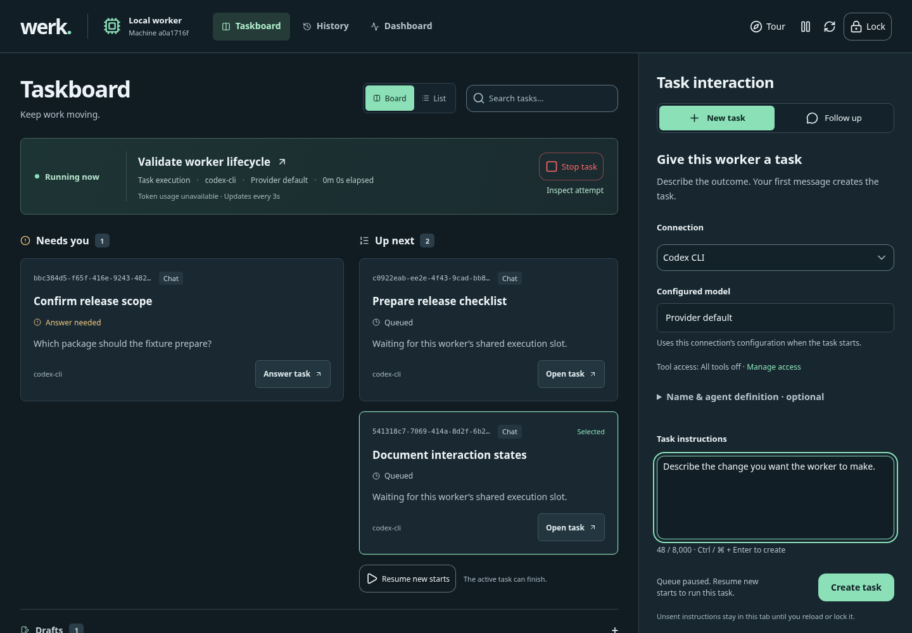 | 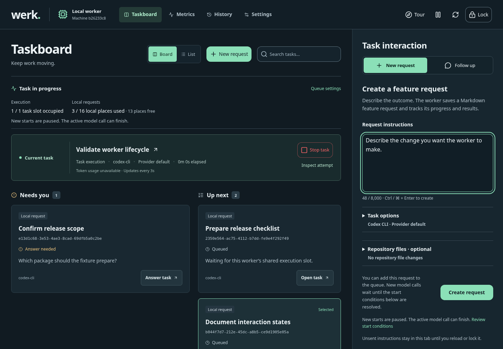 |
| 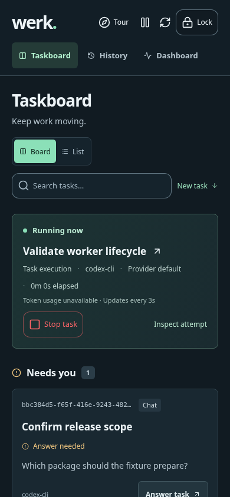 | 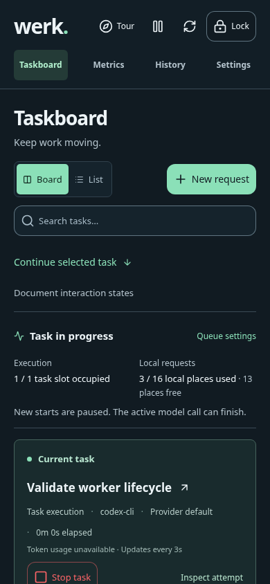 |

On desktop, the instructions field is now near the top of the interaction column. Mobile still stacks the queue and composer; the New request and Continue selected task controls provide direct focus and scroll navigation. This is not a claim that the entire mobile taskboard became shorter.

### Monitoring and configuration

| Before: combined dashboard | After: Metrics |
| --- | --- |
| 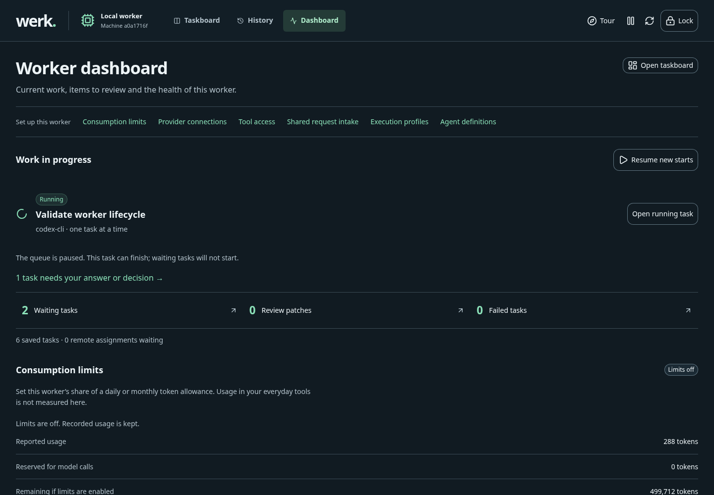 | 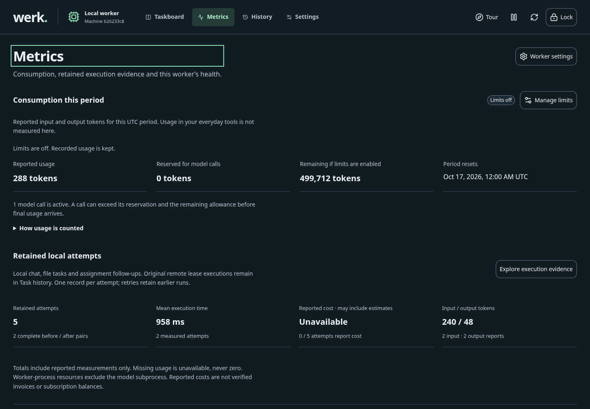 |
| 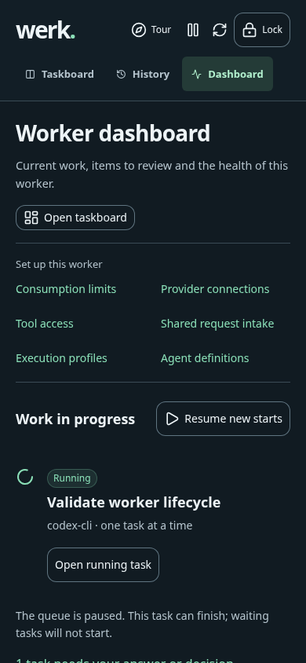 | 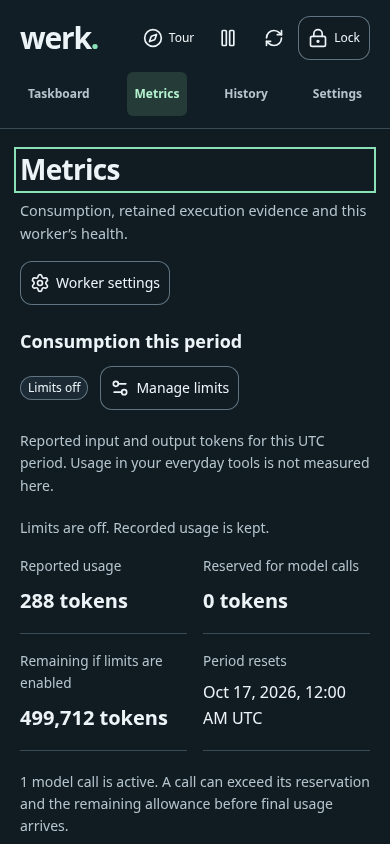 |

With equivalent fixture tasks, the first implementation capture measured Metrics at 2,214 pixels on desktop and 3,485 on mobile, down from the combined dashboard's 3,699 and 5,151. Configuration moved into dedicated sections rather than being removed.

| Providers and accounts | Queue settings on mobile |
| --- | --- |
| 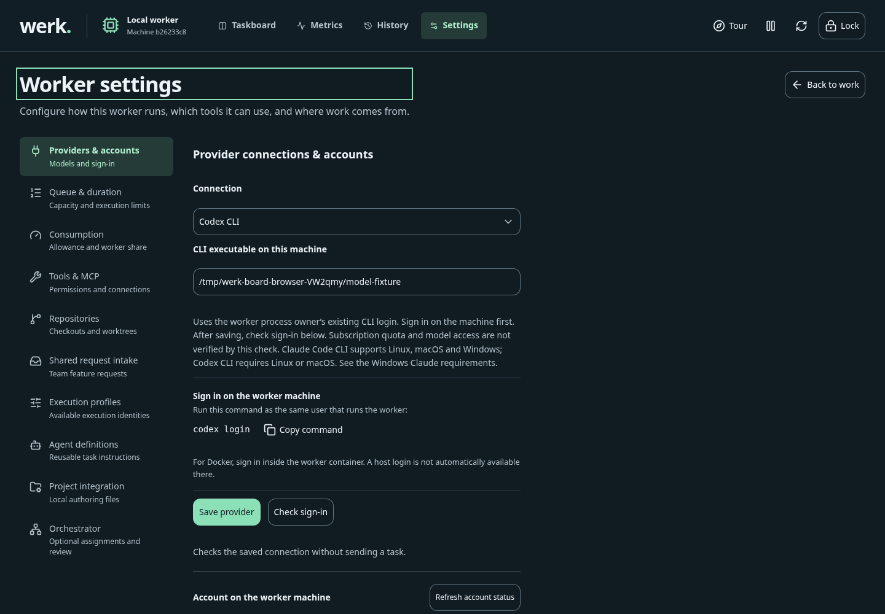 | 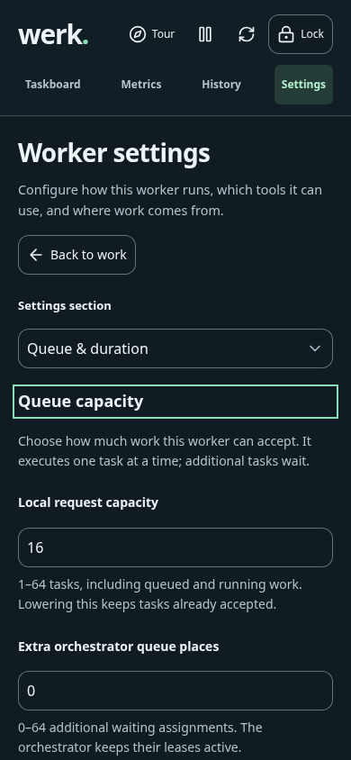 |

### Readable request record

| Desktop interaction column | Mobile |
| --- | --- |
| 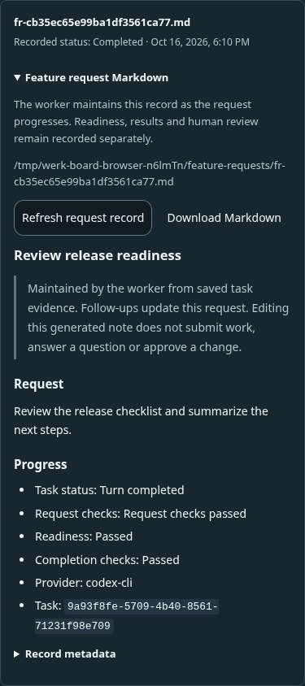 | 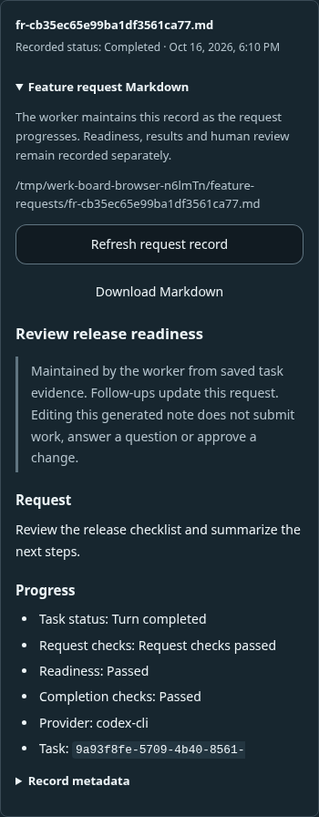 |

The readable body stays open across background updates. Obsidian frontmatter remains available in Record metadata, and Download Markdown returns the exact saved file.

## Qualification

The first postimplementation browser batch contained 32 screenshots and 47 layout observations. Five polling samples lasted 11.2 seconds each, sampled buttons every 40 ms, and delayed API responses by 300 ms. Each observed four main refresh cycles: no button text, icon, width, disabled-state or busy-state changes occurred on Taskboard, Metrics, Providers, the selected conversation or Project integration.

The review measured 776 text/background contrast pairs across twelve desktop/mobile views with no failures; the lowest included ratio was 5.10:1. Disabled controls, gradients and opacity-composited text were excluded. No horizontal overflow was found at 320, 390, 720, 900 or 1440 pixels. A 720-pixel viewport tests reflow comparable to 200% at 1440 pixels, not every browser's zoom implementation.

One combined polish batch fixed missing Settings icons, narrow header controls, the short Back to work link and search field, and absent spacing between queue and duration settings. The second confirmation verified all ten icons, 44-pixel primary control targets and 32-pixel section spacing. Image inspection also caught an open-note refresh regression that dimension and button tests had missed: replacing an unchanged session object cleared its loaded Markdown. The rebuilt browser regression verified the expanded body remained visible and nonempty through four delayed session snapshots, while metadata stayed collapsed. The affected desktop and mobile images were inspected, with no mobile overflow or browser errors.

The real-worker browser journey covers authenticated access, exact request creation, questions and follow-ups, guarded configuration, queue capacity, file permissions, patch review, lock/restart and exact Markdown download. Eleven legacy settings anchors and old chat/monitoring routes retain their destinations. Fixture Markdown with bold text, lists and code renders normally; a literal SVG payload remains inert.

Cross-platform CI exposed noncanonical macOS temporary paths in the new fixtures and a synthetic dropdown click in the file-request story. The fixtures now use canonical roots; the story uses realistic pointer events and explicitly verifies the chosen repository. All forty Worker Workspace stories passed at desktop and mobile sizes in the focused confirmation. Windows fixture corrections normalize line endings before compiling UI snippets and use bounded hashed worktree directories while retaining full request identity assertions. A packaged-startup regression also reproduced unavailable Markdown when an explicit state path had an aliased parent. Portable startup now resolves that parent at the CLI boundary; symlinked state directories and managed tracking children remain refused. Dedicated tests cover saved notes, restart, and both refusal cases.

The integrated `npm run check` passed TypeScript/Vue checks and 1563 tests (1574 total, 11 platform/environment skips, zero failures). The subsequent Windows fixture corrections passed all twenty-three focused checks, including two additional CRLF regressions. The separate real-worker browser smoke passed thirteen journeys with twenty-four screenshots and no JavaScript errors. Focused regressions cover note persistence, exact request replay, tracking storage faults, changed-worktree preservation, deleted-history/restart restrictions, settings conflicts and stable polling controls. Dependency audit reported zero vulnerabilities; generated workflow drift, changelog validation, and the strict documentation vault check passed.

The release pull request separately runs the native Linux/Windows/macOS, Docker, Ubuntu VM and Storybook qualification workflows. Those CI results and commit identities are available from its checks; the local fixture evidence above does not substitute for them.

## Limits

Automated interaction checks and measured contrast samples are not a complete assistive-technology or WCAG audit. No claims are made about live provider inference, personal subscription allowance, or feature quality based on the protocol fixture. Generated local progress files do not imply a Git push; shared-intake publication keeps its existing explicit status and retry contract.
