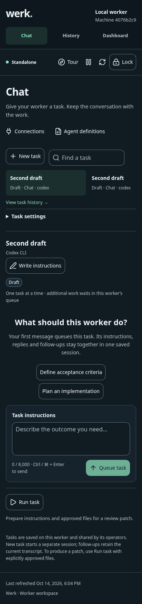
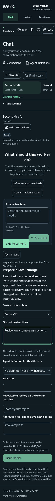
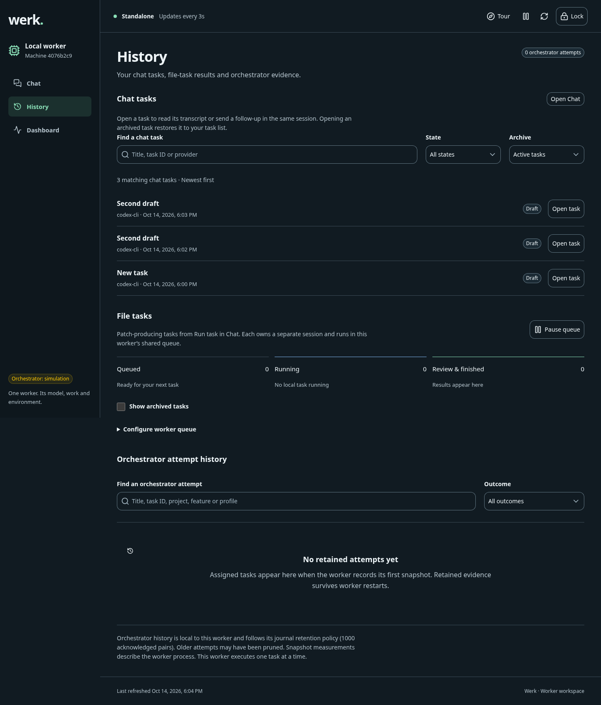
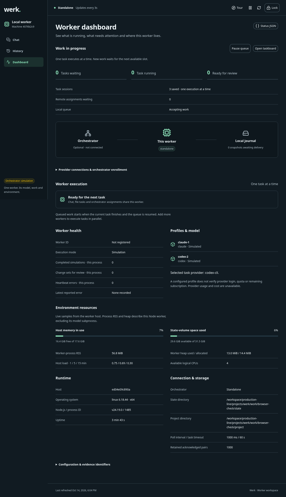

# Werk worker review and improvement pass

14 October 2026

The worker now provides a safer file-task handoff, clearer queue controls, searchable task history, resilient live updates and reliable session deletion. Four subagents covered external research, product workflows, application reliability and browser verification. The existing Vue/Nuxt UI implementation, slate/mint identity, three-page navigation and one-task execution contract are preserved.

## Product review and implemented changes

| Perspective | Finding | Improvement |
| --- | --- | --- |
| Task usability | Run task submitted the mutable Chat draft and selected Chat provider; switching tasks could silently change approved work. | Dedicated file instructions and provider selection remain stable across task switching. Submission captures a fixed payload and leaves Chat’s draft intact. |
| Failure recovery | File-task errors appeared above the editor in the Chat composer. | Local error feedback, retained inputs, pending controls and duplicate-submit guards. |
| Model compatibility | File-task definition selection lacked the new-task provider mismatch guard. | Provider/model mismatch and omitted-feature adaptation block invalid submission. |
| Queue clarity | Dashboard claimed readiness while paused; activity followed the connection diagram. | Activity comes first, with Pause queue and Resume queue controls. Paused execution receives explicit waiting-state copy. History uses matching queue terminology. |
| Information architecture | Chat history lacked search/filter controls; archived opening silently restored tasks. | Title, task ID and provider search; state/archive filters; newest-first ordering; explicit Restore and open action. Orchestrator search is separately named. |
| Task ownership | Rail did not distinguish chat, file or assigned tasks. | Task-kind labels, title/ID search, and distinct empty-list and no-match feedback. |
| Connection trust | Checking a saved connection could contradict unsaved visible settings. | Checks are blocked until edits are saved. Results show provider and check time. No quota or execution claim is added. |
| Accessibility | Dynamic conversation updates and mobile entry needed clearer affordances. | Conversation log announcements, contextual follow-up guidance, accessible errors and a mobile Write instructions action that focuses the composer. |
| Responsive layout | Several mobile tasks expanded the task rail and the entire page beyond the viewport. | Grid-child width containment keeps the rail scroll within the page at 320px and 390px. Empty Chat spacing is more compact. |
| Data integrity | A failed session-index deletion could restore a task after its transcript was erased. | Commit the index before destructive transcript cleanup. Failed index writes preserve history and selection. |
| Resource bounds | Deleted sessions and failed creations retained cached conversation instances. | Close and evict those instances. |
| Admission reliability | Concurrent same-ID feature submissions could both pass the initial idempotency check. | Recheck ID and input hash inside the serialized write. Matching input deduplicates; conflicting input rejects. |
| Freshness | One failed read discarded all eight successful refresh results. | Adopt successful resources independently; retain and flag failed-resource data. Generation checks prevent late private responses from restoring expired access. |
| Destructive actions | File-task deletion lacked a clear cancellation action. | Keep task reverses the confirmation; queued cancellation and running stop use distinct labels. |

File-editor drafts remain private tab memory. Expiry retains them; explicit Lock clears them. Reloading cannot recover unsent drafts. Instructions-only definitions remain inert, and patches still require human review.

## Reviewed flow and health

1. **Unlock and navigation — healthy in tested states.** Saved browser access and authenticated page navigation work. Expiry hides private work; Lock clears unsent inputs.
2. **Chat and task selection — improved.** Multiple tasks scroll within the rail, ownership is visible, and mobile instruction entry focuses the correct field.
3. **Provider settings — improved with limits.** Checks now refer to saved visible settings. Actual provider sign-in was not exercised.
4. **File-task preparation — improved.** Independent instructions/provider, compatibility checks, local errors and pending guards behave correctly. No live task was submitted.
5. **History and review access — improved.** Chat search and archive controls work; existing patch inspection/download remains available. Live patch production was not exercised.
6. **Dashboard and queue pause — healthy in tested states.** Work appears before topology, pause controls accurately reflect worker-wide queue state, and technical details remain secondary.
7. **Failure recovery — covered by regression tests.** Failed metadata writes preserve transcripts; concurrent admission deduplicates; partial refresh and expired-access races retain the correct state.

## Research sources and design implications

- [Nielsen usability heuristics](https://www.nngroup.com/articles/ten-usability-heuristics/) support visible system state, recoverable actions and progressive disclosure.
- [Codex follow-up behavior](https://help.openai.com/en/articles/11369540-using-codex-with-your-chatgpt-plan) provides a comparison for task continuity. Werk continues to require a running task to finish before sending its follow-up.
- [Codex code review](https://learn.chatgpt.com/docs/code-review?surface=app) and [Claude web session review](https://code.claude.com/docs/en/claude-code-on-the-web) inform task-linked change review. Werk’s review state remains distinct from acceptance or merge.
- [W3C status messages](https://www.w3.org/WAI/WCAG22/Understanding/status-messages.html), [reflow](https://www.w3.org/WAI/WCAG22/Understanding/reflow.html) and [target size](https://www.w3.org/WAI/WCAG22/Understanding/target-size-minimum.html) inform feedback and responsive checks.
- [Microsoft human–AI interaction guidelines](https://www.microsoft.com/en-us/research/publication/guidelines-for-human-ai-interaction/) inform explicit capabilities, limitations and operator control.

These sources inform recommendations; browser findings above come from fresh local captures.

## Validation

- `npm run typecheck`: passed.
- `npm test`: 594 discovered, 593 passed, one skipped, zero failed.
- Final focused behavioral suites: 12 passed, zero failed. These include three new file-editor tests, two refresh tests, three persistence/admission tests and four existing serial-execution checks.
- Final production build: passed. Vite still reports a JavaScript chunk above 500 kB; route splitting remains a performance opportunity.
- Desktop 1440px and mobile 390px/320px: no document overflow or browser page errors on Chat, History and Dashboard. Expanded file editor also fits 320px.
- Browser checks: task switching, file-editor independence, expiry retention, explicit Lock clearing, history no-match, queue pause and mobile composer focus passed without provider execution.
- `git diff --check`: passed. Strict vault check passed.

The full suite preceded the final CSS containment correction. The final build and browser confirmation cover that correction. New focused tests were run separately after integration.

## Remaining opportunities and limits

Mobile History and Dashboard remain long; compact standalone orchestrator empty states could improve scanning. Consolidating new-task configuration and first-message submission would reduce draft-session clutter but changes the creation flow and was deferred. Large transcript performance, exhaustive screen-reader behavior, full contrast compliance, additional browsers, live Claude/Codex/API authentication, billing, execution, Docker and production deployment were not qualified by this pass.

Deletion cleanup failure can leave an unindexed transcript in the private state directory. Deleted sessions cannot retrieve it through the API; a future cleanup mechanism could remove these remnants.

## Final screenshots

### Chat on mobile

### File editor at 320px

### History on desktop

### Dashboard on desktop

