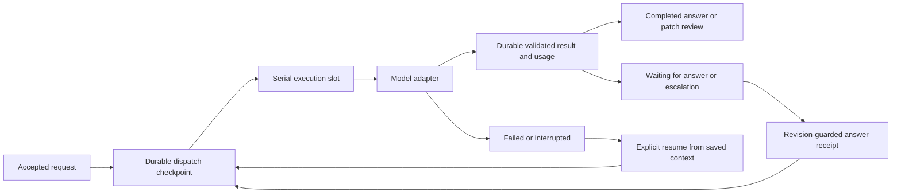

# Worker–model interaction research and implementation direction

Reviewed 2026-10-14, before implementation. This is a dated research record, not a
claim that every provider capability below is exposed by Werk. Six subagents
reviewed provider protocols, durable execution, request ownership, automation and
browser journeys. Research used primary documentation and current source; model
execution qualification uses labelled fixtures, not paid provider calls.

## Findings in the existing worker

The worker already preserved accepted Markdown input, serial execution, approved
file snapshots and numeric before/after evidence. Its local model port returned
one string plus usage. That string could not distinguish an answer, a question,
an escalation or an incomplete response. Plain questions looked like completion;
patch-mode questions failed patch validation. The rendered prompt was assembled
in several adapters and was not independently retained.

The run journal and transcript also had separate completion writes. A crash after
receiving a response but before writing its transcript could leave a successful
numeric record beside an interrupted conversation. Answers and resume actions
had no stable command receipt. Restarting a provider process would therefore risk
repeating an ambiguous invocation.

## Provider capability research

| Surface | Official capability | Consequence for this iteration |
| --- | --- | --- |
| OpenAI Responses | Strict JSON Schema output, typed SSE events, refusals and incomplete responses | Normalize a bounded versioned result and safe failure categories; never accept partial JSON as a patch |
| OpenAI state | Manual context, previous response IDs and server Conversations have different retention/continuation semantics | Preserve synchronous store:false and worker-owned context; do not imply a provider session is restored |
| OpenAI cancellation | Background responses have explicit cancellation; local fetch abort is a different operation | Record local interruption honestly; no automatic costly retry after an ambiguous response |
| Codex CLI | JSONL lifecycle/usage and structured final output; persistent sessions can be resumed | Existing --ephemeral invocations provide no persistent native session; expose worker context replay |
| Codex SDK/app-server | Thread lifecycle, interrupt/resume, notifications and capability-dependent questions | A future adapter option, not a reason to enlarge the current tool/persistence permissions |
| Claude headless/SDK | Structured output, native session resume and user-input callbacks exist in their respective modes | Keep current no-session-persistence/no-tools restrictions; questions use the worker's validated protocol |
| Claude usage | Reported USD is a client-side estimate, and resumed-session totals can include earlier spend | Mark cost basis and invocation scope; never claim invoice cost or sum a cumulative total repeatedly |
| Anthropic Messages | Explicit stop reasons, tool requests and stateless context continuation | Treat incomplete/refused/unsupported output distinctly and preserve compatible context without adding tools |

Official sources:

- [OpenAI structured outputs](https://developers.openai.com/api/docs/guides/structured-outputs)
  explains schema guarantees and the separate refusal/incomplete cases.
- [OpenAI conversation state](https://developers.openai.com/api/docs/guides/conversation-state)
  describes manual context, response chaining and Conversations; prior context can
  remain billable when a response chain is used.
- [OpenAI background mode](https://developers.openai.com/api/docs/guides/background)
  documents background polling, cancellation and retention differences. Aborting
  a synchronous HTTP call is not proof of confirmed remote cancellation.
- [OpenAI streaming](https://developers.openai.com/api/docs/guides/streaming-responses)
  distinguishes incremental data from terminal completion. The first Werk adapter
  contract need not claim streaming if it buffers until a terminal response.
- [OpenAI function calling](https://developers.openai.com/api/docs/guides/function-calling)
  makes the application responsible for tool execution. This iteration does not
  add command, browsing or arbitrary filesystem tools.
- [Codex non-interactive mode](https://learn.chatgpt.com/docs/non-interactive-mode),
  [Codex app-server](https://learn.chatgpt.com/docs/app-server) and the
  [official TypeScript SDK](https://github.com/openai/codex/blob/main/sdk/typescript/README.md)
  describe distinct integration choices. App-server and SDK native session support
  is not evidence that Werk's ephemeral CLI wrapper exposes it.
- [OpenAI SDK configuration](https://github.com/openai/openai-node/blob/main/docs/configuration.md)
  documents default retries/timeouts. Werk must not unknowingly multiply SDK,
  transport and application retries.
- [OpenAI API overview](https://developers.openai.com/api/reference/overview)
  documents request correlation. A client request ID is not a documented guarantee
  of deduplicated model execution.
- [OpenAI usage and costs](https://help.openai.com/en/articles/10478918-reviewing-api-usage-and-costs)
  separates token usage from organization cost reporting.
- [Claude headless](https://code.claude.com/docs/en/headless) and
  [Claude cost tracking](https://code.claude.com/docs/en/agent-sdk/cost-tracking)
  explain cost estimates and resumed-session accounting.
- [Claude CLI reference](https://code.claude.com/docs/en/cli-reference) documents
  the current restriction flags. `--restricted` requires Claude Code 2.1.248 or
  newer; built-in tool restrictions alone do not disable MCP. Installed versions
  must fail closed rather than silently dropping restrictions. Managed policy
  hooks can still apply.

- [Anthropic structured outputs](https://platform.claude.com/docs/en/build-with-claude/structured-outputs),
  [stop reasons](https://platform.claude.com/docs/en/build-with-claude/handling-stop-reasons)
  and [streaming](https://platform.claude.com/docs/en/build-with-claude/streaming)
  distinguish valid terminal output, refusal, truncation, server-tool continuation
  and cumulative usage. A server pause is not a human question.
- [Claude user input](https://code.claude.com/docs/en/agent-sdk/user-input) and
  [session management](https://code.claude.com/docs/en/agent-sdk/sessions)
  require their own callbacks and persisted session state. A stateless wrapper
  cannot claim those capabilities by returning a question-shaped string.

## Durable interaction patterns

[LangGraph interrupts](https://docs.langchain.com/oss/python/langgraph/interrupts)
bind resume values to persisted thread/interrupt identities and warn that resumed
nodes can repeat work before the interruption.
[Checkpointers](https://docs.langchain.com/oss/python/langgraph/checkpointers)
show why completed outputs should be durably recorded before downstream work.
For Werk, the implication is an accepted result checkpoint and a stable answer
receipt, not a dependency on a graph engine.

[Temporal approval patterns](https://docs.temporal.io/design-patterns/approval)
and [message passing](https://docs.temporal.io/encyclopedia/workflow-message-passing)
distinguish reads from validated state-changing updates. An answer needs an
accepted/rejected outcome, duplicate protection and an audit trail.
[Workflow execution](https://docs.temporal.io/workflow-execution) and
[activity execution](https://docs.temporal.io/activity-execution) distinguish a
durable workflow from potentially repeated external operations.

[ACP session setup](https://agentclientprotocol.com/protocol/v1/session-setup),
[prompt turns](https://agentclientprotocol.com/protocol/v1/prompt-turn) and
[elicitation](https://agentclientprotocol.com/protocol/v1/elicitation) provide useful
patterns for capability negotiation, typed termination and structured questions.
They do not make Werk ACP-compatible. Specifications and experimental provider
features can evolve; Werk needs a small versioned contract it actually tests.

[AWS callback tasks](https://docs.aws.amazon.com/step-functions/latest/dg/connect-to-resource.html)
illustrate binding human responses to an active attempt-specific token. Werk uses
question identity and revision guards to prevent answering an obsolete question.

## Chosen design and constraints

The worker owns the accepted request, immutable semantic dispatch, validated
result, question and continuation intent. The adapter owns provider translation,
bounded response parsing, capabilities and safe error/usage normalization.
Credentials are resolved privately at execution and are excluded from saved
prompts, public status and numeric metrics. A semantic dispatch is not claimed to
be a byte-for-byte HTTP request including authentication headers.

The result protocol has a completed response or one structured blocking question
per invocation. A question can request clarification or escalation; the worker
assigns its stable identity. Free-form punctuation is not a reliable signal.
Malformed protocol envelopes fail rather than acquiring permissions or producing
an accepted patch. Waiting releases the single model-execution slot.

Answer/resume commands carry a target identity, expected revision and operation
key. A repeated identical command returns its accepted result; conflicting reuse
or stale state is rejected. Worker admission can be deduplicated. Provider
execution cannot be promised exactly once after a crash without provider-native
idempotency or retrieval. Unknown in-flight work remains explicitly interrupted
and requires a deliberate new invocation.

Continuation uses `worker_context_replay`: the saved request and successful
context, plus the operator's answer or continuation message. It does not restore
hidden reasoning, a cancelled subprocess, remote tools or a provider's internal
stack. Accepted model output is reconciled from its checkpoint after a projection
failure rather than requested again. Existing orchestrator leases and remote
execution ownership remain separate.

Question projections belong in worker-owned request metadata or companion files,
not the accepted Markdown body. Editing the request after acceptance continues
to flag changed input; it cannot silently replace the prompt under execution.
Numeric evidence stays content-free and counts each invocation once, including
questioning and failed attempts with reported usage. Unknown values stay null.

## Acceptance and verification focus

- Save dispatch before any model invocation; preserve its provider/model/policy
  identity across later settings changes.
- Persist a question and its usage before exposing waiting state; restart and
  answer without repeating the questioning call.
- Prove duplicate answer/resume, stale revision, conflicting operation key,
  cancellation race and failed persistence behavior.
- Recover a stored result without another model call; preserve observed usage
  on an interrupted invocation without inventing its execution endpoint.
- Keep original approved-file snapshots and explicit patch review on continuation.
- Expose the same guarded operations in CLI and UI, with draft/focus preservation,
  truthful capability labels and private checkpoint access.
- Rebuild and test all applications, then qualify the extracted runtime with
  deterministic provider fixtures. Screenshots establish UI evidence, not live
  provider billing, model quality or native provider-session recovery.

## Subscription and event follow-up

The dedicated [subscription integration research](worker-subscription-research.md)
compares current operator-authenticated CLI adapters with SDK, app-server and
registered plan-backed integration paths. The maintained
[interaction contract](../reference/model-interaction.md) defines the implemented
request/result/capability boundary and durable event replay API.
