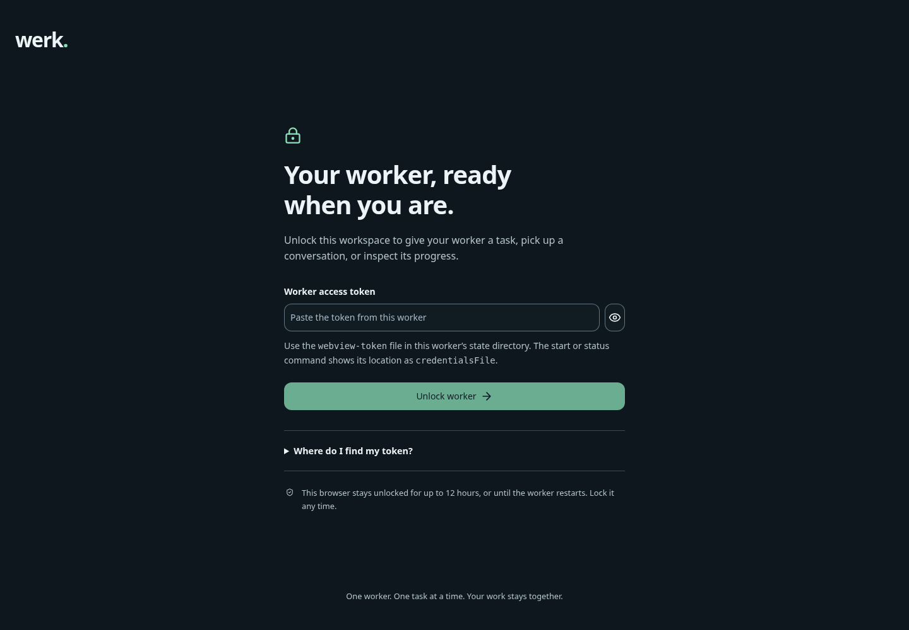
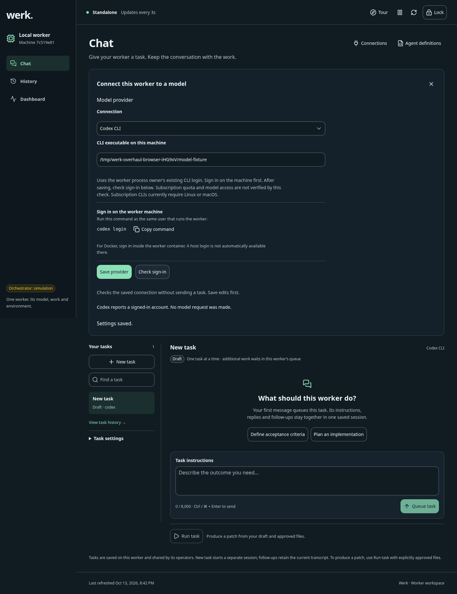
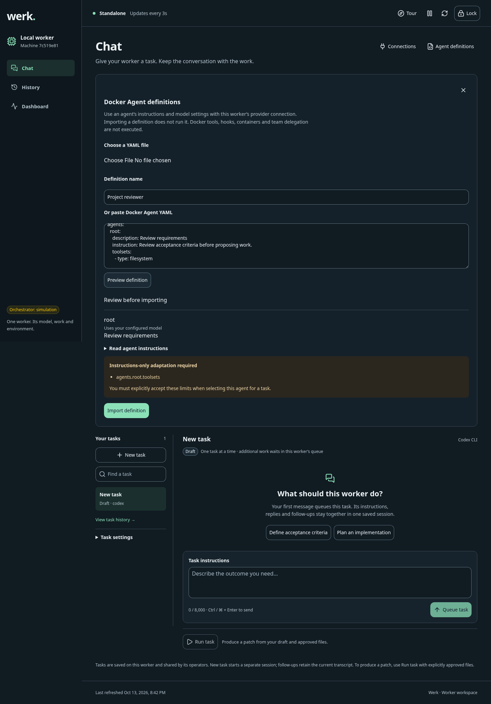
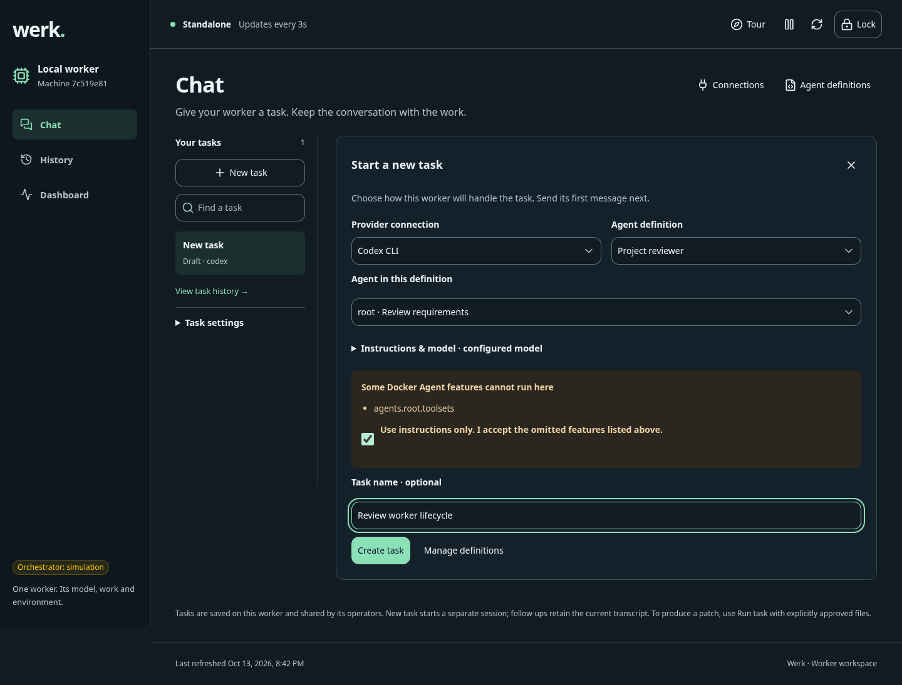
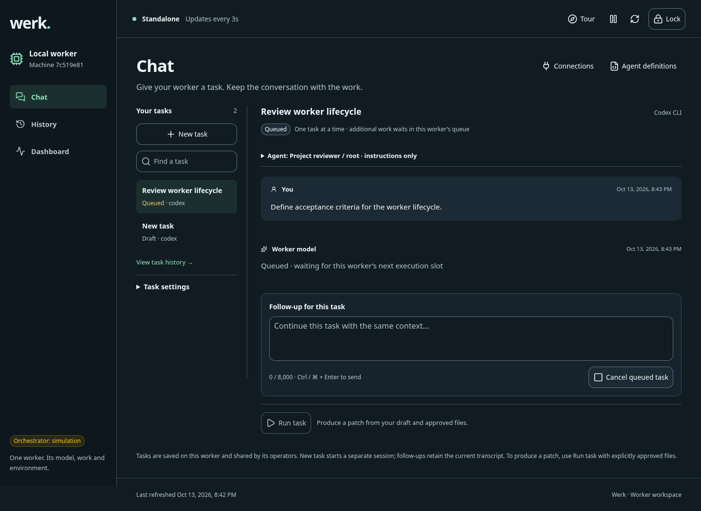
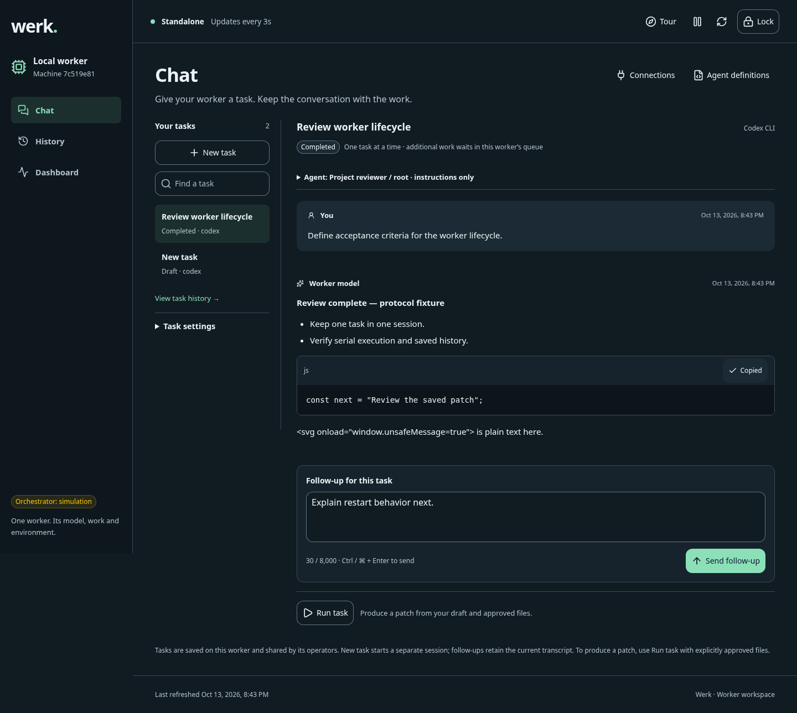

# Worker access, task chat and agent definitions review

Date: 2026-10-13. PR5 worker improvement pass, following the consolidated portable-app implementation. This report records actual research, implementation, independent review and local qualification; it is not a live-provider certification.

## Result

The worker now opens to a dedicated unlock screen, retains a bounded browser session across reloads, and provides task-focused Chat with readable replies, code copying, task navigation and explicit provider setup. A worker can import Docker Agent YAML, preview its compatibility and select an agent's instructions and compatible model for a new chat or file task. Portable CLI clients can perform the same definition and provider-check operations.

Docker Agent support is **instruction-profile compatibility**. It does not execute Docker Agent's native runtime, toolsets, hooks, external agents, harnesses or delegation. Unsupported fields are listed and require explicit instructions-only acceptance before task creation. Import does not run code, expand environment variables or fetch remote resources. See the [complete contract](../reference/agent-definitions.md).

## Research and independent perspectives

The [product research report](worker-product-research.md) contains dated primary-source links and a 21-row priority matrix. Separate subagents researched Docker Agent and worker product needs, implemented definitions, implemented access/provider checks, rebuilt the frontend, reviewed security and operations, documented the design, and performed a fresh visual finish review.

| Perspective | Findings applied |
| --- | --- |
| First-time user | Separate worker unlock from model account authentication; provide concrete token location and provider login instructions. |
| Daily task author | Chat stays first; task rail/search, new-task editor, selected task state, readable messages and follow-up drafting reduce repeated setup. |
| Operator | Queued, running and completed states retain one serial worker execution slot; restart recovery and saved history remain explicit. |
| Model/provider integration | Executable discovery does not prove sign-in. Bounded CLI authentication checks make no model request; API checks only confirm configuration. |
| Docker Agent ecosystem | Treat definitions as potentially executable configuration; preview an honest supported subset and freeze the chosen profile on each task. |
| Developer, CI and AI client | Portable `definition list/preview/import/delete` and `provider check` commands accompany the task API. Idempotent task replay preserves its original definition even after library deletion. |
| Security/privacy | Independent HttpOnly browser credentials, same-origin mutation checks, bounded YAML parsing, escaped replies and private durable settings. |
| Accessibility/responsive design | Labelled fields, pasteable/revealable token, named controls, visible focus, status messages, reduced motion, desktop/tablet/mobile Chat layouts. |
| Support and recovery | Invalid access, expired sessions and provider checks have distinct messages; expiry preserves a tab's draft without resubmitting it. Explicit Lock clears drafts. |
| Release/maintenance | Bundle YAML with the independent worker and portable app; publish the compatibility reference with downloaded documentation. |

## Dedicated improvement and polishing pass

Security review found and resolved cookie-name collisions for workers sharing an internal Docker port, an incorrect positive match for Codex's “Not logged in” result, stale provider-check responses after configuration changes, and task replay depending on a deleted definition. Frontend review resolved stale YAML preview/import races and mismatched selected-session/transcript reads. The browser walkthrough caught and fixed an import confirmation that disappeared when its input-reset watcher ran.

Visual polishing made setup editors directly reachable from Chat, improved task identity and queue wording, retained drafts while work runs, contained code-block overflow and preserved navigation at narrow widths. Product and worker design documentation were updated from the final source.

A fresh reviewer inspected all twelve final captures and the relevant source and returned **SHIP — no material visual/UX fix required**. The Impeccable context launcher and requested finish-reference resources were unavailable; review used the existing product/design context and available polish/craft guidance. No automated design-detector result is claimed.

## Verification

- `npm run check`: TypeScript/Vue checks, all application builds and **569 tests: 568 passed, one platform skip, zero failures**.
- A final worker rebuild and `npm run typecheck` passed after the import-confirmation correction.
- The independent security reviewer reran the 22 access/provider/definition tests successfully, including actual HTTP cookies/Origin/bearer behavior, parser rejection, bounded subprocesses, provider payload fixtures, immutable snapshots and deleted-definition replay.
- The real built-worker [browser walkthrough](../evidence/worker-overhaul-browser.json) passed at 1440px, 900px and 390px widths. It exercised invalid-token recovery, unlock/reload, provider configuration and sign-in check, definition preview/import, required adaptation acceptance, task queueing, drafting while busy, escaped model HTML, code copy, same-session follow-up, History, Dashboard, Tour, worker restart/relock, transcript/draft recovery and explicit Lock. Twelve captures had no document-level horizontal overflow and no page errors.
- The retained [browser qualification script](../../tests/worker/webview-smoke.mjs) was rerun successfully from its repository location; setup is documented in [the test guide](../../tests/README.md#worker-access-and-task-chat-browser-qualification).
- Portable-app integration tests copied the independent apps into a separate project and verified definition import/list, configuration-only provider check, profile-bearing tasks and persistence across restart. No npm/source checkout is needed by those copies.
- Both archive formats packaged and extracted with manifest verification. Extracted native lifecycle smoke passed with persisted task evidence and worker identity.
- Extracted Docker lifecycle smoke passed without host Node in the wrapper PATH: repeated setup, healthy services, simulated task persistence, stable worker identity across restart and no credential output.
- Extracted whole-system smoke passed with one Factory service, two logical factories, two production lines, three workers and two isolated simulated tasks. Restart preservation, read-only planning, drift rejection and automatic upgrade selection passed using actual packaged candidate bytes with fixture GitHub transport.

Strict documentation validation passed with zero errors/warnings; generated CI workflows were in sync and whitespace checks passed.

The source suite was run before the final UI-only confirmation correction; the corrected UI was rebuilt, typechecked and exercised in the complete browser pass. Documentation/evidence additions do not change runtime behavior.

## Screenshot walkthrough

These are actual built-worker captures, not mockups. The model reply is explicitly labelled a protocol fixture. No real provider account was used.

### 1. Unlock the worker

One access task with local credential guidance; model authentication is explained separately.

[Mobile unlock](../evidence/worker-overhaul-login-mobile.png)

### 2. Connect a provider and inspect sign-in

Save the connection and run a bounded authentication-status check without a model prompt.

### 3. Preview a Docker Agent definition

Review the imported agents and omitted capabilities before saving the definition.

### 4. Choose an agent for a task

The task editor pairs a provider with the selected definition. Unsupported behavior requires an explicit acknowledgement.

### 5. Observe queued work

A paused worker retains accepted work and offers cancellation. The composer remains available for drafting.

### 6. Read the result and continue the same task

Task identity, selected agent, readable output, code copying and the follow-up composer remain together.

[Tablet Chat](../evidence/worker-overhaul-chat-tablet.png) · [Mobile Chat](../evidence/worker-overhaul-chat-mobile.png)

### 7. Inspect history, environment and guidance

[Task history](../evidence/worker-overhaul-history-desktop.png) · [Worker Dashboard](../evidence/worker-overhaul-dashboard-desktop.png) · [Guided tour](../evidence/worker-overhaul-tour-desktop.png)

## Qualification limits

Provider tests use protocol fixtures; authenticated subscription/API inference, provider quota and billing are not qualified. Native Docker Agent execution is not implemented. File tasks retain approved-input, review-patch behavior: they do not apply changes or run repository tests. Cookie names prevent worker collisions but do not create security isolation between services on the same hostname. Visual review is not an exhaustive screen-reader, contrast or accessibility certification; the browser exercise covered mobile login/Chat and desktop ancillary views.
