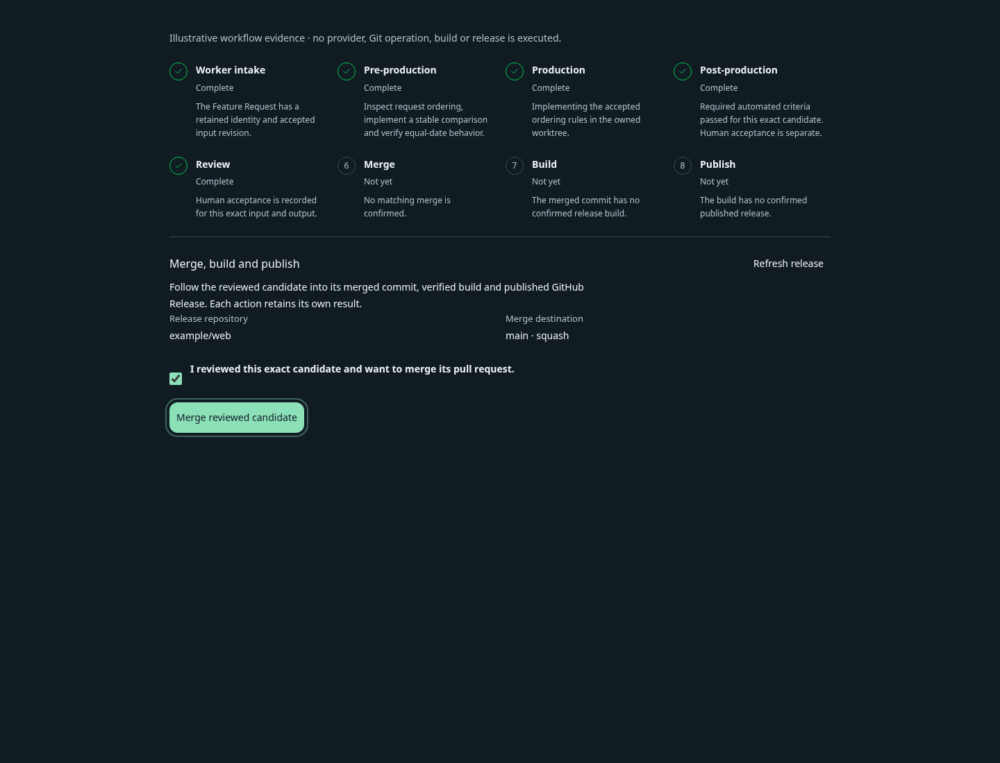
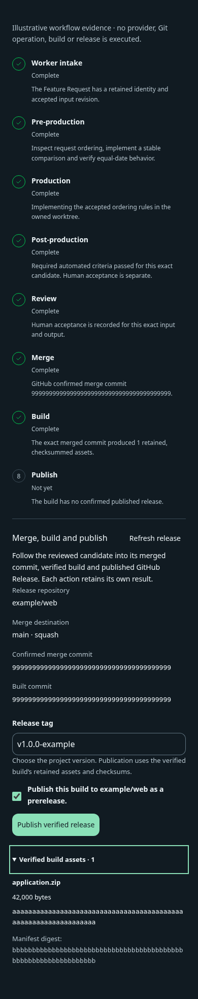
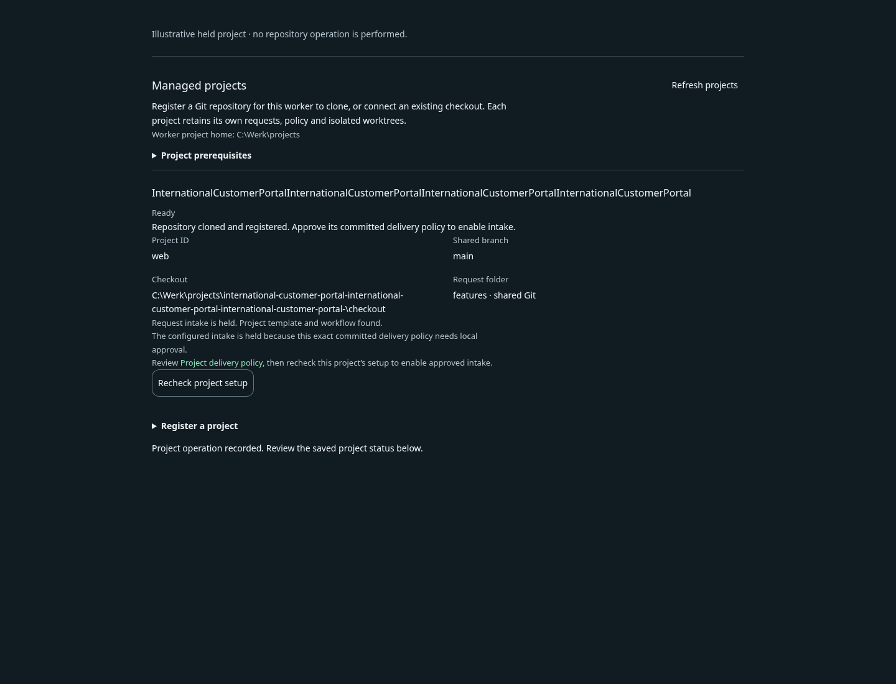
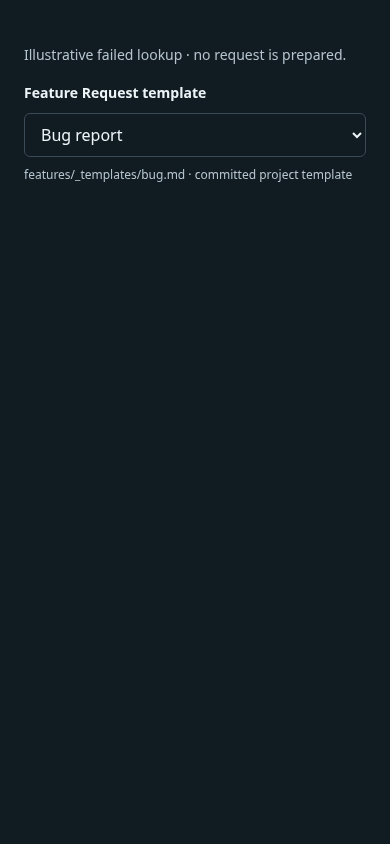
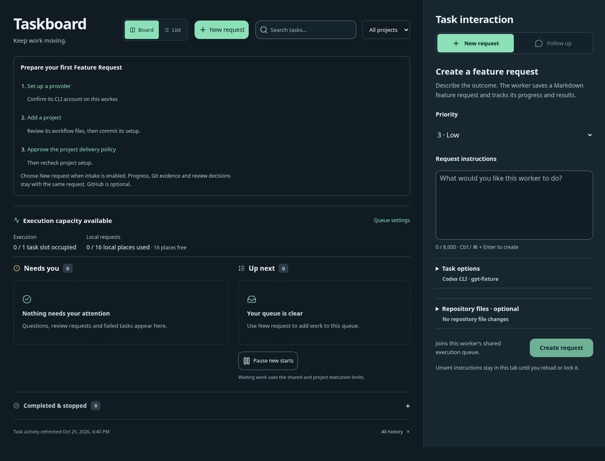
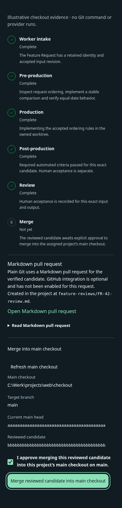
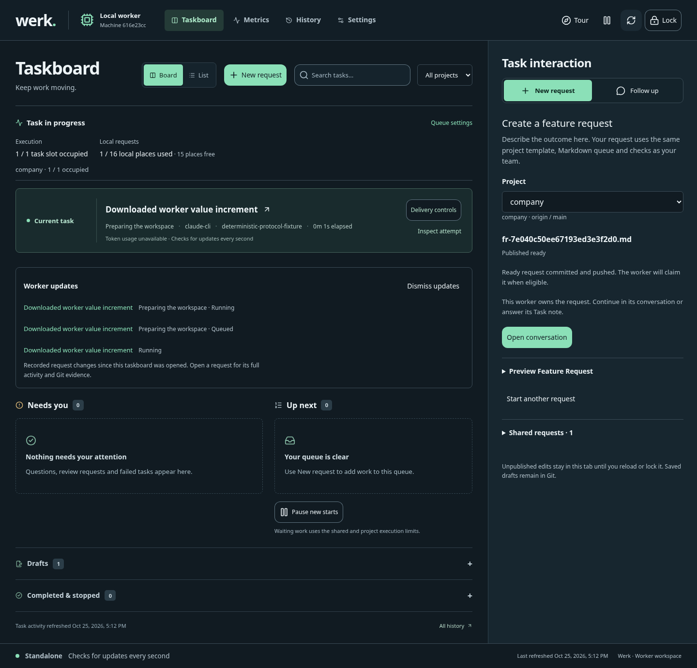
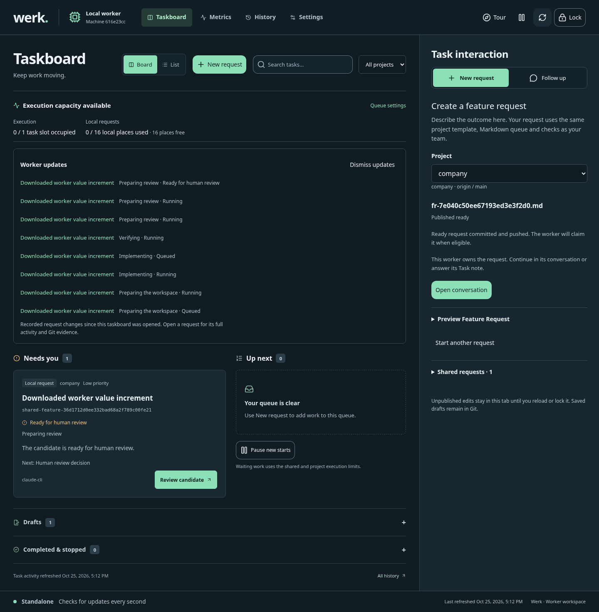

# Worker release workflow acceptance ledger

Date: 2026-10-25. Scope: the standalone worker's Git/Markdown delivery workflow and explicitly enabled optional GitHub extension added to PR #53's domain/process concept. This ledger distinguishes the required acceptance target from evidence obtained during implementation. It is not a release approval.

## Primary archive-to-main-checkout journey

The required user journey is literal: obtain the release archive → extract into a dedicated worker home → start the worker → create the Feature Request in its webview → observe Kanban progress, Git commits/pushes, webview activity/notifications and updates to the same Feature Request → review the delivered increment → explicitly allow the worker to merge that exact increment into the displayed main checkout.

The main checkout is the selected project's assigned local repository path and configured/current target branch. The worker must display that destination and its current head; approval for another candidate, checkout or head does not transfer. A review handoff alone is not permission to mutate it. No GitHub integration is required for this journey.

| User-visible step | Required observation | Qualification for the new literal journey |
| --- | --- | --- |
| Archive and dedicated home | Version/hash-verified candidate archive extracts into a fresh worker home with no source build/npm step there | Passed the maintained full candidate-archive browser fixture: checksum-verified ZIP extracted into a fresh dedicated home, with no source checkout/npm/project init there |
| Start and open webview | Worker-specific startup reaches its local UI and preserves private home/configuration | Passed actual standalone worker startup and secure browser unlock from the verified archive, with visible first-use guide; standalone presentation is separately covered by nine responsive cases |
| Create Feature Request | Registered project/template/provider selection creates one canonical request from the webview | Passed actual archive/browser prepare, edit, readiness check and ready request commit/push before inference, after real managed setup and separate policy approval |
| Observe implementation | Persisted Kanban/request activity shows actual preparation, checks, Git commit/push observations and FR updates | Passed actual archive run with Taskboard progress and Worker updates, real MCP candidate edit/native committed check, Git commit/push and same-request status; Claude protocol inference is simulated |
| Review delivered increment | Current candidate, diff, quality reports and Markdown PullRequest handoff agree | Passed actual archive/browser review: complete published candidate tree and Markdown handoff, native check evidence, manual criteria and exact-candidate acceptance |
| Allow main-checkout merge | Explicit current-candidate decision identifies main checkout/path/branch/head, then a durable guarded plain-Git merge receipt confirms its result | Passed actual archive/browser explicit current-destination consent and clean resulting main checkout merge; additional real-Git/journal/status/Markdown suites cover stale, dirty, conflict, divergence and uncertain outcomes |
| Native Claude execution | Same packaged journey on native Windows with a real authenticated Claude Code CLI invocation | Pending; protocol fixtures do not qualify the account/platform |

A locally built candidate archive is not the currently public released binary. Qualify and identify the exact candidate artifact used. These implementation changes do not publish a release tag or establish that a download from the existing public release already contains them. Earlier completed tests below retain their original scope; do not relabel them as this new literal journey.

## Default Git/Markdown acceptance target

The primary workflow uses ordinary Git and a PullRequest Markdown handoff, followed by the user explicitly allowing the exact reviewed increment to merge into the displayed main checkout. It must work with both `remoteDelivery` and `release` absent, without invoking a GitHub API or requiring GitHub CLI. New web-generated workflow setup is required to commit `localMerge: true` and receive separate exact-policy approval; that policy keeps delivery in progress until the local merge is confirmed. Existing policies without the field retain their established completion semantics. A GitHub repository URL, installed `gh`, provider login or managed-project registration must not enable the integration implicitly.

Required real-Git fixtures cover request intake/claim, implementation branch and Markdown quality handoff, review feedback/reverification, retained identity and restart/replay safety. Provider protocol fixtures are suitable for this deterministic application boundary; they are not live Claude qualification.

## Selected optional live pilot

Native Windows, Claude Code CLI with a real authenticated account, a real project repository and build assets published to an explicitly configured and locally approved GitHub Release destination remain the selected optional live pilot. That extension retains one Feature Request through implementation, verification, human feedback, the same hosting-service PR, verified merge, exact-source build and publication. Its requirements do not make GitHub a prerequisite for the default Git/Markdown workflow.

## Evidence boundaries

| Boundary | Required evidence | Qualification state |
| --- | --- | --- |
| Default Git-only delivery and opt-in boundary | Real Git/Markdown handoff with integration sections absent; no implicit GitHub actions or prerequisite | Passed real plain-Git managed workflow and GitHub opt-in suites: no gh/HTTP calls without integration consent, actual branch/Markdown handoff and restart without redispatch, including the new web-setup readiness profile |
| Contracts and documentation | Process transitions, DoR/DoD, domain identities, guarded commands and recovery | Defined in the maintained workflow/reference and process notes |
| Managed projects | Real local Git clone/adopt, duplicate/restart/failed-clone handling and unchanged developer checkout | Passed real local Git clone/adopt, replay/recovery and approval-gated intake fixtures; managed/template regression group passed 49 tests |
| Intake and execution | Canonical IDs across interfaces, pinned dispatch, owned worktree, independent checks and bounded repair | Automated provider protocol fixtures prove application behavior only |
| Same-PR rework | Real bare-Git expected-head update/race tests and host protocol fixtures | Passed real bare-Git guarded branch updates and GitHub protocol/restart fixtures; not live GitHub permissions |
| Merge | Current-head acceptance, squash merge identity, conflicts/closed PR, lost acknowledgement/restart | Passed draft readiness, current-head/squash merge, race, replay and restart fixtures; not a live merge claim |
| Build | Exact merged source, successful/failed command, safe artifact inventory and digests | Passed exact-source real Git/process builds, source tampering, replace-ref and artifact-manifest recovery fixtures |
| Publish | Correct target/tag/assets, draft/partial/conflict, unknown outcome and retry | Passed draft/partial release, exact tag/asset digests, unknown outcome and conflict fixtures; not live publication |
| Integrated UI/CLI | Same persisted milestones, next action, stale/unknown blockers and guarded commands | Passed guarded CLI/Markdown/UI fixtures and 22 desktop/mobile browser checks; native and Docker extracted-archive smoke journeys passed |
| Native Windows + live Claude | Packaged runtime on Windows, real provider invocation, interruption/recovery | Pending; a Linux fixture does not satisfy this target |
| Live GitHub release | Same-PR feedback, actual reviewed merge, source-bound build and confirmed published asset digests | Pending; API fixtures do not satisfy this target |

Automated checks must report their actual commands/results in the implementation PR. Do not replace pending native/live rows with inferred success. A green source check or successful release packaging does not establish account permissions, provider availability or published application assets.

## Default Git/Markdown acceptance scenario

1. Configure a project with plain Git and a valid approved delivery policy omitting both integration sections.
2. From the extracted standalone worker webview, clone/register the project, preview/apply its workflow setup commit/push, separately approve the exact committed policy, recheck setup, then submit and inspect the same stable Feature Request.
3. Execute a bounded fixture/provider change in an isolated worktree, run independent checks, and inspect the implementation branch plus PullRequest Markdown quality handoff.
4. Request rework and verify retained request identity, fresh evidence and the shared Git feedback acknowledgement boundary.
5. Restart/replay during Git publication and confirm no duplicate dispatch or unrelated branch overwrite.
6. Confirm no GitHub CLI/API call or GitHub prerequisite was introduced. Review the increment, explicitly allow its guarded merge into the displayed main checkout, and verify the resulting Git receipt and worktree files. The handoff alone must not claim that merge/build/release happened.

## Functional finish, hardening and polish

After the literal journey works, qualify failure/recovery behavior and its user-facing clarity. Preserve application policy behind injected ports, infrastructure adapters at the edges and the existing worker/shared boundaries. Each component should have one clear responsibility, with focused tests for stale authority, dirty targets, non-fast-forward conflicts, lost acknowledgements, restart reconciliation and no duplicate dispatch/mutation.

Browser qualification must show actual persisted progress and the next action, responsive layout, keyboard/focus behavior, setup error recovery and exact-destination merge confirmation. Synthetic browser fixtures demonstrate rendering/interaction; real Git/filesystem/process fixtures demonstrate the corresponding local boundaries. Report these observations separately and retain native Windows/live Claude qualification until it actually runs.

## Optional GitHub end-to-end acceptance scenario

1. Install the packaged worker on Windows and authenticate Claude Code CLI, Git and GitHub CLI in its account.
2. Register a remote project and approve its committed template/check/build/release policy.
3. Submit a request from the webview and confirm the same stable identity in Markdown/CLI.
4. Have Claude implement a bounded change and exercise a failing independent check followed by repair.
5. Publish the verified candidate; request a change and confirm the next verified candidate updates the same PR and invalidates earlier acceptance.
6. Accept and merge the current candidate; capture the actual merged source identity.
7. Build that exact source, publish the expected assets to GitHub Releases, and verify source/tag, asset names, byte counts and digests.
8. Interrupt remote operations, restart and reconcile without duplicate requests, branch overwrite, duplicate PRs or duplicate releases.

Capture sanitized timestamps, runtime version/source, OS, provider version, request/run/candidate/PR/merge/build/release identities and the exact check outputs needed to substantiate each result. Never include credentials, private prompts or unredacted host logs.

## Backlog reconciliation

The worker feature tracks the default standalone Git/Markdown path and an explicit optional GitHub release extension. Its GitHub release PBIs and optional live pilot do not make a hosting-service API a default prerequisite. Older P0 items retain their imported line/orchestrator acceptance scope. Reusing their provider, publication or evidence components does not complete leased line publication, mixed-provider live qualification or Factory cost/quality coverage. Follow the [backlog](../backlog/Product%20Backlog.base) and [execution modes](../explanation/modes.md) for those boundaries.

## Documentation and packaging verification

The documentation pass ran these checks in the implementation checkout:

| Check | Observed result |
| --- | --- |
| `node bin/forge.js vault check --strict` with Werk selected | Passed; zero errors and zero warnings; informational orphan attachments remain separate |
| `node bin/forge.js backlog check` with Werk selected | Passed; 53 items, zero errors and zero warnings |
| `node scripts/release/changelog.mjs check` | Passed against the current 0.15.0 release entry and Unreleased changes |
| `node --test tests/operations/release-package.test.mjs tests/operations/release-changelog.test.mjs` | 44 tests passed; zero failed/skipped, including closed local links in the actual shipped documentation allowlist |

These observations verify documentation/backlog consistency and packaging behavior. They do not replace the integrated implementation tests or pending native/live acceptance rows above. Root workspace backlog validation selects `01 - Product Backlog.base` explicitly because the project also keeps its own scoped Base.

## Implementation qualification

Implementation PR: [#54](https://github.com/Luis85/production-line/pull/54), including the reconciled concept documentation from #53. Implementation PBIs 47–53 record completed component work; the broader literal archive journey is qualified separately in the table above. Live qualification PBI 54 remains open, and the parent release feature remains Active.

Focused checks included 32 release-engine regressions, 49 managed-project/template regressions, 58 shared-intake/feedback regressions, 15 latest-source release-projection/recovery regressions, and 22 composer regressions. These groups overlap existing regression suites and must not be added together as a unique test total. Full unified source and cross-platform CI results are recorded on the implementation PR.

[Browser qualification](../evidence/worker-e2e-release/browser-qualification.json) records 22 desktop/mobile checks with no page errors or overflow. Its screenshots use explicit synthetic project, provider and GitHub data; no live model or host mutation was performed.

The extracted native and Docker archives each completed the existing simulated runtime smoke, persisted evidence and restart checks. The Docker wrapper smoke ran without host Node on its wrapper PATH. These validate packaging and startup compatibility; they do not qualify a Windows Claude account or a worker-managed live release.

## Improvement and polish qualification

The follow-up pass on the same PR clarified project approval/activation holds, restricted setup retry to eligible incomplete clones, added in-place template-read recovery, validated release tags before submission and preserved unsaved build settings when toggling release configuration. Browser confirmation covered desktop, tablet and mobile: [36 checks passed](../evidence/worker-e2e-release/polish-qualification.json) with no page/console errors or horizontal overflow, including interrupted runs whose historical evidence must not complete downstream stages.

Backend regressions cover completed builds with missing assets as known failures, safe new-tag selection only after persisted preflight evidence proves publication never started, native executable discovery, and host directory aliases without permitting links inside private prompt storage. Git fixtures were also verified with `core.autocrlf=true`. These are automated contracts; the native/live acceptance rows remain pending.

## Primary journey hardening and responsive evidence

The Git-only consent boundary is exercised by [plain Git managed workflow](../../tests/worker/plain-git-managed-workflow.test.mjs) and [GitHub opt-in](../../tests/worker/github-opt-in.test.mjs) fixtures. The real managed workflow now follows both an existing configuration and newly generated web setup through required structured readiness, native candidate checks, actual branch/PullRequest Markdown publication and restart without redispatch. Its provider inference is explicitly simulated; Git and checks are real, and the fixture rejects gh/HTTP calls.

[Managed setup](../../tests/worker/managed-project-setup.test.mjs) exercises read-only preview, preserved custom files, stale/dirty/adopted-checkout refusal, exact prepared commit, push acknowledgement/restart, definite lease rejection, tracked aliases and bounded durable state. Publication does not grant execution authority: committed exact-policy approval and intake activation remain separate.

[Local Git merge](../../tests/worker/local-merge-git.test.mjs), [durable merge commands](../../tests/worker/local-merge-journal.test.mjs), [status composition](../../tests/worker/local-merge-status.test.mjs) and [canonical Markdown commands](../../tests/worker/local-merge-markdown.test.mjs) exercise explicit localMerge:true authorization, exact candidate/destination identity, clean checkout/index requirements, unchanged targets on conflict, retained intent/preparation, expected-head mutation and read-only lost-acknowledgement recovery. Candidate source/configuration changes outside the frozen workflow-metadata allowance require fresh verification; a technically conflict-free Git merge alone is not sufficient.

The implementation keeps policy orchestration behind injected ports, durable identity in the request journal, filesystem/Git work in infrastructure adapters, and current machine approval/project binding in status composition. The UI displays persisted evidence and submits guarded commands. The [architecture and hardening notes](../explanation/local-delivery-worker.md#workflow-boundaries-and-hardening) describe these responsibilities; this observation does not substitute for the root architecture/full-test gates.

### Responsive Storybook qualification

The retained [responsive report](../evidence/worker-e2e-release/main-checkout-responsive-qualification.json) contains **33 story/viewport cases**; the [confirmation report](../evidence/worker-e2e-release/main-checkout-confirmation-qualification.json) contains **9 follow-up cases** rechecking onboarding, request progress and retained setup. Each set covers 1440, 768 and 390 pixels, with every case ready, no page/console errors and no horizontal overflow. These are separate capture sets, not a unique backend-test total.

All screenshots come from real Vue components with explicit synthetic Storybook project/provider/request/Git data. No model, Git mutation, build or release is performed by those stories. The sanitized reports retain observation fields, source-report hashes and selected PNG hashes/dimensions; full DOM text and temporary absolute paths are omitted. The source reports do not identify an exact source commit, so they are not release-source attestations. Retained PNG bytes match their original captures and have not been retouched.

Additional retained captures show [Worker updates and current next action](../evidence/worker-e2e-release/worker-main-checkout-workflow--notify-request-progress-1440.png) and [retained setup recovery on mobile](../evidence/worker-e2e-release/worker-main-checkout-workflow--resume-retained-setup-390.png).

The maintained `acceptance:worker-home` command has now passed against the exact candidate archive described below. Its real Git/process/browser work remains distinct from the simulated Claude protocol/auth responses and from the Storybook captures. Root full-test totals, live Windows/Claude execution and actual public release publication are not inferred from this fixture.

## Complete extracted-archive acceptance — passed with a provider fixture

Command: `npm run acceptance:worker-home`. The maintained run completed with every assertion enabled. Its [normalized result](../evidence/worker-e2e-release/archive-acceptance.json) retains the original result identities and selected screenshot hashes. This is a real extracted runtime on Linux/Chromium with a deterministic Claude CLI protocol/auth/version fixture; it is not a real Claude account, model response or native Windows qualification.

| Candidate artifact | Observed identity |
| --- | --- |
| Version | `0.15.0` local candidate archive |
| ZIP SHA-256 | `f7a8bc107059b5a1b93cec06b67fd93c7eed36d72b66eaf02b021af01773f057` |
| Manifest SHA-256 | `e95dbde078096bd1fc192329e9f6537894a4a380dac45fb3fce003dacdbd94ca` |
| Source commit | `null`, explicitly an isolated uncommitted candidate snapshot |
| Reviewed candidate and resulting main commit | `06a6bae1b22f64c4dedd7dc04109e0056bc0cb39` |
| Materialized published feature commit | `f4c2c45eab523718c88829e47d43eb71c2ee920e`; the run asserts its complete tree matches the reviewed candidate |

The run verifies archive checksums/extraction, standalone startup from an empty dedicated home, browser unlock and first-use guide, ordinary project/provider setup, and browser Feature Request preparation/edit/readiness/ready publication before inference. One readiness-assessment invocation and one implementation invocation use the labelled protocol fixture. The worker then uses real MCP candidate tools, executes the native committed project check, commits/pushes the complete feature branch and Markdown PullRequest, exposes progress and Worker updates, records browser manual criteria/current-candidate acceptance, and merges only after the browser's explicit exact-main-checkout confirmation. The resulting checkout is clean, and no browser page error was recorded.

The shared publisher materializes the retained candidate under its own Git commit; the assertion compares the complete Git trees rather than assuming the internal and published commit hashes are identical. The actual main-checkout result matches the reviewed candidate. A local merge is not an automatic main push or a GitHub operation.

The [actual first-use guide capture](../evidence/worker-e2e-release/archive-01-first-worker-home.png) is also retained. These are unmodified compact captures from the running extracted application. The two all-details review/merge screenshots exceeded 14,000 pixels in height and are omitted from the repository; their main-merge assertions and identities remain in the normalized result. No screenshot is retouched.

A separate [nine-case standalone-mode report](../evidence/worker-e2e-release/standalone-mode-qualification.json) covers 1440/768/390-pixel Storybook views: legacy `mode=mock` metadata does not hide the standalone first-use guide or add an orchestrator assignment-mode badge, while actual fleet simulation keeps its label. All nine cases were ready with zero page/console/fixture errors and no horizontal overflow. Those views use synthetic state; the archive run above separately confirms the real startup guide.

The ZIP is a locally built candidate, not a newly published release or proof that the existing public binary contains this change. Native Windows/live Claude and worker-managed live GitHub Releases remain pending as separate acceptance targets.

## Completed advisory workflow mutation measurement

Command: `npm run mutation -- --scope workflow`. The actual `worker-workflow-v2` run completed across **19 modules and 2,955 mutants** in **269.345 seconds**, with exit 0 and stable recorded provenance. It killed **2,336** mutants; **529** survived and **90** were uncovered. Timeout, compile/runtime error, ignored and pending counts were all zero. The scoped Stryker and strict assertion-killed scores are both **79.05%**.

The [durable measurement review](../evidence/local-delivery/mutation-workflow-v2-2026-10-25/README.md), [exact receipt](../evidence/local-delivery/mutation-workflow-v2-2026-10-25/receipt.json) and [all 619 remaining findings](../evidence/local-delivery/mutation-workflow-v2-2026-10-25/findings.tsv) retain counts, source/test/configuration hashes, compiled-input and raw-report provenance, reviewed critical guards and prioritized assertion gaps. The recorded source was an explicitly dirty implementation snapshot; this is not a clean-tag attestation.

Mutation remains advisory with its existing limits. No baseline was promoted, survivor was excluded, threshold lowered or timeout increased to obtain this result. The expanded 19-module denominator is not directly comparable with the earlier nine-module workflow measurement or the broader historical authority baseline. The remaining findings are visible quality work; this score does not establish complete application coverage, native Windows/Claude qualification or live GitHub publication. Root full-test and final CI totals are recorded on the implementation PR rather than inferred or added to the fixture counts above.

## Same-scope mutation follow-up

The [completed follow-up](../evidence/local-delivery/mutation-workflow-v2-followup-2026-10-25/README.md) raised the assertion-killed score from **79.05% to 83.72%** across the identical 19 production sources, measurement configuration and **2,955 mutants**. Thirty added contracts brought the selected suite to **103 passing tests**. The new run killed **2,474** mutants: **138 additional assertion kills**, preserving every initial kill. The remaining **401 survivors and 80 uncovered mutants** stay in the [481-finding inventory](../evidence/local-delivery/mutation-workflow-v2-followup-2026-10-25/findings.tsv); [all original finding transitions](../evidence/local-delivery/mutation-workflow-v2-followup-2026-10-25/transitions.tsv) are retained. Timeouts, compile/runtime errors, ignored and pending counts remain zero. The exact receipt confirms stable source/test/configuration fingerprints throughout the completed run.

The tests strengthen uncertain checkout outcomes, journal bounds and immutable receipts, ordinary legacy histories, independent completion/attestation states, retained PR ownership, result schemas, retag evidence and historical ordering. Production sources, the mutant deadline and overall measurement budget are unchanged; no survivor exclusion, baseline promotion or threshold reduction was used. The initial 79.05% evidence and its independently verified clean CI reproduction remain separate from the follow-up. Mutation evidence does not complete the pending live Windows/Claude/GitHub qualification.
