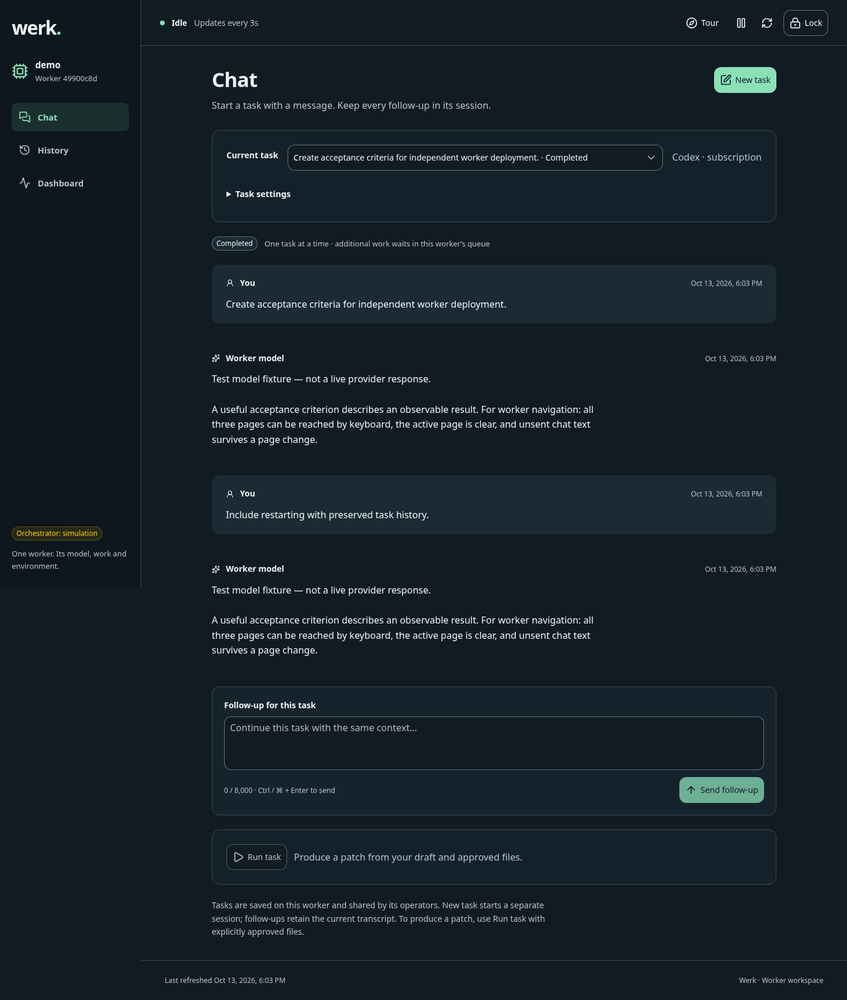
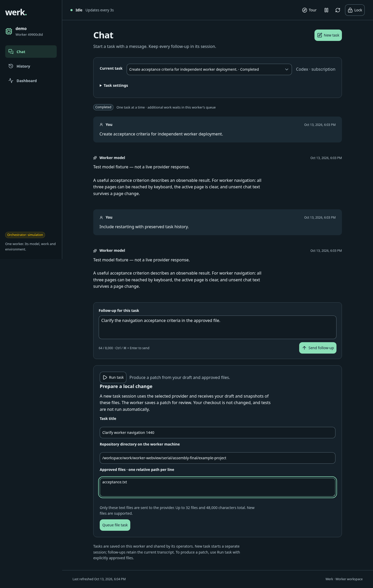
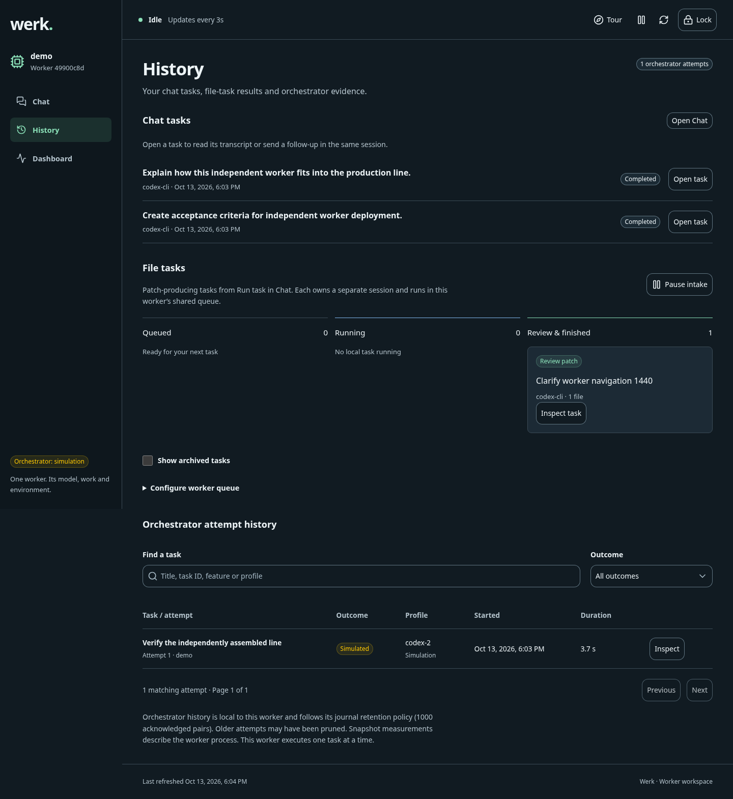
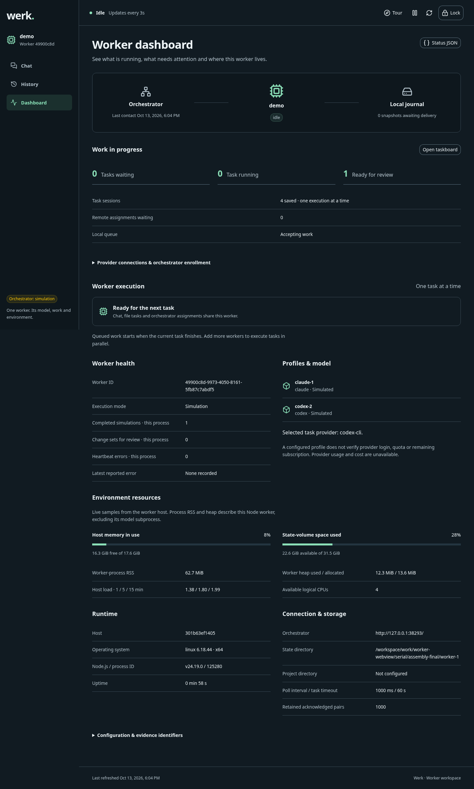
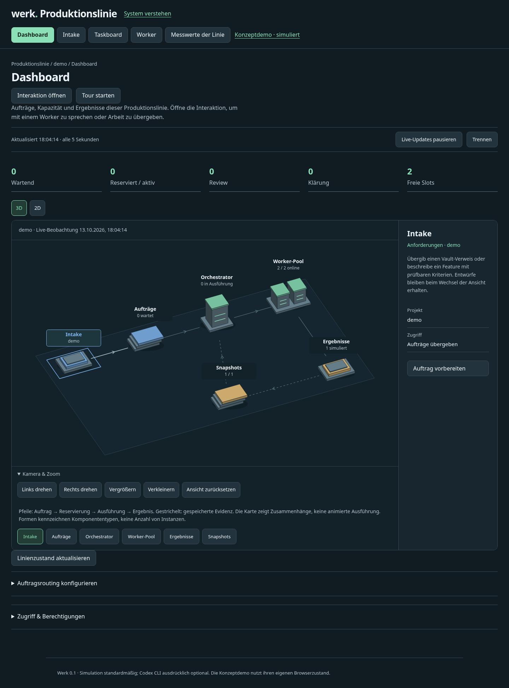
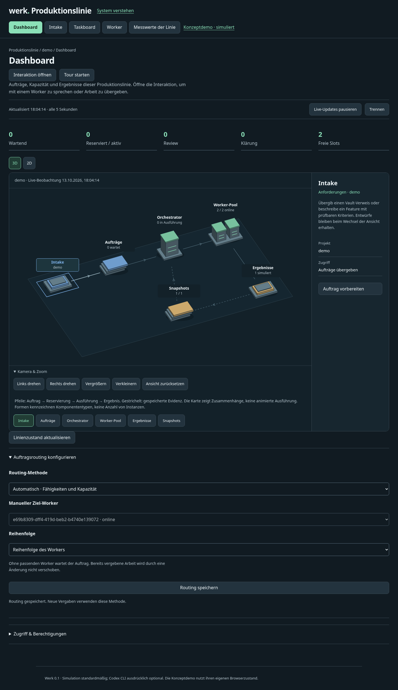
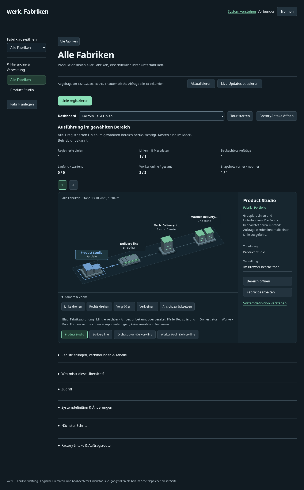
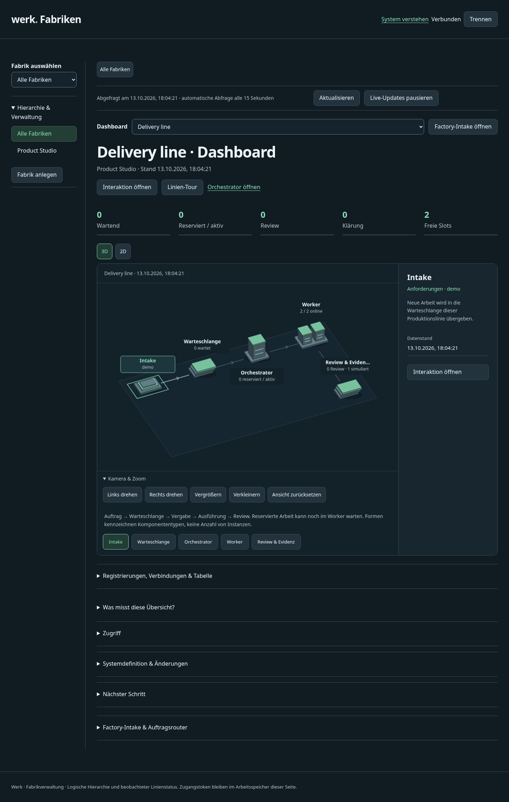
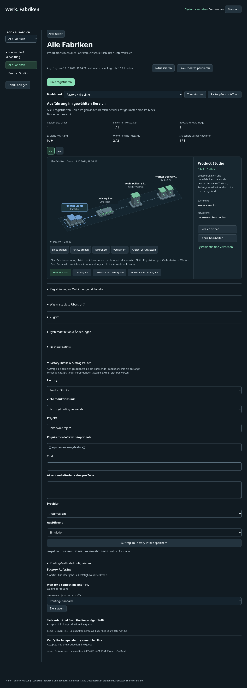

# Worker task sessions and independent system review

Date: 2026-10-13. This change is stacked on the visual-system branch (PR4),
following merged PR2. It records local qualification and review; it does not
publish a new release.

## Result

The worker now owns task entry, provider connections, durable task sessions and
serial execution. The Vue 3 / Nuxt UI webview opens on Chat, followed by History
and Dashboard. The first message in New task queues work; later messages continue
that task’s session. Every local file task and remote assignment also receives
its own session. All three sources share one execution permit, including while
waiting, paused or recovering after restart. Start more worker instances to run
more work in parallel.

Workers, orchestrators and Factory can be launched independently with separate
state and ports. Workers may enroll later; Factory may register existing lines
later. Factory and orchestrator each have durable intake/routing controls with
automatic matching and manual destinations. Their interaction widgets forward
chat to a registered worker and keep routed submission explicit.

The inherited 3D/2D views remain the primary system overview. Focused dashboards,
editors and replayable tours explain each level. The final polish addresses
mobile navigation, long task names, sticky dialog controls and early placement
of the line map.

## Screenshot storyboard

These are runtime captures from a real local assembly of two workers, an
orchestrator and Factory. Model replies and execution outcomes use explicitly
labelled deterministic fixtures/simulation, not authenticated provider execution.
Captures use 1440×1000 and 390×1000 viewports and retain the full page where needed.

### 1. Give one worker a task

New task plus its first message queues one task session. Follow-ups preserve its context. Chat, local file tasks and remote assignments share one execution slot.

### 2. Approve local file input

Run task is an explicit file-task editor. It captures the approved files into a separate task session and produces a review patch.

### 3. Manage the worker’s queue

History combines task sessions, the configurable local taskboard and retained orchestrator evidence. More queue places do not increase execution concurrency.

### 4. Inspect the worker and its environment

Dashboard shows connection state, queued and active work, execution profiles and host/process observations. A standalone worker is healthy without an orchestrator.

### 5. Add an independent production line

An independently started orchestrator accepts worker enrollment and opens on its dashboard. The 3D/2D process map and focused workspaces share current observations.

### 6. Choose how a line assigns work

Automatic matching uses compatible worker profiles and available capacity. Manual routing pins a destination; ordering and pause are explicit controls.

### 7. Add a Factory when needed

Register existing production lines and inspect aggregate operational state. Factory owns intake and routing without owning the independently launched processes.

### 8. Focus on one production line

Each line has a dedicated dashboard. Compact mobile controls and the 3D/2D map precede the aggregate counts.

### 9. Route Factory intake durably

Automatic capability/capacity matching and manual line selection are available. Unmatched work remains queued with a reason; retries preserve the pinned delivery and idempotency key.

## Complete desktop and mobile evidence

| Feature | What it demonstrates | Desktop | Mobile |
| --- | --- | --- | --- |
| Give one worker a task | New task plus its first message queues one task session. Follow-ups preserve its context. Chat, local file tasks and remote assignments share one execution slot. | [1440px](../evidence/worker-system-worker-chat-1440.png) | [390px](../evidence/worker-system-worker-chat-390.png) |
| Approve local file input | Run task is an explicit file-task editor. It captures the approved files into a separate task session and produces a review patch. | [1440px](../evidence/worker-system-worker-run-task-1440.png) | [390px](../evidence/worker-system-worker-run-task-390.png) |
| Manage the worker’s queue | History combines task sessions, the configurable local taskboard and retained orchestrator evidence. More queue places do not increase execution concurrency. | [1440px](../evidence/worker-system-worker-history-1440.png) | [390px](../evidence/worker-system-worker-history-390.png) |
| Review before applying | The worker prepares a downloadable patch from approved file snapshots. The user reviews and applies it; model output does not silently modify the checkout. | [1440px](../evidence/worker-system-worker-patch-review-1440.png) | [390px](../evidence/worker-system-worker-patch-review-390.png) |
| Inspect the worker and its environment | Dashboard shows connection state, queued and active work, execution profiles and host/process observations. A standalone worker is healthy without an orchestrator. | [1440px](../evidence/worker-system-worker-dashboard-1440.png) | [390px](../evidence/worker-system-worker-dashboard-390.png) |
| Connect providers and enroll later | Configure subscription CLI or API connections on the worker. Add an orchestrator when needed; private keys are never returned to the browser. | [1440px](../evidence/worker-system-worker-connections-1440.png) | [390px](../evidence/worker-system-worker-connections-390.png) |
| Learn the worker | The replayable tour explains task chat, history and monitoring in place. | [1440px](../evidence/worker-system-worker-tour-1440.png) | [390px](../evidence/worker-system-worker-tour-390.png) |
| Add an independent production line | An independently started orchestrator accepts worker enrollment and opens on its dashboard. The 3D/2D process map and focused workspaces share current observations. | [1440px](../evidence/worker-system-orchestrator-dashboard-1440.png) | [390px](../evidence/worker-system-orchestrator-dashboard-390.png) |
| Choose how a line assigns work | Automatic matching uses compatible worker profiles and available capacity. Manual routing pins a destination; ordering and pause are explicit controls. | [1440px](../evidence/worker-system-orchestrator-routing-1440.png) | [390px](../evidence/worker-system-orchestrator-routing-390.png) |
| Interact without leaving the line | The interaction widget offers worker-backed task chat and separate routed task submission. Only the worker prompts the model. | [1440px](../evidence/worker-system-orchestrator-chat-1440.png) | [390px](../evidence/worker-system-orchestrator-chat-390.png) |
| Learn the orchestrator | The tour explains the line dashboard, routing, workers and evidence. | [1440px](../evidence/worker-system-orchestrator-tour-1440.png) | [390px](../evidence/worker-system-orchestrator-tour-390.png) |
| Add a Factory when needed | Register existing production lines and inspect aggregate operational state. Factory owns intake and routing without owning the independently launched processes. | [1440px](../evidence/worker-system-factory-dashboard-1440.png) | [390px](../evidence/worker-system-factory-dashboard-390.png) |
| Focus on one production line | Each line has a dedicated dashboard. Compact mobile controls and the 3D/2D map precede the aggregate counts. | [1440px](../evidence/worker-system-line-dashboard-1440.png) | [390px](../evidence/worker-system-line-dashboard-390.png) |
| Act from the line dashboard | Open a registered worker’s task chat or submit work through the selected line’s router from the same interaction widget. | [1440px](../evidence/worker-system-line-interaction-1440.png) | [390px](../evidence/worker-system-line-interaction-390.png) |
| Learn the selected line | The contextual line tour points to the dashboard, interaction and orchestrator navigation. | [1440px](../evidence/worker-system-line-tour-1440.png) | [390px](../evidence/worker-system-line-tour-390.png) |
| Route Factory intake durably | Automatic capability/capacity matching and manual line selection are available. Unmatched work remains queued with a reason; retries preserve the pinned delivery and idempotency key. | [1440px](../evidence/worker-system-factory-intake-1440.png) | [390px](../evidence/worker-system-factory-intake-390.png) |
| Learn Factory scope | The Factory tour explains ownership, registration, aggregate monitoring and intake. | [1440px](../evidence/worker-system-factory-tour-1440.png) | [390px](../evidence/worker-system-factory-tour-390.png) |

## Independent review and polishing

Engineering, security and worker-lifecycle reviewers inspected implementation
and failure paths. Their resolved findings include stable independent component
identity, durable Factory delivery ownership, stale interaction responses,
selected-session fencing, lease renewal while waiting for the serial permit,
failed initial lease acceptance, orphaned local sessions and preservation of
failed/cancelled task input and later follow-up state across restart.

The dedicated finish review inspected browser captures and implementation.
Required corrections included a long-title mobile overflow, repeated Factory
headings, excess space above the line map and dialog controls that could scroll
out of reach. The corrected surfaces were recaptured; the finish reviewer’s
final verdict was **ship**, with no remaining required findings in that review.
Documentation was updated independently and reconciled with the final behavior.
These are scoped engineering/product reviews, not a security certification.

## Verification

- Final isolated full suite on the final build (`node --test --test-concurrency=1`):
  533 tests, 532 passed, 0 failed, 1 platform-specific skip.
  TypeScript/Vue checking and all three application builds passed.
- The prior normal-concurrency run had 531 passes, one failure and one skip:
  the native two-line system’s doctor health probe missed its deadline under
  load. The complete native-system suite then passed 8/8 in a focused rerun.
  No product test threshold or assertion was relaxed.
- Dependency audit: zero reported vulnerabilities. Generated workflows are in
  sync; whitespace validation passed.
- Browser: 17 feature surfaces at two widths, 34 captures, zero page-script
  errors, no page-wide horizontal overflow and no browser-stored credentials.
  A final targeted mobile check confirmed the line controls at 426px and map
  canvas at 776px, inside the first 1000px viewport, with no overflow.
- Independent native assembly: two workers started standalone, an orchestrator
  was added and both workers enrolled, then Factory registered the line and
  delivered intake that completed as a simulation. Browser interactions also
  exercised same-session follow-ups, local patch review, both routing policies,
  line task submission, unmatched intake and all four tours.
- Extracted native release: startup, simulated task, two persisted snapshots
  and state-preserving restart passed without a source checkout or npm install.
- Extracted Docker release: image build and two standalone workers passed.
  Identities and credentials were distinct, each worker reported one execution
  slot, a cross-worker token was rejected and restart preserved identity/token.
  The probe re-resolves Docker’s randomly published port after restart.
- The separate full Docker wrapper lifecycle check did **not** complete locally:
  its existing 150-second `start` deadline expired after image build and Compose
  container creation, while waiting for orchestrator health. Disposable container
  creation was slow in this environment. No timeout was changed; its resources
  were cleaned up. The PR’s release workflow runs this gate independently.
- Final engineering, security, worker-lifecycle and visual finish findings were
  resolved and rechecked within their stated scopes.

## CI follow-up

The initial implementation commit `dd15ab1` passed Linux/macOS source checks,
all three independent service builds and the full
[release qualification workflow](https://github.com/Luis85/production-line/actions/runs/38447485957):
extracted native releases on Linux, macOS and Windows, both Docker startup
journeys and the Ubuntu cloud-init VM. This provides successful Docker qualification
beyond the local timeout recorded above. Publishing was skipped, as intended for a PR.

Windows source CI identified two test-fixture defects: SQLite cleanup ran before
closing the database, and the patch fixture inherited host Git CRLF conversion.
Cleanup now closes the database first, including failure paths. The temporary
patch repository explicitly configures LF; the exact-content assertion remains.
Both affected suites passed locally after correction (17/17). Application source
and the photographed UI did not change. The PR checks carry the latest complete
cross-platform result.

## Limits

- Subscription/API adapters were checked with protocol fixtures and failure
  tests. No authenticated live Codex, Claude, OpenAI or Anthropic task was
  qualified in this environment. A live Codex attempt was blocked by the
  environment’s network policy. Screenshots label test model replies explicitly.
- A local file task generates a bounded patch from approved files. It does not
  execute generated shell commands, apply the patch or run repository tests.
- Existing orchestrator execution profiles remain separate from webview provider
  connections. Default profiles simulate work; saving an API key does not make
  an unsupported remote execution profile available.
- Docker workers need an API connection or a separately prepared, authenticated
  CLI image. A host’s subscription login is not automatically inside a container.
- Local qualification is Linux/Node 24. Cross-platform CI is reported on the PR.
  Packaged archives were built for local validation only; no new version was
  tagged or released by this pass.

For operating instructions, see [Use the worker webview](../how-to/use-worker-webview.md)
and [Assemble independent components](../how-to/assemble-independent-components.md).
Machine-readable observations are in [validation evidence](../evidence/worker-system-validation.json).
